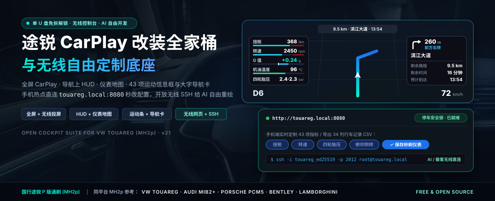
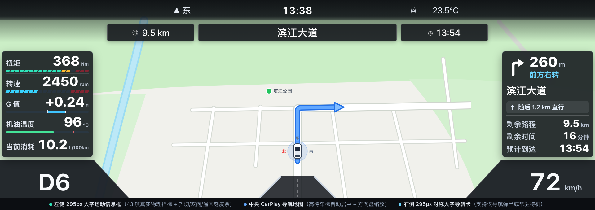
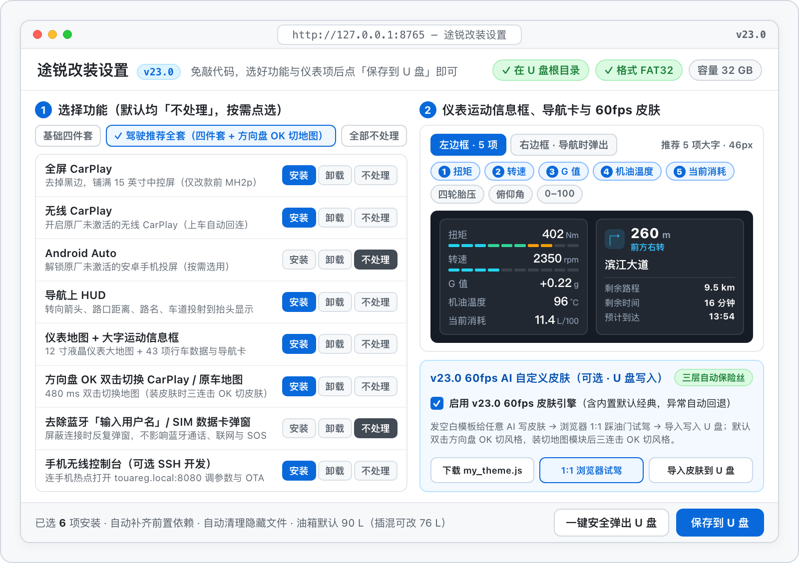
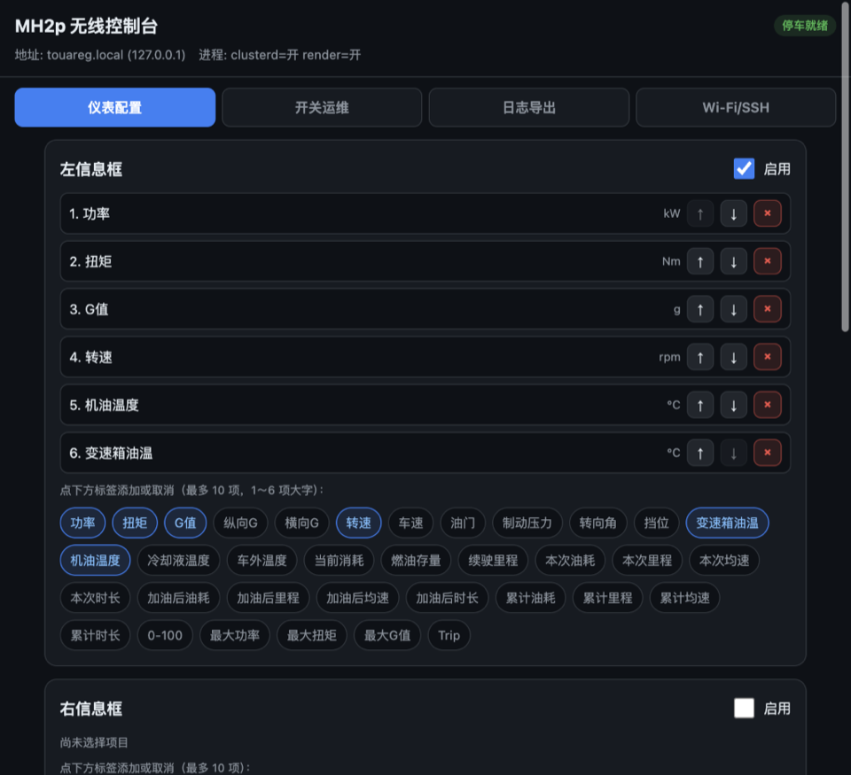
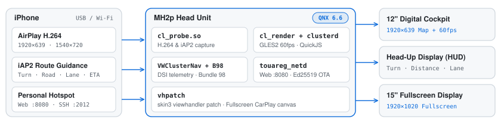

<div align="center">

<picture>
  <source media="(prefers-color-scheme: dark)" srcset="docs/img/hero_banner_dark.svg">
  <source media="(prefers-color-scheme: light)" srcset="docs/img/hero_banner_light.svg">
  
</picture>

# VW Touareg (CR7 / MH2p) CarPlay- & Cockpit-Mods

Ein-USB-Stick-Paket ohne Demontage und ohne System-Upgrade für Wireless- & Vollbild-CarPlay, HUD-Navigation, digitale Kombiinstrument-Karte, Echtzeit-Fahrdaten sowie drahtlose Einrichtung und Updates per Smartphone.

<p>
  <a href="https://github.com/a78c7/touareg-cn-carplay-mods/releases/latest"><b>Download v23.2</b></a> ·
  <a href="#funktionen">Funktionen</a> ·
  <a href="#4-schritte-installation">4-Schritte-Installation</a> ·
  <a href="#kompatibilität">Kompatibilität</a> ·
  <a href="https://github.com/a78c7/touareg-cn-carplay-mods/discussions">Forum & Community-Mods</a> ·
  <a href="RELEASE_NOTES.md">Versionshinweise</a> ·
  <a href="README.md">简体中文</a> ·
  <a href="README.en.md">English</a>
</p>

<p><a href="https://github.com/a78c7/touareg-cn-carplay-mods/releases"></a>&nbsp;&nbsp;<a href="https://github.com/a78c7/touareg-cn-carplay-mods/stargazers"></a>&nbsp;&nbsp;<a href="https://touareg-likes.pages.dev/like?lang=de"></a></p>

</div>

---

<div align="center">
  
  <br>
  <sub><i>Ansicht im Digital Cockpit: zentrierte CarPlay-Karte mit symmetrischen Großschrift-Fahrdaten und Abbiege-Navigationskarte.</i></sub>
</div>

<br>

https://github.com/user-attachments/assets/618e8fe2-e579-4aed-b9de-ab50b8576374

<div align="center">
  <sub><i>Live-Demo im Fahrzeug (Klick für Ton, chinesisch/englische Untertitel; der Anfang zeigt ein 60-fps-Custom-Design).</i></sub>
</div>

---

## Funktionen

Ganz ohne Kommandozeile — einfach den Offline-Konfigurator auf dem USB-Stick doppelklicken, gewünschte Funktionen anhaken, Infoboxen per Drag & Drop anordnen und speichern (alle Module sind standardmäßig deaktiviert und jederzeit per Klick deinstallierbar):

<div align="center">
  
  <br>
  <sub><i>Offline-Konfigurator für PC/Mac: Module auswählen, Infoboxen und Navigationskarte visuell anordnen und mit einem Klick auf den USB-Stick speichern.</i></sub>
</div>

<br>

| Kategorie | Funktion | Wirkung im Fahrzeug | Kompatibilität |
| :--- | :--- | :--- | :---: |
| **Display & Projektion** | **Vollbild-CarPlay** | Entfernt seitliche schwarze Ränder für echte Vollbild-Darstellung auf dem 15"-Display (derzeit für CN `P2878`; ältere Stände überspringen sicher ohne Einfluss auf andere Module) | CN Touareg `P2878` |
| | **Wireless CarPlay** | Aktiviert werksseitig inaktives Wireless CarPlay für kabelloses Verbinden | MH2p allgemein |
| | **Android Auto** | Aktiviert werksseitig inaktives Android Auto (CN-Vorfacelift 2019–2023 ab Werk ohne Android Auto) | MH2p allgemein |
| **HUD & Kombiinstrument** | **Navigation im HUD** | Projiziert Abbiegepfeile, Distanz, Straßennamen & Spurhinweise (Apple/AMap/Baidu) ins Windschutzscheiben-HUD (erfordert Werks-HUD; Kabel & Wireless) | CN Touareg `P*` |
| | **Kombiinstrument-Karte + Fahrdaten** | Zeigt die CarPlay-Karte direkt im 12"-Digital Cockpit (AMap-Zentrierung, Lenkrad-Zoom) mit symmetrischen 43-Kanal-Fahrdaten, Navigationskarte & 60-fps-Custom-Designs | CN Touareg `P*` |
| | **Lenkrad-`OK` Kartenwechsel** | Doppelklick auf rechte `OK`-Taste (`480-ms`-Fenster) schaltet zwischen CarPlay- und Werkskarte um; bei aktivem `v23`-Design wechselt Dreifachklick das Design (ohne dieses Modul wechselt Doppelklick direkt das Design) | CN Touareg `P*` |
| | **Sprachtaste Kurzdruck für Siri (Experimentell)** | Kurzdruck auf die Lenkrad-Sprachtaste startet Siri bei aktivem CarPlay (Werks-Langdruck unverändert; je nach Firmwarestand kann zusätzlich die Werkssprachbedienung auslösen) | CN Touareg `P*` |
| **WLAN & Verwaltung** | **Mobile WLAN-Konsole** | Verbindet sich mit dem Handy-Hotspot für Live-Anpassung der Infoboxen, Designwechsel, signierte Offline-Updates und Diagnose unter `http://touareg.local:8080` (optional Key-only SSH) | MH2p allgemein |
| **Fixes & Filter** | **P2878 5-GHz-WLAN-Region-Fix** | Nur nötig, falls nach Update von älterer Firmware (z. B. `P9832`) auf `P2878` Kabel-CarPlay läuft, Wireless aber nicht verbindet | CN Touareg `P*` |
| | **Bluetooth-Popup „Benutzername eingeben“ ausblenden** | Unterdrückt das wiederkehrende Bluetooth-Anmeldefenster ohne Einfluss auf Telefonie, Musik oder CarPlay | VW MH2p |
| | **Popup „SIM nur für Daten“ ausblenden** | Unterdrückt den SIM-Datenhinweis bei CarPlay ohne Einfluss auf mobile Daten oder SOS | VW MH2p |

<details>
<summary><b>Empfohlene Kombinationen für Einsteiger</b></summary>

| Profil | Empfohlene Auswahl | Hinweis |
| :--- | :--- | :--- |
| **Die meisten Touareg-Fahrer** | Ein-Klick-Preset **Empfohlenes Fahrpaket** (Vollbild + Wireless CarPlay + HUD + Cockpit-Karte + `OK`-Kartenwechsel); bei Bedarf Kurzdruck-Siri ergänzen | Beste Navigation inkl. sofortigem Wechsel zur Werkskarte |
| **Anpassung & Updates per Handy** | Zusätzlich **Mobile WLAN-Konsole** aktivieren (SSH im Alltag deaktiviert lassen) | Infoboxen, Designs und signierte Updates direkt im Handy-Browser |
| **Störende Popups** | Je nach Meldung „Benutzername eingeben“ oder „SIM nur für Daten“ anhaken | Unabhängig voneinander nutzbar |
| **Kein Wireless nach P2878-Update** | **P2878 5-GHz-WLAN-Region-Fix** aktivieren | Bei ab Werk mit `P2878` ausgelieferten Fahrzeugen mit funktionierendem Wireless CarPlay nicht erforderlich |

</details>

---

<a id="notice"></a>

## Kompatibilität

> [!IMPORTANT]
> **Kein System-Upgrade nötig — direkt auf Werks-Firmware nutzbar!** CN-Modelle (2019–2023, 15"-Display) können Kombiinstrument-Karte, HUD-Navigation und Wireless CarPlay direkt ohne Firmware-Update installieren (nur Vollbild-CarPlay setzt aktuell `P2878` voraus; ältere Stände überspringen es sicher). **Niemals inoffizielle `2878`-Systempakete aus dem Netz flashen** — es drohen Totalausfall (Brick) oder manipulierte Händlerskripte mit Batterieentladung (System-Updates nur offiziell beim VW-Partner).

| Bereich | Details |
| :--- | :--- |
| **Unterstützt** | **Touareg III Vorfacelift (CN 2019–2023)** mit **15"-Display & 12"-Digital Cockpit** (direkt auf Werks-`P*`-Firmware nutzbar; `P2878` unterstützt alle Module, ältere Stände überspringen Vollbild sicher; WLAN-Konsole & Doku gelten MH2p-übergreifend). |
| **Nicht unterstützt** | Basismodelle mit **9,2"-Discover Pro** / Analoginstrument / ohne HUD (beendet sich beim Einstecken sofort sicher ohne Änderungen); **EU-Facelift ab MJ 2024 (MIB3)** und **CN-Facelift 2025–2026 (15,05"-Asterix)**; **Touareg II (7P)**. |
| **EU- / MH2p-Fahrzeuge** | Die fertigen Touareg-UI-Skripte brechen auf EU-Ständen (z. B. `P2869`) und anderen MH2p-Marken sicher ohne Änderungen ab; Architektur, Quellcode, Previewer, Doku und WLAN-Konsole dienen direkt als Basis (siehe [Touareg-Freunde EU-P2869-Thread](https://www.touareg-freunde.de/forum/thread/30309-geschafft-apple-carplay-im-digitalen-kombiinstrument-des-touareg-cr-mh2p-p2869/)). |

- **Ausstattungs- & Antriebshinweise**: HUD-Navigation erfordert Werks-HUD; `pitch`/`roll`-Neigungswinkel erfordern Luftfederung (nicht verfügbar bei Modellen ohne Luftfederung wie CN eHybrid 2021–2022); Tankvolumen standardmäßig `90 L` (CN Verbrenner; für CN eHybrid `76 L`, für EU-Serie `75 L` eintragen); 8-Gang-Ersatzübersetzung & Balkenskalen sind auf 3.0 TSI kalibriert.
- **Schutzschaltung & Kostenlos-Hinweis**: Integrierte 3-Absturz-Schutzschaltung (Zero-Wear Safe Mode, keine eMMC-Schreibzugriffe bei normalem Start). Einstellungen niemals während der Fahrt bedienen; für Geschwindigkeit und Warnleuchten gilt stets die Werksanzeige. Kostenlos, Open Source & **strikt nicht-kommerziell**.
- **Vorab gewerblich codierte / gebrauchte Fahrzeuge**: Manche kommerziellen Nachrüstpakete hinterlassen ein Hintergrund-Wiederherstellungsskript, das den Autostart blockiert und nachweislich zu **Ruhestrom-/Batterieentladung in Tiefgaragen** führen kann ([#10](https://github.com/a78c7/touareg-cn-carplay-mods/issues/10)). Nach dem Flashen `Logs/` auf dem USB-Stick prüfen (Details in [`docs/07` Abschn. 12](docs/07-无线控制台与SSH开发.md#12-已改装车与二手车冲突排查改装店锁死入口与残留公钥)).
- **Community-Designs & eigene Pakete**: Eigene `v23`-Designs, Infobox-Layouts oder EU-/MH2p-Anpassungen können als `.zip` in **[GitHub Discussions](https://github.com/a78c7/touareg-cn-carplay-mods/discussions/categories/show-and-tell)** geteilt werden (Drittanbieter-Uploads sind ungeprüft; Nutzung auf eigene Gefahr).

---

## 4-Schritte-Installation

1. **USB-Stick vorbereiten**: Einen USB-Stick mit **≤ 32 GB im FAT32-Format** verwenden (neue Sticks sind ab Werk meist bereits FAT32, und der Konfigurator prüft dies oben automatisch — **nur formatieren, falls er noch kein FAT32 ist**, nicht jedes Mal neu formatieren).
2. **Direkt ins Hauptverzeichnis entpacken**: Neuestes Release-`zip` unter **[Releases](https://github.com/a78c7/touareg-cn-carplay-mods/releases/latest)** laden und den gesamten Inhalt direkt auf die oberste Ebene des USB-Sticks legen (keinen zusätzlichen Unterordner anlegen):
   ```text
   USB-Stammverzeichnis/
   ├── Data/                          ← Muss direkt im Hauptverzeichnis liegen
   ├── Meta/                          ← Muss direkt im Hauptverzeichnis liegen
   ├── Mods/                          ← Standardmäßig leer; wird vom Konfigurator befüllt
   ├── 未选模块/                       ← Enthält alle 12 Modulordner (HUD = VW_HUD_1 + VW_HUD_2)
   └── 改装设置（Windows）.exe / （Mac）.command
   ```
3. **Konfigurator ausführen & speichern (Pflicht)**: **`改装设置（Windows）.exe`** oder **`改装设置（Mac）.command`** direkt vom USB-Stick starten (ohne diesen Schritt wird nichts installiert):
   - Preset wählen oder Module einzeln auf **Installieren / Deinstallieren / Ignorieren** setzen, Infoboxen anordnen oder `v23`-Designs importieren;
   - Bei aktivierter **WLAN-Konsole** 1–5 Handy-Hotspots und eine 6–16-stellige PIN eintragen und auf **Auf USB speichern** klicken (die Mac-Version entfernt `._*`-Dateien automatisch).
4. **Im Fahrzeug installieren**: USB-Stick sicher auswerfen → **Motor starten** → Stick in einen der beiden **vorderen Daten-USB-Anschlüsse** stecken (Mittelarmlehne oder Ablagefach unter der Mittelkonsole; hintere USB-Buchsen sind reine Ladebuchsen; keine USB-Hubs oder Verlängerungskabel verwenden). Nach ca. 10 Sekunden startet das System automatisch neu und flasht über einige Minuten (**Infotainment dabei nicht bedienen**) → Stick nach Aufforderung abziehen.

> [!NOTE]
> - **Unsignierte Binärdatei**: Der Desktop-Konfigurator besitzt kein kommerzielles Zertifikat (Windows: *Weitere Informationen → Trotzdem ausführen*; macOS: *Systemeinstellungen → Datenschutz & Sicherheit → Dennoch öffnen*). Per GitHub Actions aus [`tools/configurator`](tools/configurator) mit `SHA256SUMS.txt` gebaut; lauscht nur auf `127.0.0.1`, völlig offline.
> - **Upgrade von `v22.01` oder älter**: Einmaliges USB-Upgrade auf `v22.1` / `v23.2` erforderlich (bestehende `cl.conf` und `web.pin` bleiben erhalten; ist keine PIN gesetzt, zeigt das Cockpit beim ersten Start eine 6-stellige Einmal-PIN an). Danach funktioniert drahtloses OTA weiter.
> - **Schwarze Ränder nach dem ersten Flash**: In den iPhone Bluetooth-/CarPlay-Einstellungen *Dieses Fahrzeug ignorieren* wählen und neu verbinden.

---

<details>
<summary><b>Alltag, AMap-Hinweise, Fehlerbehebung & Deinstallation</b></summary>

### Bedienung im Alltag
- **Kombiinstrument & HUD**: Mit den rechten Lenkrad-**Blättertasten (links/rechts)** das Navigationsmenü im Digital Cockpit wählen und per Taste **`VIEW`** (oder in den Infotainment-Fahrzeugeinstellungen → *Digital Cockpit*) die Rundinstrumente ausblenden; CarPlay erscheint automatisch und passt sich Nachtmodus sowie ACC-Versatz an.
- **Lenkrad-Kurzbefehle**: Bei aktiviertem `v23`-Design ohne Kartenwechsel-Modul wechselt **Doppelklick `OK`** direkt das Design; mit `VW_HUD_4_OkMapSwitch` schaltet **Doppelklick `OK` (`480-ms`-Fenster)** zwischen CarPlay- und Werkskarte um und **Dreifachklick `OK`** wechselt das Design; Kurzdruck-Sprachtaste startet Siri bei aktivem Modul (identisch bei physischen 2019–2020 und kapazitiven 2021–2023 Lenkrädern).
- **Lokaler 1:1-Simulator & Fahrdaten-Log**: [`tools/preview/index.html`](tools/preview/index.html) lokal im Browser öffnen, um Layouts, `v23`-Designs oder 10-Hz-CSV-Fahrdaten zu testen (optionaler Log-USB-Modus im Konfigurator aktivierbar; Marken-USB-Stick am vorderen Daten-Port empfohlen).

### Bekannte AMap-Eigenheiten & Deinstallation
- **AMap-Zentrierung & Zoom**: Die automatische Bilderkennung zentriert den versetzten AMap-Positionspfeil innerhalb von ca. 3 s; Zoomstufen setzt AMap geschwindigkeitsabhängig selbst zurück und übermittelt keine Spurdaten über CarPlay (Baidu Maps unterstützt Spurpfeile).
- **Deinstallation**: Gewünschte Module im Konfigurator auf **Deinstallieren** setzen, speichern und einmal im Fahrzeug flashen (beim Entfernen von HUD müssen Cockpit-Karte, `OK`-Kartenwechsel und Kurzdruck-Siri mit deinstalliert werden).
- **Diagnose für Issues**: Anonymisiertes Diagnosepaket über `http://touareg.local:8080` exportieren (Passwörter/PINs/FIN/Telefonnummern automatisch entfernt) oder Ordner `cluster_logs` auf einem USB-Stick anlegen; **niemals den eigenen `backup`-Ordner veröffentlichen**.
- **Vorher gewerblich geflashtes Fahrzeug (keine Fehlermeldung, aber keine Cockpit-Karte / Batterieentladung)**: `Logs/` auf dem USB-Stick prüfen — `WARN: suspected shop` weist auf ein altes Händler-Wiederherstellungsskript hin. Sicherste Lösung ist ein offizielles Werks-Update beim VW-Partner; keine inoffiziellen Firmware-Pakete aus dem Netz nutzen (Details & gezielte Bereinigung in [`docs/07` Abschn. 12](docs/07-无线控制台与SSH开发.md#12-已改装车与二手车冲突排查改装店锁死入口与残留公钥)).

</details>

<details>
<summary><b>Mobile WLAN-Konsole, Systemarchitektur, WLAN-SSH & Entwicklerdoku</b></summary>

<br>

### Mobile WLAN-Konsole (`http://touareg.local:8080`)

`VW_WiFi_Dev` nutzt das freie `bcm2`-Client-Interface (`dhcp.client -n -R`) parallel zu 5-GHz-RSDB-Wireless-CarPlay ohne Eingriff in `ecm0`-Werks-Telematik (Details: **[`docs/07-无线控制台与SSH开发.md`](docs/07-无线控制台与SSH开发.md)**).

<div align="center">
  
  <br>
  <sub><i>Mobile WLAN-Konsole: Park-Sperre (≤ 3 km/h), 43-Kanal-Anzeigen & Designwechsel, Ed25519-signiertes Offline-OTA und anonymisierte Diagnose.</i></sub>
</div>

1. Im Konfigurator **Mobile WLAN-Konsole** aktivieren (SSH für normale Nutzung aus lassen), 1–5 Handy-Hotspots und 6–16-stellige PIN eintragen und im Fahrzeug Hotspot starten (iPhone: *Kompatibilität maximieren* aktivieren und Hotspot-Menü 3–5 s offen lassen; Android: WPA2).
2. **`http://touareg.local:8080`** öffnen (`X-Pin`-Header-Auth + Park-Sperre `≤ 3 km/h`): Infoboxen/Designs live anpassen, **Ed25519-signierte & SHA-256-geprüfte** `.tar`-OTA-Pakete mit Rollback einspielen, Diagnose exportieren oder Safe Mode zurücksetzen.

### Systemarchitektur (MH2p-Datenpfad)

<div align="center">
<picture>
  <source media="(prefers-color-scheme: dark)" srcset="docs/img/arch_dark.svg">
  <source media="(prefers-color-scheme: light)" srcset="docs/img/arch_light.svg">
  
</picture>
</div>

### WLAN-SSH (`:2012`) & Hardware-Leitplanken für KI-Entwicklung

Optionales Key-only-SSH (`:2012`) im Konfigurator aktivieren (fahrzeugspezifischer Ed25519-Schlüssel unter Desktop `途锐无线SSH密钥/touareg_ed25519`, nicht auf dem Stick) und per `root@touareg.local:2012` verbinden. QNX 6.6 / Tegra-K1-Grenzen beachten:
- **RAM (~2 GB) & `/tmp` (tmpfs)**: Keine großen Dateien oder unbegrenzten Logs in `/tmp`; Hintergrunddienste schlank halten.
- **eMMC-Schutz**: `/mnt/app` regulär read-only belassen; keine hochfrequenten Telemetrie-Schreibvorgänge auf `/mnt/app` oder `/mnt/ota` (`/tmp/dash.state` & `/tmp/cluster_cp.state` nutzen); atomar über `.new` + `sync && mount -ur /mnt/app` schreiben. `/ifs`, `/mnt/system` und CAN-Ruhestrom-Management unangetastet lassen.
- **60-fps-Rendering**: Für Vollbild-60-fps-Designs mit Live-CarPlay-Karte `src/cl_render/v23_gles.c` (`v23_mode`, QuickJS + GLES2 + `EGL_KHR_image_pixmap` Zero-Copy, 55–59 fps) oder `src/cl_render/gles60.c` (`capture=gles60`, dynamisches `eglGetProcAddress`, niemals direkt gegen `-lGLESv2` linken) verwenden; keine Vollbild-CPU-Schleifen in `dash.c`.

### Entwicklungsdoku & Quellcode-Index

Ausführliche Entwicklungsnotizen (`docs/01–07`, Chinesisch) und MH2p-Plattformreferenz (`docs/reference/R1–R5`, `CLUSTER_LAYOUT_SPEC.md`, jeweils markiert als **Touareg-spezifisch** vs. **MH2p-allgemein** für VW Touareg, Audi, Porsche PCM 5, Bentley, Lamborghini LIS III) liegen in **[`docs/README.md`](docs/README.md)**, der vollständige Quellcode unter [`src/`](src) und [`tools/`](tools).

</details>

<details>
<summary><b>Sicherheit, Lizenzdetails, Markenhinweise & Danksagung</b></summary>

### Sicherheit, Haftungsausschluss & Markenhinweise
- **3-Absturz-Schutzschaltung (Zero-Wear Safe Mode)**: Schützt J9 HMI, `cl_probe.so`, `clusterd`/`cl_render` und `io-pkt` (keine eMMC-Schreibzugriffe bei normalem Start). Für Geschwindigkeit und Warnleuchten gilt stets die Werksanzeige.
- **Inoffiziell & Nutzung auf eigene Gefahr**: Privates Forschungsprojekt ohne Verbindung zu Volkswagen, Audi, Porsche, Bentley, Lamborghini, Apple, Google, AMap oder Baidu. Bereitstellung ohne Gewährleistung; jedes Flash- und Garantierisiko trägt der Nutzer selbst. Rechteinhaber können über [GitHub Issues](https://github.com/a78c7/touareg-cn-carplay-mods/issues) Kontakt aufnehmen.
- **Markenhinweise**: Volkswagen und Touareg sind eingetragene Marken der Volkswagen AG. CarPlay is a trademark of Apple Inc., registered in the U.S. and other countries and regions.

### Lizenzgrenzen
- **Eigenständige Originalkomponenten**: `src/hud-java`, `src/popup-filter-java`, `src/cluster-probe` (inkl. eigenständig neu implementiertem `wired/cl_wired*.c`), `src/clusterd`, `src/touareg_netd`, `src/vhpatch`, `src/common`, `tools/` sowie alle `VW_*`-Skripte stehen unter **[PolyForm Noncommercial 1.0.0](LICENSE) + [Nicht-kommerzielle Zusatzbedingungen](LICENSE.ADDITIONAL-TERMS.md)** (keine proprietären VW-/Apple-Binärdateien; Weiterverkauf, bezahltes Flashen und kommerzielle Bündelung streng untersagt); `docs/`-Texte stehen unter **CC BY-SA 4.0**.
- **Abgeleitete & Drittkomponenten**: Der angepasste `src/cl_render/`-Code samt kompiliertem Binary `cl_render` (ohne Zusatzbedingungen; eingebettetes `quickjs/` bleibt MIT, `dash_font.h` SIL OFL 1.1, `stb_truetype.h` Public Domain / MIT) sowie `dio_cluster.so`, ModKit und optionale LawPaul-Module unterliegen **[CC BY-NC-SA 4.0](LICENSES/CC-BY-NC-SA-4.0.md)**. Vollständige Nachweise in **[THIRD_PARTY_NOTICES.md](LICENSES/THIRD_PARTY_NOTICES.md)**.

### Danksagung & Community
- **[luanqibazao0123-bot](https://github.com/luanqibazao0123-bot)** ([#7](https://github.com/a78c7/touareg-cn-carplay-mods/issues/7)): Impulsgeber für das `v21`-Großschrift-Sport-Design sowie die `60fps`-Kombiinstrument-Engine und Praxishinweise zum `P2878`-Upgrade.
- **Touareg-Freunde Community**: Verlinkt und diskutiert im [deutschen EU-MH2p-P2869-Projektthread](https://www.touareg-freunde.de/forum/thread/30309-geschafft-apple-carplay-im-digitalen-kombiinstrument-des-touareg-cr-mh2p-p2869/).
- **[LawPaul / MH2p SD ModKit](https://github.com/LawPaul/MH2p_SD_ModKit)** ([Website](https://lawpaul.github.io/MH2p_SD_ModKit_Site/)): USB-ModKit-Basis sowie optionale `AppleCarPlay`- / `AndroidAuto`-Module ([CC BY-NC-SA 4.0](LICENSES/CC-BY-NC-SA-4.0.md), inkl. [fifthBro/pcm5-androidauto-connect-fix](https://github.com/fifthBro/pcm5-androidauto-connect-fix)).
- **[fifthBro / mh2p-cluster](https://github.com/fifthBro/mh2p-cluster)** & **[mh2p-ssh-access](https://github.com/fifthBro/mh2p-ssh-access)**: Upstream-Basis für `dio_cluster.so` (v0034) und `cl_render` ([CC BY-NC-SA 4.0](LICENSES/CC-BY-NC-SA-4.0.md)).
- **[davecozens / touareg-carplay](https://github.com/davecozens/touareg-carplay)**: Vollbild-Geometriereferenz; **[luka-dev](https://github.com/luka-dev)**: `jxe2jar` und `qnx65-armv7-toolchain`.

</details>

---

## Lizenz

Eigenständige Originalkomponenten stehen unter **[PolyForm Noncommercial 1.0.0](LICENSE) + [Nicht-kommerzielle Zusatzbedingungen](LICENSE.ADDITIONAL-TERMS.md)** (kostenlos, Open Source, strikt nicht-kommerziell); `src/cl_render/` & `cl_render` sowie Upstream-Module stehen unter **[CC BY-NC-SA 4.0](LICENSES/CC-BY-NC-SA-4.0.md)** (ohne Zusatzbedingungen); `docs/`-Texte unter **CC BY-SA 4.0**; vollständige Drittlizenzen in **[THIRD_PARTY_NOTICES.md](LICENSES/THIRD_PARTY_NOTICES.md)**.
