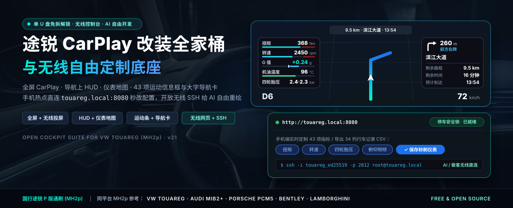
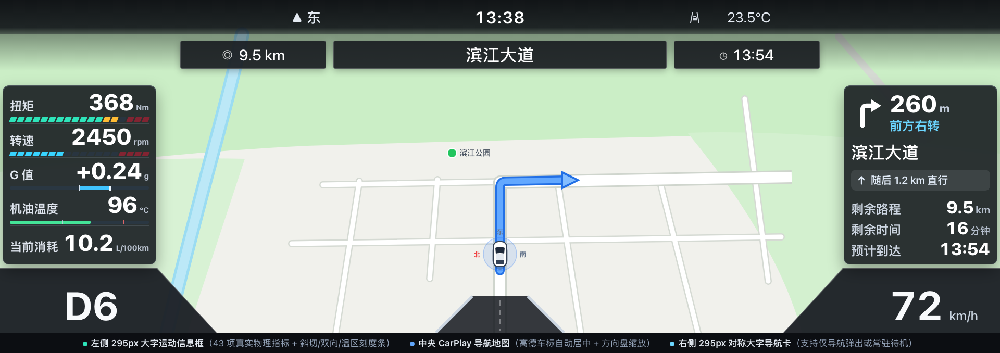
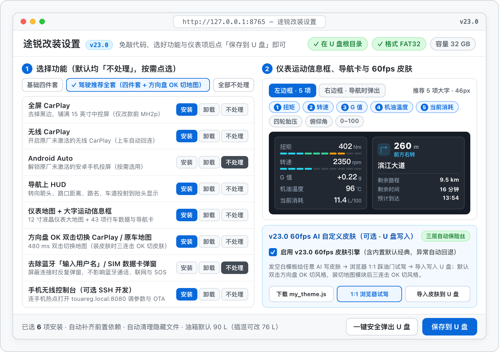
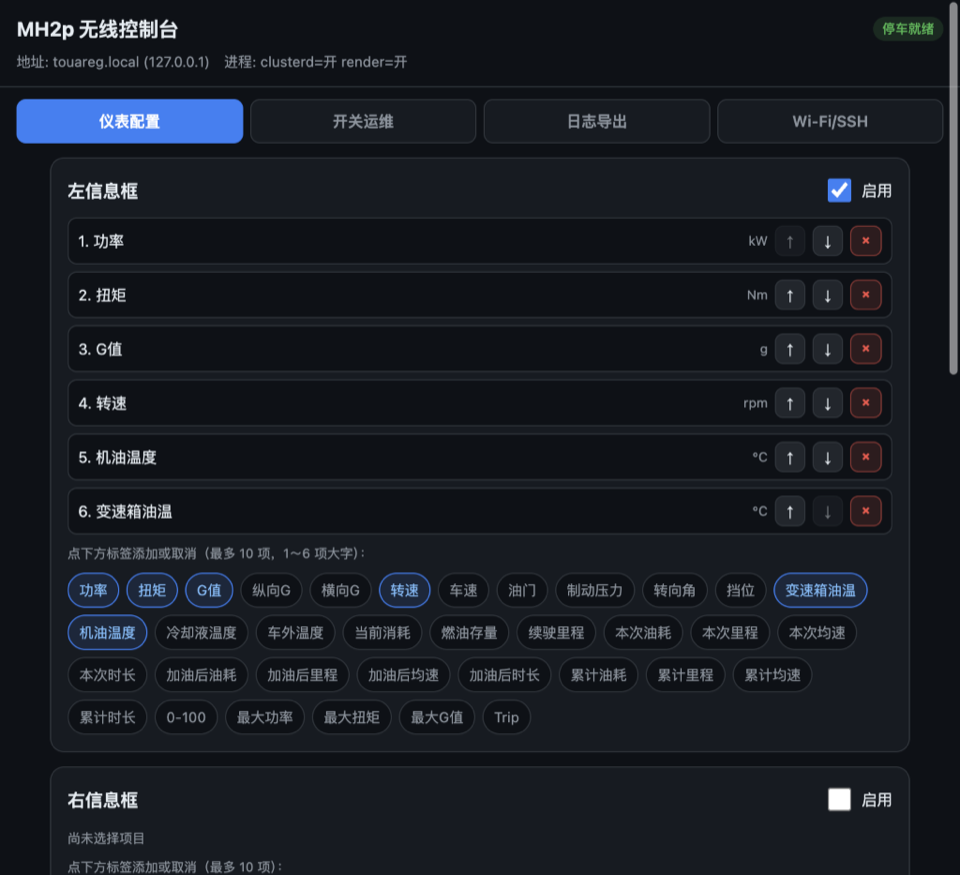
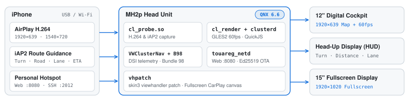

<div align="center">

<picture>
  <source media="(prefers-color-scheme: dark)" srcset="docs/img/hero_banner_dark.svg">
  <source media="(prefers-color-scheme: light)" srcset="docs/img/hero_banner_light.svg">
  
</picture>

# VW Touareg (CR7 / MH2p) CarPlay & Cockpit Mods

Single-USB, no-disassembly, no-firmware-upgrade toolkit unlocking wireless & full-screen CarPlay, Windshield HUD navigation, Digital Cockpit map & live driving telemetry, plus phone-based wireless setup and updates.

<p>
  <a href="https://github.com/a78c7/touareg-cn-carplay-mods/releases/latest"><b>Download v23.4</b></a> ·
  <a href="#features">Features</a> ·
  <a href="#4-step-usb-installation">4-Step Install</a> ·
  <a href="#compatibility">Compatibility</a> ·
  <a href="https://github.com/a78c7/touareg-cn-carplay-mods/discussions">Discussions & Community Mods</a> ·
  <a href="RELEASE_NOTES.md">Release Notes</a> ·
  <a href="README.md">简体中文</a> ·
  <a href="README.de.md">Deutsch</a>
</p>

<p><a href="https://github.com/a78c7/touareg-cn-carplay-mods/releases"></a>&nbsp;&nbsp;<a href="https://github.com/a78c7/touareg-cn-carplay-mods/stargazers"></a>&nbsp;&nbsp;<a href="https://touareg-likes.pages.dev/like?lang=en"></a></p>

</div>

---

<div align="center">
  
  <br>
  <sub><i>In-cluster layout: auto-centered CarPlay map flanked by symmetrical bold driving telemetry boxes and a turn-by-turn navigation card.</i></sub>
</div>

<br>

https://github.com/user-attachments/assets/618e8fe2-e579-4aed-b9de-ab50b8576374

<div align="center">
  <sub><i>In-car demo video (click for audio; bilingual CN/EN subtitles; opening clip shows a 60 fps custom cluster theme).</i></sub>
</div>

---

## Features

No command line required — double-click the offline configurator on your USB drive, check the features you want, drag-and-drop your telemetry layout, and save (all modules ship disabled by default and can be cleanly uninstalled anytime):

<div align="center">
  
  <br>
  <sub><i>Desktop offline configurator: pick modules, arrange left/right telemetry boxes and navigation card visually, and save to USB in one click.</i></sub>
</div>

<br>

| Category | Feature | What It Does | Compatibility |
| :--- | :--- | :--- | :---: |
| **Display & Projection** | **Full-Screen CarPlay** | Removes side black bars so CarPlay fills the 15" center screen (exact CRC table verified on `P2878`; other CN 15" `P*` builds such as `P2838`/`P2853`/`P9832` auto-adapt via strict bytecode fingerprinting and safely skip if mismatched) | CN Touareg `P*` |
| | **Wireless CarPlay** | Unlocks factory-inactive Wireless CarPlay for cable-free auto-connect | MH2p Generic |
| | **Android Auto** | Unlocks factory-inactive Android Auto (CN 2019–2023 pre-facelift ships without factory Android Auto) | MH2p Generic |
| **HUD & Cluster** | **Navigation to HUD** | Projects Apple Maps, AMap, or Baidu turn arrows, distance, street names, and lanes onto the Windshield HUD (requires factory HUD; works wired & wireless) | CN Touareg `P*` |
| | **Cluster Map + Driving Telemetry** | Displays live CarPlay map in the 12" Digital Cockpit (auto-centers AMap, supports steering-wheel zoom) with symmetrical 43-channel driving gauges, navigation card, and 60 fps custom themes | CN Touareg `P*` |
| | **Steering-Wheel `OK` Map Switch** | Double-tap right `OK` (`480 ms` window) on the map screen to toggle CarPlay/stock map; triple-tap `OK` cycles custom themes when both are active (without this module, double-tap `OK` switches themes directly) | CN Touareg `P*` |
| | **Voice Button Short-Press Siri (Experimental)** | Short-press the steering-wheel voice button to invoke Siri during CarPlay (factory long-press unchanged; on some firmwares short-press may also trigger factory voice control) | CN Touareg `P*` |
| **Wireless & Setup** | **Mobile Wireless Console** | Connects to your phone hotspot so you can edit cluster gauges, switch themes, run signed offline updates, and export diagnostics at `http://touareg.local:8080` (optional key-only SSH) | MH2p Generic |
| **Fixes & Noise** | **P2878 5 GHz Wireless Region Fix** | Only needed if upgrading legacy firmware (e.g. `P9832`) to `P2878` broke wireless CarPlay while wired still works | CN Touareg `P*` |
| | **Suppress Bluetooth "Enter Username" Popup** | Blocks the recurring Bluetooth login prompt without affecting calls, audio, or CarPlay | VW MH2p |
| | **Suppress "SIM for Data Only" Popup** | Blocks the recurring SIM data-only prompt during CarPlay without affecting mobile data or SOS | VW MH2p |

<details>
<summary><b>Recommended Presets for Most Owners</b></summary>

| Owner Profile | Recommended Selection | Notes |
| :--- | :--- | :--- |
| **Most Touareg owners** | Click the one-click preset **Driving Essentials** (Full-Screen + Wireless CarPlay + HUD + Cluster Map + `OK` Map Switch); add Short-Press Siri if desired | Balanced navigation with instant fallback to stock map |
| **Phone setup + cable-free updates** | Add **Mobile Wireless Console** (leave SSH unchecked for daily use) | Adjust gauges, switch themes, and install signed updates from your phone browser |
| **Annoying popups** | Enable **Suppress Bluetooth "Enter Username"** or **Suppress "SIM for Data Only"** as needed | Independent toggles, zero conflict |
| **Upgraded to P2878 and lost wireless** | Enable **P2878 5 GHz Wireless Region Fix** | Not needed on factory `P2878` units where wireless CarPlay already works after activation |

</details>

---

<a id="notice"></a>

## Compatibility

> [!IMPORTANT]
> **No Firmware Upgrade Needed — Flash Directly on Your Stock System!** 2019–2023 CN 15" Touareg models can install the full toolkit directly on stock `P*` firmware (including cross-version Full-Screen CarPlay auto-adaptation; if a skin build doesn't match cleanly it still safely skips without affecting anything else). **Never flash unofficial `2878` firmware files found online** — full system flashes risk bricking the head unit or introducing shop scripts that cause battery drain (use an official VW dealership if you ever want a firmware update).

| Category | Details |
| :--- | :--- |
| **Supported** | **Pre-facelift 3rd-gen Touareg (CN 2019–2023)** with **15" center screen + 12" Digital Cockpit** (works directly on stock `P*` builds; `P2878` is fully end-to-end verified, other CN 15" `P*` builds auto-adapt full-screen via bytecode fingerprinting and safely skip on mismatch; Wireless Console & docs apply across MH2p). |
| **Not Supported** | Base **9.2" Discover Pro trims** with analog gauges & no HUD (safely exits on plug-in without touching files); **CN 2025–2026 facelift (15.05" Asterix)** and **EU MY2024+ facelift (MIB3)**; **2nd-gen Touareg (7P)**. |
| **EU / Other MH2p Cars** | Touareg UI patches intentionally abort cleanly without modifying files on EU builds (e.g. `P2869`) or other MH2p brands; the architecture, source code, previewer, docs, and Wireless Console serve directly as a foundation (see the [Touareg-Freunde EU P2869 thread](https://www.touareg-freunde.de/forum/thread/30309-geschafft-apple-carplay-im-digitalen-kombiinstrument-des-touareg-cr-mh2p-p2869/)). |
| **iPhone & Cluster Map** | **AMap on Digital Cockpit (2nd screen)**: AMap officially requires **iPhone 12 or newer + iOS 17.4+** (with an updated AMap app); older iPhones or iOS versions only render on the center screen and send no 2nd-screen stream (Apple Maps supports cluster projection on `iOS 15.4+`).<br>**Wireless connection**: Use **factory Wireless CarPlay** unlocked by this toolkit (or wired USB) — most **aftermarket wireless CarPlay dongles (U2W adapters) do not forward the 2nd screen**, projecting only to the center screen while leaving the cluster blank. |

- **Trim & Powertrain Notes**: HUD navigation requires factory Windshield HUD; `pitch`/`roll` require air suspension (unavailable on non-air-suspension trims such as CN 2021–2022 eHybrid); fuel tank defaults to CN ICE `90 L` (set to `76 L` for CN eHybrid or `75 L` for EU stock); 8AT fallback gear ratios & gauge bar scales are calibrated on a 3.0TSI vehicle.
- **Safety & Free Use**: Built-in 3-crash zero-wear safe mode restores stock behavior automatically (zero eMMC writes on normal boots). Never operate settings while driving; always rely on factory instruments for speed and warnings. Strictly free, open-source, and **non-commercial** — demand a refund if you paid for it.
- **Previously Shop-Modified / Used Cars**: Some paid retrofit-shop packages leave behind a background auto-restore script that blocks open-source modules from starting on boot and has been confirmed to cause **underground-garage battery drain** ([#10](https://github.com/a78c7/touareg-cn-carplay-mods/issues/10)). Check USB `Logs/` after flashing for automatic detection (details in [`docs/07` Sec. 12](docs/07-无线控制台与SSH开发.md#12-已改装车与二手车冲突排查改装店锁死入口与残留公钥)).
- **Community Themes & Mods**: Custom `v23` cluster themes, gauge layouts, or EU/MH2p adaptations can be shared as `.zip` archives in **[GitHub Discussions](https://github.com/a78c7/touareg-cn-carplay-mods/discussions/categories/%E8%87%AA%E5%88%B6%E5%8C%85%E4%B8%8E%E7%9A%AE%E8%82%A4%E5%88%86%E4%BA%AB)** (community uploads are not audited by the maintainer; verify firmware compatibility and use at your own risk).

---

## 4-Step USB Installation

1. **Prepare a USB Drive**: Use a **≤ 32 GB FAT32** USB drive (most new drives ship as FAT32 out of the box, and the configurator checks this automatically at the top — **only format to FAT32 if it isn't already**, no need to reformat every time).
2. **Extract to the USB Root**: Download the latest `zip` from **[Releases](https://github.com/a78c7/touareg-cn-carplay-mods/releases/latest)** and extract all files directly to the top level of the USB drive (do **not** wrap inside an extra folder):
   ```text
   USB_ROOT/
   ├── Data/                          ← Must sit directly at USB root
   ├── Meta/                          ← Must sit directly at USB root
   ├── Mods/                          ← Empty by default; populated by the configurator
   ├── 未选模块/                       ← Holds all 12 module folders (HUD = VW_HUD_1 + VW_HUD_2)
   └── 改装设置（Windows）.exe / （Mac）.command
   ```
3. **Run the Configurator & Save (Required)**: Launch **`改装设置（Windows）.exe`** or **`改装设置（Mac）.command`** from the USB root (flashing without running it installs nothing):
   - Pick a preset or toggle modules (**Install / Uninstall / Ignore**), arrange telemetry boxes, or import custom `v23` themes;
   - If enabling **Mobile Wireless Console**, enter 1–5 phone hotspots and a 6–16 character PIN, then click **Save to USB** (macOS build strips `._*` AppleDouble files automatically).
4. **Flash In-Car**: Safely eject the USB drive → **start the engine** → plug into **either front data USB port** (center-armrest storage or under-console cubby; rear ports are charge-only; do not use USB hubs or extension cables). After ~10 seconds the unit reboots and flashes over a few minutes (**do not touch the screen**) → unplug when prompted.

> [!NOTE]
> - **Unsigned Binary Warning**: The desktop configurator has no commercial signing certificate (Windows: *More info → Run anyway*; macOS: *System Settings → Privacy & Security → Open Anyway*). Built by GitHub Actions from [`tools/configurator`](tools/configurator) with `SHA256SUMS.txt`; binds only to `127.0.0.1` and never connects to the internet.
> - **Upgrading from `v22.01` or Earlier**: Flash `v22.1` / `v23.4` **once via USB** (preserves existing `cl.conf` and `web.pin`; if `web.pin` was never set, a 6-digit PIN displays on the cluster on first boot and clears after first login); wireless OTA resumes afterward.
> - **Black Borders After First Flash**: Tap *Forget This Car* in iPhone Bluetooth/CarPlay settings and reconnect once.

---

<details>
<summary><b>Daily Usage, AMap Notes, Troubleshooting & Uninstall</b></summary>

### Daily Controls
- **Cluster & HUD**: Use the right steering-wheel **left/right page buttons** to switch to the Navigation menu, and short-press **`VIEW`** (or use infotainment *Vehicle Settings → Digital Cockpit*) to hide the side dials; CarPlay projects automatically, syncs with night mode, and shifts up when ACC is active.
- **Steering-Wheel Shortcuts**: With `v23` themes enabled and without the map-switch module, **double-tap `OK`** switches themes directly; with `VW_HUD_4_OkMapSwitch` also installed, **double-tap `OK` (`480 ms` window)** toggles CarPlay/stock map and **triple-tap `OK`** cycles themes; short-press voice invokes Siri when enabled (same functions on 2019–2020 physical and 2021–2023 capacitive steering wheels).
- **1:1 Browser Simulator & Drive Logs**: Open [`tools/preview/index.html`](tools/preview/index.html) locally to test layouts, `v23` themes, or replay 10 Hz CSV logs (optional drive-log USB mode can be toggled in the configurator using a reliable brand-name drive in a front data USB port).

### Known AMap Quirks & Troubleshooting
- **AMap icon centering & zoom**: AMap offsets its car icon toward the destination (~3 cm); vision-based centering restores it below the clock within ~3s. AMap resets zoom level automatically on speed/junctions, and does not send CarPlay lane guidance (use Baidu Maps if lane arrows are needed).
- **Center Screen Works, But No Cluster Map (2nd Screen)**: (1) If Apple Maps projects to the cluster while AMap does not, verify **iPhone 12+ & iOS 17.4+** (AMap requirement); (2) if using an aftermarket wireless CarPlay dongle, unplug it and use factory Wireless CarPlay or wired USB (most dongles drop `altScreen`).
- **One-Click Uninstall**: Set unwanted modules to **Uninstall** in the configurator, save, and flash once (uninstalling HUD must also uninstall Cluster Map, `OK` Map Switch, and Short-Press Siri).
- **Diagnostics for Issues**: Export a sanitized diagnostic bundle from `http://touareg.local:8080` (passwords/PINs/VINs/phones auto-redacted), or create a `cluster_logs` folder on a USB drive for 2 minutes; **never share your vehicle `backup` folder**.
- **Previously Shop-Modified Car (No Errors, But No Cluster Map / Battery Drain)**: Check `Logs/` on the USB drive after flashing — `WARN: suspected shop` indicates a leftover shop auto-restore script blocking startup. Cleanest fix is an official dealership stock firmware reflash; never use untrusted online firmware packs (technical details & targeted cleanup in [`docs/07` Sec. 12](docs/07-无线控制台与SSH开发.md#12-已改装车与二手车冲突排查改装店锁死入口与残留公钥)).

</details>

<details>
<summary><b>Mobile Wireless Console, System Architecture, Wireless SSH & Developer Docs</b></summary>

<br>

### Mobile Wireless Console (`http://touareg.local:8080`)

`VW_WiFi_Dev` uses the idle `bcm2` STA interface (`dhcp.client -n -R`) concurrently alongside 5 GHz RSDB Wireless CarPlay without touching `ecm0` factory telematics (see **[`docs/07-无线控制台与SSH开发.md`](docs/07-无线控制台与SSH开发.md)**).

<div align="center">
  
  <br>
  <sub><i>Mobile Wireless Console: parked-only lock (≤ 3 km/h), 43-channel gauges & theme switcher, Ed25519-signed offline OTA, and sanitized diagnostics.</i></sub>
</div>

1. Install **Mobile Wireless Console** in the configurator (leave SSH unchecked unless developing), configure 1–5 phone hotspots + 6–16 char PIN, and enable your phone hotspot in-car (iPhone: turn on *Maximize Compatibility* and keep the Hotspot page awake 3–5s on first join — note the same iPhone cannot host Personal Hotspot and run Wireless CarPlay simultaneously, so turn Hotspot off for daily driving or use wired USB CarPlay + Hotspot; Android: WPA2).
2. Visit **`http://touareg.local:8080`** (`X-Pin` header auth + parked-only lock `≤ 3 km/h`) to adjust layouts/themes, flash **Ed25519-signed & SHA-256 verified** offline `.tar` OTA with one-click rollback, export sanitized diagnostics, or manage 3-crash safe mode.

### System Architecture (MH2p Pipeline)

<div align="center">
<picture>
  <source media="(prefers-color-scheme: dark)" srcset="docs/img/arch_dark.svg">
  <source media="(prefers-color-scheme: light)" srcset="docs/img/arch_light.svg">
  
</picture>
</div>

### Wireless SSH (`:2012`) & AI Development Guardrails

Enable key-only SSH (`:2012`) in the configurator (per-car Ed25519 key saved to Desktop `途锐无线SSH密钥/touareg_ed25519`, never stored on the USB drive) and connect via `root@touareg.local:2012`. Respect these QNX 6.6 / Tegra K1 hardware guardrails:
- **RAM (~2 GB) & `/tmp` (tmpfs)**: Never store large files or unbounded logs in `/tmp`; keep resident helper processes lean.
- **eMMC flash wear**: Keep `/mnt/app` read-only normally; never write high-frequency telemetry to `/mnt/app` or `/mnt/ota` (use `/tmp/dash.state` & `/tmp/cluster_cp.state`); write atomically via `.new` + `sync && mount -ur /mnt/app`. Never alter `/ifs`, `/mnt/system`, or CAN sleep power management.
- **60 fps rendering**: For full-screen 60 fps themes & live CarPlay map composition, use `src/cl_render/v23_gles.c` (`v23_mode`, QuickJS + GLES2 + `EGL_KHR_image_pixmap` zero-copy, 55–59 fps) or standalone `src/cl_render/gles60.c` (`capture=gles60`, dynamic `eglGetProcAddress`, never link `-lGLESv2`). Never run full-screen CPU loops in `dash.c`.

### Engineering Docs & Source Index

Full Chinese engineering guides (`docs/01–07`) and MH2p platform reference (`docs/reference/R1–R5`, `CLUSTER_LAYOUT_SPEC.md`, each note tagged **Touareg-specific** vs **MH2p-generic** for VW Touareg, Audi, Porsche PCM 5, Bentley, Lamborghini LIS III) live in **[`docs/README.md`](docs/README.md)** alongside full source under [`src/`](src) and [`tools/`](tools).

</details>

<details>
<summary><b>Safety, License Details, Trademarks & Credits</b></summary>

### Safety, Unofficial Disclaimer & Trademarks
- **Zero-Wear Safety Fuse**: Covers J9 HMI, `cl_probe.so`, `clusterd`/`cl_render`, and `io-pkt` (3-crash automatic fallback with zero eMMC writes during normal boots). Always rely on factory gauges for speed and warning indicators.
- **Unofficial & Use at Your Own Risk**: Independent hobbyist research project unaffiliated with Volkswagen, Audi, Porsche, Bentley, Lamborghini, Apple, Google, AMap, or Baidu. Provided "AS IS" with no warranty; you assume all flashing and warranty risks. Rights holders may contact via [GitHub Issues](https://github.com/a78c7/touareg-cn-carplay-mods/issues).
- **Trademarks**: Volkswagen and Touareg are registered trademarks of Volkswagen AG. CarPlay is a trademark of Apple Inc., registered in the U.S. and other countries and regions.

### License Boundaries
- **Independent Original Components**: `src/hud-java`, `src/popup-filter-java`, `src/cluster-probe` (including independently rewritten `wired/cl_wired*.c`), `src/clusterd`, `src/touareg_netd`, `src/vhpatch`, `src/common`, `tools/`, and all `VW_*` scripts are licensed under **[PolyForm Noncommercial 1.0.0](LICENSE) + [Additional Non-Commercial Terms](LICENSE.ADDITIONAL-TERMS.md)** (no OEM VW/Apple binaries; reselling, paid flashing, or commercial bundling strictly prohibited); `docs/` text is licensed under **CC BY-SA 4.0**.
- **Adapted & Third-Party Components**: The adapted `src/cl_render/` codebase and compiled binary `cl_render` (without imposing Additional Terms; embedded `quickjs/` retains MIT, `dash_font.h` retains SIL OFL 1.1, and `stb_truetype.h` retains Public Domain / MIT), together with `dio_cluster.so`, ModKit, and optional LawPaul modules follow **[CC BY-NC-SA 4.0](LICENSES/CC-BY-NC-SA-4.0.md)**. Full attributions are listed in **[THIRD_PARTY_NOTICES.md](LICENSES/THIRD_PARTY_NOTICES.md)**.

### Credits
- **[luanqibazao0123-bot](https://github.com/luanqibazao0123-bot)** ([#7](https://github.com/a78c7/touareg-cn-carplay-mods/issues/7)): Inspired the `v21` bold sport gauge redesign and `60fps` cluster engine, and provided real-world `P2878` upgrade testing clues.
- **International Community**: Referenced by the German Touareg-Freunde community in the [EU MH2p P2869 cluster CarPlay thread](https://www.touareg-freunde.de/forum/thread/30309-geschafft-apple-carplay-im-digitalen-kombiinstrument-des-touareg-cr-mh2p-p2869/).
- **[LawPaul / MH2p SD ModKit](https://github.com/LawPaul/MH2p_SD_ModKit)** ([Site](https://lawpaul.github.io/MH2p_SD_ModKit_Site/)): USB ModKit framework and optional `AppleCarPlay` / `AndroidAuto` modules ([CC BY-NC-SA 4.0](LICENSES/CC-BY-NC-SA-4.0.md), incorporating [fifthBro/pcm5-androidauto-connect-fix](https://github.com/fifthBro/pcm5-androidauto-connect-fix)).
- **[fifthBro / mh2p-cluster](https://github.com/fifthBro/mh2p-cluster)** & **[mh2p-ssh-access](https://github.com/fifthBro/mh2p-ssh-access)**: Upstream `dio_cluster.so` (v0034) and `cl_render` base ([CC BY-NC-SA 4.0](LICENSES/CC-BY-NC-SA-4.0.md)).
- **[davecozens / touareg-carplay](https://github.com/davecozens/touareg-carplay)**: Full-screen geometry reference; **[luka-dev](https://github.com/luka-dev)**: `jxe2jar` and `qnx65-armv7-toolchain`.

</details>

---

## License

Independent original components are licensed under **[PolyForm Noncommercial 1.0.0](LICENSE) + [Additional Non-Commercial Terms](LICENSE.ADDITIONAL-TERMS.md)** (free, open-source, strictly non-commercial); `src/cl_render/` & `cl_render` and upstream modules follow **[CC BY-NC-SA 4.0](LICENSES/CC-BY-NC-SA-4.0.md)** (without Additional Terms); `docs/` text follows **CC BY-SA 4.0**; full third-party notices in **[THIRD_PARTY_NOTICES.md](LICENSES/THIRD_PARTY_NOTICES.md)**.
