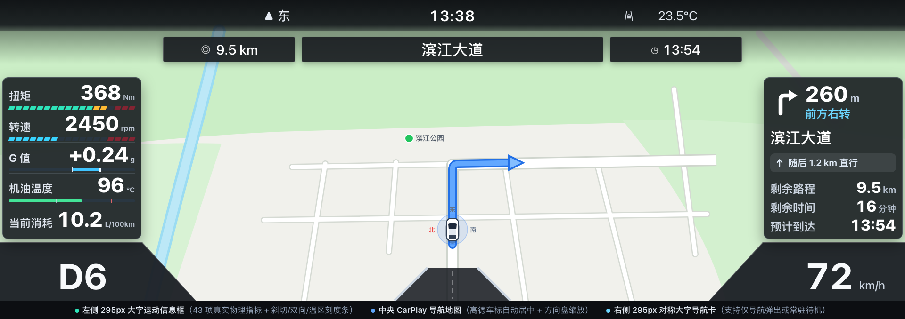

<div align="center">


# 途锐 MH2p CarPlay 改装全家桶 & 无线开发底座

<p>
  <a href="https://github.com/a78c7/touareg-cn-carplay-mods/releases/latest"></a>
  <a href="docs/README.md"></a>
  <a href="#许可证"></a>
</p>

**单 U 盘解锁途锐全屏 / 无线 / HUD / 仪表地图与运动信息框，支持手机 `8080` 签名 OTA 与无线开发。**

<p>
  <a href="https://github.com/a78c7/touareg-cn-carplay-mods/releases/latest"><b>📦 下载稳定版（v22.1）</b></a> ·
  <a href="https://github.com/a78c7/touareg-cn-carplay-mods/releases/tag/v23.0-beta.5"><b>🧪 尝鲜版（v23.0-beta.5）</b></a> ·
  <a href="#4-步免拆刷入安装"><b>⚡ 4 步安装</b></a> ·
  <a href="#11-大可选功能全景"><b>🧩 功能清单</b></a> ·
  <a href="README.en.md"><b>🇺🇸 English</b></a> ·
  <a href="README.de.md"><b>🇩🇪 Deutsch</b></a>
</p>

<p><sub>觉得有帮助欢迎点右上角 <b>⭐ Star</b>，或直接点下方红色按钮<b>免登录点个赞</b>；如需第一时间收到新版发版提醒，请点 <b>👀 Watch → Custom → 勾选 Releases</b>。</sub></p>

<p>
  <a href="https://github.com/a78c7/touareg-cn-carplay-mods/releases"></a>
  &nbsp;
  <a href="https://github.com/a78c7/touareg-cn-carplay-mods/stargazers"></a>
  &nbsp;
  <a href="https://touareg-likes.pages.dev/like"></a>
</p>

</div>

---

> [!TIP]
> **🧪 尝鲜测试版 [`v23.0-beta.5 (Pre-release)`](https://github.com/a78c7/touareg-cn-carplay-mods/releases/tag/v23.0-beta.5) 已开放下载** —— 实车验通 **55～59 fps 硬件零拷贝 AI 自定义皮肤引擎（GLES2 + QuickJS）**、**1920×639 实车标定几何规范**（[`CLUSTER_LAYOUT_SPEC.md`](docs/reference/CLUSTER_LAYOUT_SPEC.md)）、**方向盘 OK 盲切多皮肤**（默认双击 OK 零延迟切皮肤；同时装切原车地图模块时双击切图、三连击切皮肤）与 `8080` 多皮肤切换按钮、**信息框运动条整条平滑四色热力渐变**、并已移除 2 秒开机启动图直出地图（默认关闭 `v23_mode`，全程受车机三层自动保险丝保护）。日常求稳请继续下载 [`v22.1` 稳定版](https://github.com/a78c7/touareg-cn-carplay-mods/releases/latest)。

<div align="center">
  
  <br>
  <sub><i>仪表视觉示意：CarPlay 地图自动居中，左右 <code>295×344px</code> 等宽对称大字运动信息框与导航卡。</i></sub>
</div>

<br>

https://github.com/user-attachments/assets/618e8fe2-e579-4aed-b9de-ab50b8576374

<div align="center">
  <sub><i>实车演示视频（点击有声播放，中英双语字幕；前段定制主题为基于本仓库 <code>1920×639</code> 通道的扩展演示）。</i></sub>
</div>

---

## 11 大可选功能全景

> 所有模块默认保存在 `USB/未选模块/`（**默认全部未开启**），均通过电脑端「改装设置」按需勾选**安装 / 卸载 / 不处理**，前置依赖自动联动。

| 分类 | 模块名称 | 核心效果 | 适用范围 |
| :--- | :--- | :--- | :---: |
| **中控与投屏** | **🖥️ 全屏 CarPlay** | 车机端就地修补 38 字节去黑边铺满中控屏（自动校验皮肤 CRC32，不符安全跳过） | 国行途锐 P 版 |
| | **📡 无线 CarPlay** | 开启原厂未激活的无线 CarPlay（集成 LawPaul 模块） | MH2p 通用 |
| | **🤖 Android Auto** | 开启原厂未激活的安卓投屏（集成 LawPaul 模块） | MH2p 通用 |
| **HUD 与仪表** | **🧭 导航上 HUD** | 苹果/高德/百度转向箭头、距离、路名、车道直投 HUD（自研有线 iAP2 + 无线双栈） | 国行途锐 P 版 |
| | **🗺️ 仪表地图 + 大字运动信息框** | CarPlay 地图投射 `1920×639` 全液晶仪表（高德自动居中、方向盘缩放）；左右 `295px` 对称 **46px 粗体 + 10Hz 阻尼运动条**（43 项真实物理数据）、**大字导航卡**与 **GLES2 60fps 通道**（试验） | 国行途锐 P 版 |
| | **🔄 方向盘 OK 双击切原车地图** | 方向盘右侧 `OK` 键 2 秒内连按 2 下秒切 CarPlay/原车地图（`VW_HUD_4_OkMapSwitch`） | 国行途锐 P 版 |
| | **🎙️ 方向盘语音键短按唤 Siri（试验）** | CarPlay 在线时短按方向盘语音键直接唤 Siri（原厂长按不变；部分固件可能并触原车语音） | 国行途锐 P 版 |
| **无线与运维** | **📱 手机无线控制台（OTA + 诊断 + 可选 SSH）** | 连热点打开 `http://touareg.local:8080` 改信息框、**Ed25519 签名离线 OTA 与回滚**、一键脱敏诊断与安全模式管理；可选开 `2012` 无线 SSH | MH2p 通用 |
| **修复与降噪** | **📶 升 P2878 无线 5GHz 修复** | 仅旧固件（如 P9832）升 P2878 后有线正常、无线连不上时勾选 | 国行途锐 P 版 |
| | **🔕 去除蓝牙「输入用户名」弹窗** | 共享 Bundle `98` 仅拦截蓝牙 OBEX 认证弹窗（`Busrlo`），不影响通话、音乐与 CarPlay | 大众 MH2p |
| | **🔕 屏蔽「SIM 仅用于数据」弹窗** | 共享 Bundle `98` 仅拦截投屏时的 `PHONE_SIM_DATAONLY` 提示，不影响联网与 SOS | 大众 MH2p |

<details>
<summary><b>💡 新手 2 秒抄作业：推荐勾选组合</b></summary>

| 车主类型 | 推荐勾选模块 | 说明 |
| :--- | :--- | :--- |
| **大多数途锐车主** | 在配置器点一键 **「驾驶推荐全套」**（全屏 + 无线 CarPlay + HUD + 仪表地图 + OK 双击切地图），习惯用 Siri 再补勾 **「语音键短按唤 Siri」** | 兼顾导航体验与原车地图随时切回 |
| **想手机调仪表 + 后续免拔盘升级** | 在上面基础上补勾 **「手机无线控制台」**（普通车主无需勾 SSH） | 后续改信息框、OTA 升级、导诊断包全在手机完成 |
| **被烦人弹窗困扰** | 按实际弹窗补勾 **「去除输入用户名弹窗」** 或 **「屏蔽 SIM 提示」** | 两项独立生效，互不冲突 |
| **老固件升 P2878 连不上无线** | 补勾 **「老固件升 P2878 无线 CarPlay 5GHz 区域修复」** | 原厂 P2878 无线正常无需勾选 |

</details>

---

<a id="notice"></a>

> [!IMPORTANT]
> **安装前必读：适用车型、安全保护、非商业与免责声明**
> - **适用范围**：途锐专属功能自动适配国行途锐全部 `P` 版固件（`MH2p_CN_VWG36_P*`，如 `P2878`/`P2876`/`P2838`/`P9832`），非国行途锐 P 版安全跳过不改文件；弹窗屏蔽校验大众 `VW`；`VW_WiFi_Dev` 与 [`docs/`](docs/README.md) 适用于同平台 **MH2p（大众途锐、奥迪、保时捷 PCM 5、宾利、兰博基尼 LIS III）**。
> - **安全熔断与行车安全**：内置 **3 次崩溃零损耗安全模式自动熔断**（覆盖 J9 HMI、`cl_probe.so`、`clusterd`/`cl_render`、`io-pkt`，正常开机零 eMMC 写入）。严禁驾驶时操作控制台或车机设置；信息框数据仅供参考，车速与告警灯以原车仪表为准。
> - **免费开源，严禁商用与倒卖**：本项目遵循 **[PolyForm Noncommercial 1.0.0](LICENSE) + [非商业附加条款](LICENSE.ADDITIONAL-TERMS.md)**，仅供个人非商业学习使用，严禁转售压缩包、付费代刷或商业捆绑；花钱买到请立即退款。
> - **非官方、风险自负**：个人业余研究项目，与大众、奥迪、保时捷、宾利、兰博基尼、苹果、谷歌、高德等公司无关，代码与安装包按“现状”提供，刷机风险与后果由使用者自负；权利人如有异议请通过 [Issue](https://github.com/a78c7/touareg-cn-carplay-mods/issues) 联系。

## 4 步免拆刷入安装

1. **准备 U 盘**：容量 **32GB 以内**，格式化为 **FAT32**（Windows：右键格式化；Mac：磁盘工具 → 抹掉 → `MS-DOS (FAT)`）。
2. **解压到 U 盘根目录**：从 **[Releases](https://github.com/a78c7/touareg-cn-carplay-mods/releases/latest)** 下载最新 `zip`，把压缩包里的**全部内容直接放进 U 盘第一层**（切勿多套一层外层文件夹）：
   ```text
   U盘根目录/
   ├── Data/                          ← 必须直接位于 U 盘第一层
   ├── Meta/                          ← 必须直接位于 U 盘第一层
   ├── Mods/                          ← 默认为空，由配置器自动移入已选模块
   ├── 未选模块/                       ← 存放全部 12 个待选模块目录
   └── 改装设置（Windows）.exe / （Mac）.command
   ```
3. **【必做】运行「改装设置」勾选并保存**：双击 U 盘根目录的 **`改装设置（Windows）.exe`** 或 **`改装设置（Mac）.command`**（**不运行直接插车会空刷、不会安装任何模块**）：
   - 点快捷预设或逐项选 **「安装 / 卸载 / 不处理」**，点选拖拽左右信息框与大字导航卡；
   - 若开启「手机无线控制台」，填好手机热点和 6～16 位管理口令 → 点 **「保存到 U 盘」**（Mac 版自动清 `._*` 隐藏文件）。
4. **上车自动刷入**：安全弹出 U 盘 → **发动车辆** → 插入扶手箱 USB 口。约 10 秒后自动重启刷机（全程数分钟、自动重启几次，**期间勿操作车机**）→ 提示移除介质后拔出即生效。

> [!TIP]
> - **未签名提示与哈希核对**：桌面配置器未购商业签名，Windows 点「更多信息 → 仍要运行」，Mac 在「系统设置 → 隐私与安全性」点「仍要打开」；程序由 GitHub Actions 从 [`tools/configurator`](tools/configurator) 源码构建并随 Release 附 `SHA256SUMS.txt`，仅监听本机 `127.0.0.1`，**绝不联网**。
> - **旧版升级与 PIN 兼容**：**`v22.01` 及更早版本升级到 `v22.1` 必须先用 U 盘覆盖刷入一次**（旧版 OTA 未内置 Ed25519 公钥，会安全拒绝新版签名包；刷入 `v22.1` 后即可继续无线 OTA）。U 盘覆盖刷入自动保留已有 `cl.conf` 与 `web.pin`（兼容旧版 4～8 位口令）；若早期旧版从未设过 `web.pin`，`v22.1` 首次启动自动生成 6 位随机口令并显示在途锐仪表屏，手机首次登录 `8080` 后永久隐藏（无仪表模块车型见 [`docs/07`](docs/07-无线控制台与SSH开发.md)）。
> - **CarPlay 黑边**：首次刷完若仍有黑边，在 iPhone 蓝牙/CarPlay 设置里「忘记此车辆」重连一次即可。

<details>
<summary><b>🖥️ 展开查看：电脑端「途锐改装设置」离线界面</b></summary>
<br>
<div align="center">
  
  <br>
  <sub><i>电脑端「改装设置」：离线勾选模块、预览并拖拽左右信息框与大字导航卡，一键保存到 U 盘。</i></sub>
</div>
</details>

---

## 日常使用与排障

- **仪表与 HUD**：方向盘按 `VIEW` 切到导航页，连上 CarPlay 自动投屏（两侧原厂圆表盘可在车机设置里隐藏），夜间模式同步变深色；开 ACC 时地图自动上移避让辅助驾驶图标。
- **方向盘快捷操作**：选装 `VW_HUD_4_OkMapSwitch` 后，地图页且 CarPlay 在线时 **2 秒内双击右侧 `OK` 键**秒切原车/CarPlay 地图；选装 `VW_HUD_5_SiriShortPress` 后，CarPlay 在线时**短按语音键**直接唤 Siri。
- **电脑端离线预览与配置分享**：双击打开 [`tools/preview/index.html`](tools/preview/index.html) 即可在浏览器按 `1920×639` 预览 `dash.conf`、对比 `smooth=1` 阻尼动画或回放行车 CSV，欢迎把配置与效果图发到 **[GitHub Discussions](https://github.com/a78c7/touareg-cn-carplay-mods/discussions)**。

<details>
<summary><b>📼 进阶（可选）：10Hz 行车记录 U 盘（绝大多数车主无需开启）</b></summary>

- 普通车主刷完拔走 U 盘即可。
- 如需记录 34 项真实物理传感器 CSV 供 AI 复盘或拖入 `tools/preview/index.html` 回放，在「改装设置」底部展开 **「进阶工具：U 盘用途切换」** 点 **「改成行车记录 U 盘」** 后常插扶手箱（已装「导航上 HUD」时自动后台写入 `drive_logs/`，每小时约 5 MB，不再触发刷机）。
- 长期写入请使用**品牌正品 U 盘**（闪迪 / 三星 / 铠侠），防止车辆断电损坏杂牌盘 FAT32 分区。

</details>

<details>
<summary><b>📍 高德地图在 CarPlay 仪表上的已知特性</b></summary>

- **车标左右偏（默认自动居中）**：高德导航会把车标往目的地侧偏移约 3 cm；改装默认每秒识别画面车标，偏约 3 秒自动挪回时钟正下方（仅对高德生效，苹果/百度不受影响）。
- **比例尺自动缩放**：导航中高德会随车速与路口自动改回比例尺，方向盘上下键缩放为临时生效。
- **车道指引**：高德不通过 CarPlay 下发车道数据，需要 HUD/导航卡车道指引可用百度地图。
- **偶发开机停在原车地图**：iPhone 未响应第二屏请求，断开 CarPlay 重连一次即可恢复。

</details>

<details>
<summary><b>🔧 卸载还原、5GHz 无线修复与提 Issue 附日志</b></summary>

- **一键卸载还原**：运行「改装设置」把要移除的模块选为 **「卸载」** 保存后插车刷一次即可（手动卸载需先移回 `Mods/` 再放空文件 `uninstall.txt`；卸载 HUD 需连同仪表地图、OK 切地图与语音键短按 Siri 一并卸载）。
- **插 U 盘没反应 / 刷完没变化**：确认 U 盘为 **≤ 32GB FAT32**、`Data`/`Meta` 直接在根目录，且**已运行「改装设置」将所选模块移入 `Mods/`**；排查看 U 盘 `Logs/`（`_ModKit_Update.log` 中的 `Filename too long` 可忽略）。
- **老固件升 P2878 后无线连不上**：勾选 **「老固件升 P2878 无线 CarPlay 5GHz 区域修复」** 刷入，并在车机与 iPhone 双端忘记设备重连（见 [#7](https://github.com/a78c7/touareg-cn-carplay-mods/issues/7)）。
- **提 Issue 附日志**：已装无线控制台直接在 `http://touareg.local:8080` → **日志导出**点 **「下载脱敏诊断包」**（自动脱敏密码/口令/VIN/手机号）；无无线模块可在 U 盘根目录建 `cluster_logs` 文件夹插车 2 分钟提取，切勿公开本车 `backup` 目录。

</details>

---

## 进阶：无线控制台、AI 开发与技术文档

<details>
<summary><b>📱 展开查看：手机无线控制台（8080 / 签名 OTA / 诊断）与无线 SSH + AI 自由开发</b></summary>

<br>

`VW_WiFi_Dev` 利用车机闲置 `bcm2` 客户端接口静默连入手机热点（RSDB 并发不占无线 CarPlay，不改原车 `ecm0` 4G 车联网），完整技术细节见 **[`docs/07-无线控制台与SSH开发.md`](docs/07-无线控制台与SSH开发.md)**。

<div align="center">
  
  <br>
  <sub><i>手机无线控制台（<code>http://touareg.local:8080</code>）：停车锁保护、43 项选配、签名 OTA 升级与脱敏诊断导出。</i></sub>
</div>

### 普通车主：手机浏览器零命令行管理
1. 在「改装设置」安装 **「手机无线控制台」**（无需勾选 SSH），填入 1～3 个热点与 6～16 位口令；上车开热点（iPhone 首次开「最大兼容性」并在热点页亮屏 3～5 秒；安卓选 WPA2），约 1 分钟连入。
2. 访问 **`http://touareg.local:8080`**（`X-Pin` 请求头鉴权、车速 ≤ 3 km/h 生效）：可实时调整信息框/车标、上传 **Ed25519 签名校验** 的 `touareg-ota-*.tar` 离线升级与一键回滚、下载脱敏诊断包 `touareg_diag_sanitized.txt`，以及管理 3 次崩溃安全模式。

### 开发者：无线 SSH（`:2012`）+ AI 自由开发
用电脑端 **[DeepSeek Harness](https://github.com/deepseek-ai/deepseek-harness)** / Claude Code / Cursor，或安卓端 **[DSH Go](https://github.com/ccch1mneyyy/dsh-go)**（iPhone 暂无公开包）无线连车自定义仪表只需 3 步：
1. 安装无线控制台时勾上 **「同时开启 SSH 无线开发终端（端口 2012）」**，本车专属私钥自动保存到桌面 `途锐无线SSH密钥/touareg_ed25519`（不留在 U 盘）。
2. 发动车辆并开热点等待约 1 分钟（若开了全局 VPN/代理请关闭或绕过局域网）。
3. 把私钥与下面指令直接发给 AI（完整硬件与渲染界限见 [`docs/07` 第 11 节](docs/07-无线控制台与SSH开发.md#11-ai-无线开发边界与车机硬件护栏开发者与-ai-必读)）：

```text
这是我车机的 SSH 私钥文件 `touareg_ed25519`（电脑默认在桌面 `途锐无线SSH密钥/` 文件夹，安卓手机端请直接读取我上传或放在 Download 目录下的 `touareg_ed25519`）。
请你自己读取这把私钥并配置保存好车机 SSH 连接（端口 `2012`，用户名 `root`）：
- 先尝试连接 `touareg.local:2012`；如果当前系统（如安卓端）不解析 `.local`，请你自动读取本机热点路由/ARP 邻居表或扫描当前热点子网开放 `2012` 端口的设备找到车机 IP 并连上，无需让我手动查 IP 或填配置。

车机环境、硬件资源与渲染安全护栏（请严格遵守，不可违背）：
1. 系统是 QNX 6.6.0 (ARMv7 Tegra K1，总内存约 2 GB)，shell 是 ksh（无 bash / sed -i / wc）。
2. 严禁改动原厂只读分区（/ifs、/mnt/system），不要频繁重载 pfctl 避免冲击 io-pkt；锁车后整机随 CAN 休眠断电，禁止干扰车机电源管理。
3. 内存与 eMMC 寿命红线：`/tmp` 是内存盘，严禁往 `/tmp` 塞大文件、视频或无限增长日志；严禁高频周期性写 `/mnt/app` 或 `/mnt/ota` 闪存（实时遥测全部在 `/tmp/dash.state` 与 `/tmp/cluster_cp.state`）。
4. `/mnt/app` 默认只读：改文件前先 `mount -uw /mnt/app` 并备份原文件，用 `.new` 写完原子 `mv` 替换后立刻 `sync && mount -ur /mnt/app` 恢复只读；改完仪表配置执行 `slay -f cl_render` 秒级刷新（无需重启车机）。
5. 渲染架构与帧率护栏（极重要）：
   - `cl_render` 的 `capture=h264` 地图模式走 NVDEC 硬解 + `screen_blit`，`dash.c` 是 CPU 软渲两侧 295×344 小框（开启 `smooth=1` 即可流畅显示数字与运动条）；严禁在 `dash.c` 里用 CPU 循环做 1920×639 全屏复杂动画，必然掉帧发卡！
   - 若要开发全屏 60fps 动效仪表、指针或粒子主题，必须走 `src/cl_render/gles60.c` 的 OpenGL ES 2.0 硬件加速通道（`capture=gles60`，窗口 `58`，`eglSwapInterval(dpy, 1)`，通过 `eglGetProcAddress` 动态解析 `gl*` 函数，绝不直接链接 `-lGLESv2`）。
   - 车机已启用 3 次崩溃安全模式熔断（`/mnt/app/eso/bin/apps/cluster/safe_mode` 或 `/tmp/vw_*_safe_mode`），改动前请先用电脑端 `tools/preview/index.html` 本地验证。
6. 完整接口表与开发界限见公开仓库：https://github.com/a78c7/touareg-cn-carplay-mods/tree/main/docs

现在请自动连上车机，只读查看一下当前车速/油温、安全模式状态和已安装的模块，向我汇报连接成功，然后听我用大白话吩咐修改。
```

</details>

<details>
<summary><b>📚 展开查看：MH2p 跨品牌开发手册与源码索引</b></summary>

<br>

完整开发笔记与平台参考已并入 **[`docs/`](docs/README.md)**（每条结论均标注 **【途锐特有】** 或 **【MH2p 通用】**）：

| 开发实战记录（[`docs/01~07`](docs/README.md)） | MH2p 平台参考（[`docs/reference/`](docs/reference/README.md)） | 核心源码目录（[`src/` & `tools/`](src)） |
| :--- | :--- | :--- |
| • [01 调试环境与工具](docs/01-调试环境与工具.md)<br>• [02 CarPlay 导航上 HUD](docs/02-CarPlay导航上HUD.md)<br>• [03 CarPlay 地图上仪表](docs/03-CarPlay地图上仪表.md)<br>• [04 仪表信息框与行车记录](docs/04-仪表信息框.md)<br>• [05 全屏补丁与 U 盘包](docs/05-全屏CarPlay与U盘包.md)<br>• [06 给其他车型的建议](docs/06-给其他车型的建议.md)<br>• [07 无线控制台与 SSH 开发](docs/07-无线控制台与SSH开发.md) | • [R1 系统结构与防火墙](docs/reference/R1-系统结构与文件位置.md)<br>• [R2 HMI（J9 Java 与 BAP）](docs/reference/R2-HMI-J9-Java.md)<br>• [R3 DSI 车辆数据实测表](docs/reference/R3-车辆数据接口.md)<br>• [R4 显示屏编号与 dmdt](docs/reference/R4-显示系统.md)<br>• [R5 CarPlay / iAP2 双栈](docs/reference/R5-CarPlay与iAP2.md) | • [`src/hud-java`](src/hud-java)：HMI 插件与 43 项遥测<br>• [`src/popup-filter-java`](src/popup-filter-java)：共享 Bundle 98 弹窗过滤<br>• [`src/cluster-probe`](src/cluster-probe)：双屏解密与有线 Cinemo 钩子<br>• [`src/clusterd`](src/clusterd)：仪表切屏与安全区守护<br>• [`src/cl_render`](src/cl_render)：H.264 硬解、信息框与 GLES2<br>• [`src/vhpatch`](src/vhpatch)：全屏 CarPlay 就地补丁器<br>• [`src/touareg_netd`](src/touareg_netd)：mDNS、8080 控制台与签名 OTA<br>• [`tools/configurator`](tools/configurator)：跨平台本地「改装设置」 |

</details>

<details>
<summary><b>🙏 展开查看：社区引用与致谢</b></summary>

- **[luanqibazao0123-bot](https://github.com/luanqibazao0123-bot)**（[#7](https://github.com/a78c7/touareg-cn-carplay-mods/issues/7)）：启发了 `v21` 大字运动刻度信息框视觉重构与 `60fps` 仪表引擎，并提供老固件升 `P2878` 实测线索。
- **海外社区引用**：已被德国途锐论坛 **Touareg-Freunde** 的 [欧版 MH2p P2869 仪表投屏项目帖](https://www.touareg-freunde.de/forum/thread/30309-geschafft-apple-carplay-im-digitalen-kombiinstrument-des-touareg-cr-mh2p-p2869/)引用参考。
- **[LawPaul / MH2p SD ModKit](https://github.com/LawPaul/MH2p_SD_ModKit)**（[官网](https://lawpaul.github.io/MH2p_SD_ModKit_Site/)）：免拆 U 盘刷机框架及可选 `AppleCarPlay` / `AndroidAuto` 模块（[CC BY-NC-SA 4.0](LICENSES/CC-BY-NC-SA-4.0.md)，其中安卓修复引用了 [fifthBro/pcm5-androidauto-connect-fix](https://github.com/fifthBro/pcm5-androidauto-connect-fix)）。
- **[fifthBro / mh2p-cluster](https://github.com/fifthBro/mh2p-cluster)** & **[mh2p-ssh-access](https://github.com/fifthBro/mh2p-ssh-access)**：`dio_cluster.so`（v0034）与 `cl_render` 上游基础（[CC BY-NC-SA 4.0](LICENSES/CC-BY-NC-SA-4.0.md)）。
- **[davecozens / touareg-carplay](https://github.com/davecozens/touareg-carplay)**：全屏几何数值参考；**[luka-dev](https://github.com/luka-dev)**：`jxe2jar`、`qnx65-armv7-toolchain` 编译与逆向工具链。

</details>

---

## 许可证

- **原创代码**：**[PolyForm Noncommercial 1.0.0](LICENSE) + [非商业附加条款](LICENSE.ADDITIONAL-TERMS.md)**（不含大众/苹果原厂文件；非商业、反倒卖与免责边界见 **[安装前必读](#notice)**）；`docs/` 文档文字采用 **CC BY-SA 4.0**。
- **第三方组件**：`src/cl_render`、`dio_cluster.so`、ModKit 及可选 LawPaul 模块遵循 **[CC BY-NC-SA 4.0](LICENSES/CC-BY-NC-SA-4.0.md)**，完整署名与其余第三方许可见 **[THIRD_PARTY_NOTICES.md](LICENSES/THIRD_PARTY_NOTICES.md)**。
