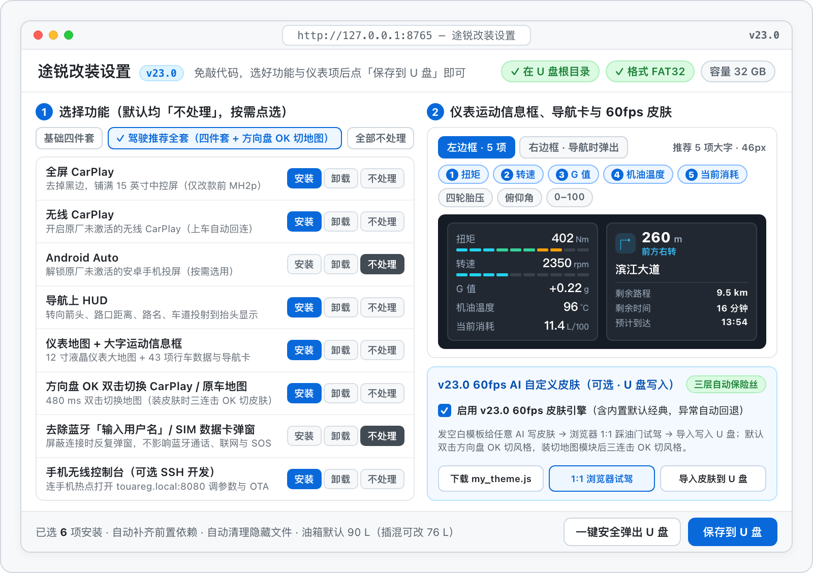

# 途锐中国版(MH2p P2878) CarPlay 改装合集：全屏 + 无线 + Android Auto + 导航上HUD + CarPlay地图上仪表 + 自定义仪表信息框，一个U盘一次刷入

<div align="center">


<p>
  <a href="https://github.com/a78c7/touareg-cn-carplay-mods/releases/latest"></a>
  <a href="docs/README.md"></a>
  <a href="#手机无线控制台与-ai-自由开发"></a>
  <a href="docs/07-无线控制台与SSH开发.md"></a>
  <a href="#许可证"></a>
</p>

**不拆一粒螺丝、无需专用网卡 —— 插一次 U 盘解锁途锐全套 CarPlay 增强，并开放手机无线控制台与 AI 自由开发底座。**

<p>
  <a href="https://github.com/a78c7/touareg-cn-carplay-mods/releases/latest"><b>📦 下载最新版 U 盘包</b></a> ·
  <a href="#4-步免拆刷入安装"><b>⚡ 4 步安装</b></a> ·
  <a href="#手机无线控制台与-ai-自由开发"><b>📱 无线控制台 & SSH</b></a> ·
  <a href="docs/README.md"><b>📚 MH2p 跨品牌开发手册</b></a> ·
  <a href="#免责声明"><b>⚠️ 免责声明</b></a> ·
  <a href="#vw-touareg-cn--mh2p-open-cockpit"><b>🇺🇸 English</b></a> ·
  <a href="#vw-touareg--mh2p-open-cockpit-deutsch"><b>🇩🇪 Deutsch</b></a>
</p>

</div>

---

## 演示与概念预览

https://github.com/user-attachments/assets/618e8fe2-e579-4aed-b9de-ab50b8576374

<div align="center">
  <p>
    <sub><i>上方视频可直接点击有声播放（中英双语字幕） · 如需收藏最高画质可点此 <a href="https://github.com/a78c7/touareg-cn-carplay-mods/releases/download/v20.0/touareg-cockpit-demo-1080p60.mp4"><b>🎞️ 下载 1080p 60fps 原画母带 (67 MB)</b></a></i></sub>
    <br>
    <sub><i>注：视频前段展示的多套定制仪表皮肤为基于本仓库 <code>1920×639</code> 独立图层与 10Hz 实时车辆数据通道的扩展概念演示；当前 U 盘包开箱内置「全屏 CarPlay 地图 + 左右双信息框」，并开放无线网页控制台与无线 SSH 供自由定制开发。</i></sub>
  </p>
</div>

---

> [!IMPORTANT]
> **适用车型与安全边界（必读）**
> - **途锐专属界面模块**（全屏 CarPlay、导航上 HUD、仪表地图与信息框）严格校验固件版本 **`MH2p_CN_VWG36_P2878`**，版本不符时自动安全跳过，不改动任何文件。已在一台 2023 款途锐（iOS 27）及未改装实车上完整验证；另有车友实测反馈 **2838 版本**与 **2019 款途锐锐锋版**一次刷入成功（个案供参考）。
> - **跨品牌同平台通用底座**：可选的 **`VW_WiFi_Dev`（手机无线控制台 / 无线 SSH）** 与 **[`docs/` 平台技术手册](docs/README.md)** 适用于大众集团同平台 **MH2p（MIB2+ High）** 车机 —— 涵盖 **大众途锐、奥迪（A6/A7/A8/Q3/Q7/Q8/e-tron）、保时捷（PCM 5：911 992/Cayenne E3/Macan/Panamera）、宾利（添越/飞驰/欧陆 GT）、兰博基尼（Urus LIS III）**。
> - 非官方个人研究项目，免费开源，**严禁任何形式的转售或付费代刷**。使用前请先阅读文末[免责声明](#免责声明)。

## 功能全景矩阵

| 模块 | 开箱即用效果 | 默认状态 |
| :--- | :--- | :---: |
| **🖥️ 全屏 CarPlay** | 车机端就地修补 38 字节去掉黑边，铺满整块中控屏（仓库不分发任何原厂文件） | 默认不开启（按需安装/可卸载） |
| **📡 无线 CarPlay & Android Auto** | 开启原厂未激活的无线 CarPlay 与安卓投屏（集成 LawPaul 模块） | 默认不开启（按需安装/可卸载） |
| **🧭 CarPlay 导航上 HUD** | 苹果地图、高德、百度的转向箭头、路口距离、路名、车道直投抬头显示（有线/无线双协议栈均支持） | 默认不开启（按需安装/可卸载） |
| **🗺️ CarPlay 地图上仪表 + 大字运动信息框** | 手机导航实时投射至 `1920×639` 全液晶仪表中央；高德车标画面识别自动居中、方向盘上下键缩放；左右双框**严格镜像等宽（`295px`）**对齐底部斜边，支持 **43 项真实物理数据**（含四轮胎压、俯仰/侧倾坡度、GNSS 海拔、8AT 实时挡位）与 **46px 大号粗体 + 内嵌运动刻度条**，并内置**大字导航信息卡**（支持仅导航弹出或未导航常驻待机导航框） | 默认不开启（按需安装/可卸载） |
| **🔄 方向盘 OK 双击切换原车地图** | 独立选装模块（`VW_HUD_4_OkMapSwitch`）：方向盘右侧 `OK` 键 2 秒内连按 2 下，在 CarPlay 导航地图与原车自带地图之间零延迟来回切换 | 默认不开启（按需安装/可卸载） |
| **📈 10Hz 行车记录（AI 复盘）** | 刷完一键把 U 盘切换为「行车记录盘」常插车上，每秒 10 行记录全车动力 + 四轮胎压 + 俯仰/侧倾/海拔共 34 列真实传感器 CSV，附带提问模板直接交给豆包、千问、DeepSeek 分析 | 随时切换 |
| **📱 手机无线控制台 & SSH** | **v20 新增**：连手机个人热点打开 `http://touareg.local:8080` 秒改信息框、调车标、无线下载行车记录 CSV；进阶可勾选开启 `2012` 无线 SSH 自由开发 | 默认不开启（按需安装/可卸载） |
| **🔕 去除「输入用户名」弹窗** | 可选模块 **`VW_NoBtAuthPopup`**：共享 HMI 弹窗过滤插件（Bundle `98`，与 HUD 插件 `97` 互不冲突），仅拦截蓝牙 OBEX 认证弹窗（`Busrlo` / `BLUETOOTH_CONNECT_AUTH_REQUIRED`），不影响正常蓝牙配对、通话、音乐与 CarPlay | 默认不开启（按需安装/可卸载） |
| **🔕 屏蔽「SIM 卡仅用于数据连接。」弹窗** | 可选模块 **`VW_NoSimPopup`**：共享 HMI 弹窗过滤插件（Bundle `98`），仅拦截连接 CarPlay / Android Auto 时的 `PHONE_SIM_DATAONLY` 提示弹窗，不影响 SIM 联网、蓝牙、CarPlay 与 SOS | 默认不开启（按需安装/可卸载） |

<div align="center">
  
  <br>
  <sub><i>仪表效果示意：中央为手机 CarPlay 实时导航地图，左右为可自由配置的半透明数据信息框；深灰导航条、挡位与车速为仪表原车图层。</i></sub>
</div>

---

## 4 步免拆刷入安装

1. **准备 U 盘**：容量 **32GB 以内**，格式化为 **FAT32**（Windows：右键格式化；Mac：磁盘工具 → 抹掉 → `MS-DOS (FAT)`）。
2. **拷入根目录**：从 **[Releases](https://github.com/a78c7/touareg-cn-carplay-mods/releases/latest)** 下载最新 `zip`，解压后把里面的**全部内容直接放到 U 盘根目录**（确保 `Data`、`Meta`、`Mods` 在第一层）。
3. **可视化勾选配置**（推荐）：双击 U 盘里的 **`改装设置（Windows）.exe`** 或 **`改装设置（Mac）.command`**，在自动弹出的本地离线网页里：
   - 按需选择每个模块 **「安装 / 卸载 / 不处理」**，点选并拖拽左右信息框的显示项；
   - 想用手机随时改配置或无线 SSH 开发的，把 **「手机无线控制台（可选 SSH 开发）」** 选为「安装」，填好手机热点与口令后点 **「保存到 U 盘」**（Mac 用户运行保存一次还能自动清掉 `._*` 隐藏文件）。
4. **上车自动刷入**：弹出 U 盘 → **发动车辆** → 插入扶手箱 USB 口。约 10 秒后车机自动重启进入刷机（全程数分钟、会自动重启几次，**期间请勿操作车机**）→ 屏幕提示移除介质时拔掉 U 盘即生效。

> [!TIP]
> - **未签名程序提示**：`改装设置` 未购买商业证书，Windows 点「更多信息 → 仍要运行」；Mac 在「系统设置 → 隐私与安全性」点「仍要打开」。程序仅监听本机 `127.0.0.1` 修改当前 U 盘文件，**绝不联网**，源码在 [`tools/configurator`](tools/configurator)。
> - **旧版升级与全屏生效**：刷过旧版的车直接覆盖刷入即可，原有的车标校准 `cl.conf` 会自动保留；若首次刷完 CarPlay 仍有黑边，在 iPhone 蓝牙/CarPlay 设置里「忘记此车辆」重连一次即可。

<details>
<summary><b>🖼️ 点击展开查看：电脑端「途锐改装设置」本地配置页截图</b></summary>
<br>
<div align="center">
  
</div>
</details>

---

## 手机无线控制台与 AI 自由开发

传统 MH2p 调试每次都要接 D-Link `DUB-E100` 有线网卡（且插有线 CarPlay 会断网卡供电），改个信息框也要反复拔 U 盘回电脑重刷。`v20.0` 利用车机闲置的 `bcm2` 无线客户端接口彻底打通了全无线链路（不占无线 CarPlay、不改原车 `ecm0` 4G 车联网路由）：

<div align="center">
  
  <br>
  <sub><i>手机连热点打开 <code>http://touareg.local:8080</code> 实机界面：停车安全锁保护、43 项指标点选排序与运动刻度条、车标与宽画布微调、CSV 行车记录无线下载。</i></sub>
</div>

### 1. 普通车主：零命令行，手机浏览器秒改配置
- 在「改装设置」里把 **「手机无线控制台」** 选为安装（无需勾选 SSH），填入 1～3 个手机热点（程序自动处理中文十六进制编码与 iPhone 弯撇号 `’`）及 4～8 位管理口令。
- 上车打开手机个人热点（**iPhone 首次请打开「最大兼容性」并停留在「设置 → 个人热点」页面亮屏 3～5 秒**；安卓选 WPA2），车机开机约 1 分钟后静默连入。
- 手机浏览器访问 **`http://touareg.local:8080`**（首次输一次口令自动记住），停车状态下（车速 ≤ 3 km/h）直接点选左右信息框、调车标高度、开宽画布、或把 U 盘 `drive_logs` 里的行车记录 CSV 直接无线下载到手机发给 AI 分析。

### 2. 傻瓜式无线 SSH + AI 自由开发教程（把钥匙和一句话丢给 AI，全程免敲命令）

想用电脑上的 **[DeepSeek Harness](https://github.com/deepseek-ai/deepseek-harness)**（或 Claude Code / Cursor），或者只带一部手机用 **[DSH Go](https://github.com/ccch1mneyyy/dsh-go)**（DeepSeek Harness 手机客户端，Android 直接装 APK，iPhone 暂无公开安装包）直接无线连进车机改配置、自定义仪表画面，**不需要你自己查车机 IP、不需要手动填端口建连接、也不需要敲一行命令**，只需 **3 步**：

1. **刷机前勾上 SSH 拿到「专属钥匙」**：双击运行 U 盘里的 `改装设置`，把「手机无线控制台（可选 SSH 开发）」选为 **「安装」**，填好手机热点，勾上 **「同时开启 SSH 无线开发终端（端口 2012）」** 点保存。电脑桌面会自动生成 **`途锐无线SSH密钥`** 文件夹，里面的 **`touareg_ed25519`**（不带 `.pub` 后缀）就是本车唯一私钥（上车插 U 盘刷入一次即可）。
2. **上车打开手机个人热点**：发动车辆，打开手机个人热点等约 **1 分钟**车机自动连入（iPhone 请开「最大兼容性」并在首次连接时停留在热点页亮屏 3～5 秒；安卓选 WPA2，若手机开了全局 VPN/代理请先关闭或绕过局域网）。
3. **把私钥和下面这段话直接发给 AI（让它自己读钥匙、自己找车机连上）**：
   - **电脑端**：电脑 Wi-Fi 连同一个手机热点，打开 **DeepSeek Harness**（或 Claude Code / Cursor）；
   - **安卓手机端（免带电脑）**：把 `touareg_ed25519` 私钥存到安卓手机上，打开 **[DSH Go](https://github.com/ccch1mneyyy/dsh-go)**（Android 客户端，iPhone 暂无公开包）；
   - 在对话框里附上 `touareg_ed25519` 私钥（或告诉它所在文件夹），把下面整段话复制发给它即可：

```text
这是我车机的 SSH 私钥文件 `touareg_ed25519`（电脑默认在桌面 `途锐无线SSH密钥/` 文件夹，安卓手机端请直接读取我上传或放在 Download 目录下的 `touareg_ed25519`）。
请你自己读取这把私钥并配置保存好车机 SSH 连接（端口 `2012`，用户名 `root`）：
- 先尝试连接 `touareg.local:2012`；如果当前系统（如安卓端）不解析 `.local`，请你自动读取本机热点路由/ARP 邻居表或扫描当前热点子网开放 `2012` 端口的设备找到车机 IP 并连上，无需让我手动查 IP 或填配置。

车机环境与安全护栏（请严格遵守）：
1. 系统是 QNX 6.6.0 (ARMv7 Tegra K1)，shell 是 ksh（无 bash / sed -i / wc）。
2. 严禁改动原厂只读分区（/ifs、/mnt/system），不要频繁重载 pfctl 避免冲击 io-pkt。
3. 改装目录在 `/mnt/app/eso/bin/apps/cluster/`（仪表渲染 `cl_render`、配置 `dash.conf` / `cl.conf`）和 `/mnt/app/eso/bin/apps/wifi_dev/`；10Hz 实时车速、功率、扭矩、油温等数据在 `/tmp/dash.state` 与 `/tmp/cluster_cp.state`。
4. `/mnt/app` 默认只读：改文件前先 `mount -uw /mnt/app` 并备份原文件，用 `.new` 写完原子 `mv` 替换后立刻 `sync && mount -ur /mnt/app` 恢复只读；改完仪表配置执行 `slay -f cl_render` 即可秒级刷新仪表画面（无需重启车机）。
5. 完整接口表与自定义编译说明见公开仓库：https://github.com/a78c7/touareg-cn-carplay-mods/tree/main/docs

现在请自动连上车机，只读查看一下当前车速/油温状态和已安装的模块，向我汇报连接成功，然后听我用大白话吩咐修改。
```

---

## 日常使用与进阶指南

- **HUD 与大字运动仪表信息框（v21.0）**：仪表按方向盘 `VIEW` 键切到导航页，连上 CarPlay 后地图自动投上仪表（两侧圆形表盘可在原车仪表设置里隐藏），切夜间模式同步变深色。左右信息框**严格等宽对称（`295px`）**并对齐底部挡位与车速斜边，采用 **46px 大号抗锯齿粗体 + 内嵌斜切分段/双向/温区运动刻度条**，支持 43 项真实物理传感器指标（含四轮直接胎压、俯仰/侧倾角、海拔与 8AT 挡位）；**大字导航信息卡**同步显示转向大箭头、大字距离与完整路名、车道指引/下下路口、剩余路程、剩余时间与预计到达，并支持设为**仅导航时自动弹出**或**常驻显示（未导航时显示待机导航框）**。开 ACC 时地图自动上移避开辅助驾驶图标。
- **方向盘 OK 键双击秒切原车地图**：选装 `VW_HUD_4_OkMapSwitch`（或在手机无线控制台开启）后，仪表在地图页且 CarPlay 在线时 **2 秒内连按 2 下方向盘右侧 `OK` 键**，即可在 CarPlay 地图与原车自带地图之间无缝秒切（单按 `OK` 键仍保持原车自动缩放，不干扰上下缩放键）。
- **行车记录喂给 AI**：在「改装设置」底部点 **「改成行车记录 U 盘」** 后即可一直插在车上（不会再触发刷机）。把 `drive_logs` 里生成的 34 列 CSV 连同自动附带的 **`给AI分析行车记录.txt`** 一起传给豆包、千问、DeepSeek，即可一键复盘里程、急加减速、最大功率扭矩、四轮胎压与三油温变化。

<details>
<summary><b>📍 展开查看：高德地图在 CarPlay 仪表上的已知特性与说明</b></summary>

下面这些是高德 App 自身的行为，车机侧已做针对性适配或说明：
- **车标左右偏（已做画面自动居中）**：高德导航时会把车标往目的地方向偏约 3 厘米。改装默认开启「看画面自动居中」（仅对高德生效，苹果/百度不受影响）：每秒识别仪表画面车标，偏了约 3 秒自动挪回时钟正下方；不想要可在设置里选「关」。
- **比例尺自动缩放**：导航中高德会随车速和路口自动调整比例尺，方向盘上下键手动缩放过一会儿会被高德改回。
- **车道指引**：高德不通过 CarPlay 向车机发车道数据，因此 HUD 只显示转向箭头、距离和路名；需要 HUD 车道指引可使用百度地图。
- **巡航（未导航）状态**：仪表仅显示带定位点的基础地图，无电子眼播报；重新规划路线时 HUD 信息会短暂闪断一次；点高德「全览」按钮可能对调中控与仪表全览状态。
- 偶发开机后仪表停在原车地图（iPhone 未响应第二屏请求），断开 CarPlay 重连一次即可恢复。
</details>

<details>
<summary><b>🔧 展开查看：卸载还原与常见问题排障（Issue 日志抓取）</b></summary>

- **一键卸载还原**：运行「改装设置」，把要卸载的功能选为「卸载」保存到 U 盘，上车再刷一次即精准还原原厂文件（手动方式：在对应模块目录放空文件 `uninstall.txt`；三个 HUD/仪表模块需同时卸载）。
- **插 U 盘没反应**：检查 U 盘是否为 **FAT32**（32GB 以内），且 `Data`、`Meta` 直接在 U 盘根目录而非子文件夹内。
- **刷完没变化**：查看 U 盘 `Logs/` 下对应模块的 `.log`（版本号不符会记录 `abort`）；`_ModKit_Update.log` 中的 `Filename too long` 是 ModKit 自带提示，可忽略。
- **从旧固件（如 P9832）升级 P2878 后无线 CarPlay 连不上**：跨版本升 P2878 后部分老车机运行时 Wi-Fi 国家码仍锁在 `XT/0`（仅 2.4 GHz 信道），会被 P2878 新增的 `"enable5GHzCountryAdaption":true` 强行拦截。**v20.1 已内置一键修复模块**：在「改装设置」里把 **「老固件升 P2878 无线 CarPlay 5GHz 区域修复」** 选为「安装」刷入，再于车机和 iPhone 双端删除蓝牙/CarPlay 记录重新配对即可（原厂 P2878 无线正常无需勾选，详见 [#7](https://github.com/a78c7/touareg-cn-carplay-mods/issues/7)）。
- **安卓端直连无线 SSH 提示找不到 `touareg.local`**：部分安卓原生程序内置 DNS 不走系统 mDNS，打开手机热点「已连接设备」列表找到 `touareg` 对应的实际 IP 填入即可；若手机开了全局 VPN/代理请对局域网段放行。
- **提 Issue 附日志**：在 U 盘根目录新建 `cluster_logs` 文件夹插车上导航 2 分钟以上（或直接在 `8080` 无线控制台「日志导出」页下载），仅上传 `Logs` 与排障日志（U 盘 `backup` 原厂备份与本车绑定切勿公开；发帖前留意抹去日志里可能出现的手机名或路名）。
</details>

---

## MH2p 跨品牌开发文档与源码架构

原开发笔记仓库 `vw-mh2p-dev-notes` 已完整并入本仓库 **[`docs/`](docs/README.md)**，每条结论均标注 **【途锐特有】** 或 **【MH2p 通用】**，供大众、奥迪、保时捷、宾利、兰博基尼同平台玩家参考：

| 开发全记录（[`docs/01~07`](docs/README.md)） | MH2p 平台参考手册（[`docs/reference/R1~R5`](docs/reference/README.md)） | 核心源码目录（[`src/` & `tools/`](src)） |
| :--- | :--- | :--- |
| • [01 调试环境与工具](docs/01-调试环境与工具.md)<br>• [02 CarPlay 导航上 HUD](docs/02-CarPlay导航上HUD.md)<br>• [03 CarPlay 地图上仪表](docs/03-CarPlay地图上仪表.md)<br>• [04 仪表信息框与行车记录](docs/04-仪表信息框.md)<br>• [05 全屏补丁与 U 盘包](docs/05-全屏CarPlay与U盘包.md)<br>• [06 给奥迪/保时捷/宾利/兰博基尼的建议](docs/06-给其他车型的建议.md)<br>• [07 无线控制台与 SSH 开发](docs/07-无线控制台与SSH开发.md) | • [R1 QNX 分区、进程、ModKit 与防火墙](docs/reference/R1-系统结构与文件位置.md)<br>• [R2 HMI（J9 Java 插件与 BAP 编号）](docs/reference/R2-HMI-J9-Java.md)<br>• [R3 DSI 车辆数据属性与无效值实测表](docs/reference/R3-车辆数据接口.md)<br>• [R4 显示屏编号、图层叠放与 dmdt](docs/reference/R4-显示系统.md)<br>• [R5 CarPlay / iAP2 双栈与第二屏协议](docs/reference/R5-CarPlay与iAP2.md) | • [`src/hud-java`](src/hud-java)：HMI OSGi 插件与车辆数据采集<br>• [`src/popup-filter-java`](src/popup-filter-java)：HMI 弹窗过滤插件（蓝牙 OBEX / SIM 数据提示）<br>• [`src/cluster-probe`](src/cluster-probe)：双屏视频解密与有线 Cinemo 钩子<br>• [`src/clusterd`](src/clusterd)：仪表切屏与安全区守护<br>• [`src/cl_render`](src/cl_render)：H.264 硬解、双信息框与车标识别<br>• [`src/vhpatch`](src/vhpatch)：全屏 CarPlay 就地字节补丁器<br>• [`src/touareg_netd`](src/touareg_netd)：`touareg.local` mDNS 与 `8080` 无线控制台<br>• [`tools/configurator`](tools/configurator)：跨平台本地「改装设置」工具 |

---

## 社区引用与致谢

- **[luanqibazao0123-bot](https://github.com/luanqibazao0123-bot)**（[#7](https://github.com/a78c7/touareg-cn-carplay-mods/issues/7)）：感谢分享信息框实车视觉效果图与仪表化设计思路——在转速、功率、扭矩、G 值、油温、转向角等动态行车数据下方嵌入运动刻度进度条，直接启发了 `v21.0` 大字运动信息框的视觉重构与全量动态指标仪表化适配，并提供了旧固件升 `P2878` 的实测线索。
- **海外社区引用**：本项目已被德国途锐车友论坛 **Touareg-Freunde** 的 [CarPlay 仪表地图项目讨论帖](https://www.touareg-freunde.de/forum/thread/30309-geschafft-apple-carplay-im-digitalen-kombiinstrument-des-touareg-cr-mh2p-p2869/)引用，作为其欧版 MH2p `P2869` 适配项目的参考来源之一。
- **[LawPaul / MH2p SD ModKit](https://github.com/LawPaul/MH2p_SD_ModKit)**（[官网](https://lawpaul.github.io/MH2p_SD_ModKit_Site/)）：MH2p 免拆 U 盘刷机基础框架及 `AppleCarPlay` / `AndroidAuto` 模块（原样包含，遵循 [CC BY-NC-SA 4.0](LICENSES/MH2p_SD_ModKit_LICENSE.md)，其中保时捷多设备修复引用了 [fifthBro/pcm5-androidauto-connect-fix](https://github.com/fifthBro/pcm5-androidauto-connect-fix)）。
- **[fifthBro / mh2p-cluster](https://github.com/fifthBro/mh2p-cluster)** & **[mh2p-ssh-access](https://github.com/fifthBro/mh2p-ssh-access)**：MH2p 仪表投屏开拓者，`dio_cluster.so` 原样来自其 v0034，`cl_render` 基于其公开的 `cluster.c` 修改（遵循 [CC BY-NC-SA 4.0](LICENSES/fifthBro_mh2p-cluster_LICENSE.md)）。
- **[davecozens / touareg-carplay](https://github.com/davecozens/touareg-carplay)**：全屏几何数值参考；**[luka-dev](https://github.com/luka-dev)**：`mib2q-carplay-rgi`、`jxe2jar`、`qnx65-armv7-toolchain`。

## 许可证

- 本仓库原创部分（全屏补丁器、`src/hud-java`、`src/popup-filter-java`、`src/cluster-probe`、`src/clusterd`、`src/touareg_netd`、`tools/`、模块脚本）采用 **GPL-3.0 OR CC BY-NC-SA 4.0 双重许可**（见 [LICENSE](LICENSE)，单独使用源码可遵循 GPL-3.0，与下方非商业组件联合打包分发时遵循 CC BY-NC-SA 4.0 以保证许可证完全兼容）；`docs/` 下的技术笔记文字同时允许按 **CC BY-SA 4.0** 署名共享。
- `src/cl_render`、`src/cluster-probe/wired`（含编译出的 `cl_probe.so`）、`dio_cluster.so`、ModKit 及 LawPaul 模块：**CC BY-NC-SA 4.0**；预渲染字形 `dash_font.h` 基于 Noto Sans CJK SC（[SIL OFL 1.1](LICENSES/NotoSansCJK_OFL.md)）；单头文件字体光栅化库 `stb_truetype.h` 为公有领域许可（[Public Domain / Unlicense](LICENSES/stb_PUBLIC_DOMAIN.md)）。
- **因包含非商业授权组件，整个 U 盘发布包仅供个人非商业学习与使用，严禁商用或售卖**。仓库与发布包内不含任何大众或苹果受版权保护的原厂二进制文件。

## 免责声明

1. **非官方**：本项目是个人业余研究，与大众汽车（Volkswagen）、奥迪、保时捷、宾利、兰博基尼、苹果（Apple）、谷歌（Google）、高德等公司没有任何关系，也未获得其授权或认可。文中提到的品牌和商标归各自所有者，仅用于说明适用车型和功能。
2. **按现状公开，不提供保证**：代码、U 盘包和文档按“现状”公开，仅供学习研究与个人使用，作者不保证其无误、适用你的车辆或持续维护。
3. **风险自负**：刷机和改装可能导致车机或仪表异常、无法启动、需赴 4S 店恢复、丧失原厂保修或不符合当地法规检验要求。**由此产生的任何车辆损坏、数据丢失、维修费用、保修或法律纠纷等直接或间接后果，均由使用者自行承担，作者概不负责**。
4. **行车安全**：严禁在驾驶时操作手机控制台或车机设置。HUD、仪表地图和信息框数据仅供参考，车速、告警灯等一律以原车仪表为准。
5. **禁止商用与代刷**：作者不提供付费刷机或远程协助。任何第三方修改、打包、转售或付费代刷本项目的行为均与作者无关，且违反上述非商业开源许可。
6. **权利人联系**：如相关权利人认为本仓库内容涉及您的合法权益，请通过 [Issue](https://github.com/a78c7/touareg-cn-carplay-mods/issues) 联系，核实后将及时处理。

---

## VW Touareg (CN) & MH2p Open Cockpit

One zero-disassembly USB flash for the China-market VW Touareg (`MH2p_CN_VWG36_P2878` — Touareg-specific UI/cluster patches safely skip any other firmware), plus an open wireless web console & SSH development base adaptable across **MH2p (MIB2+ High)** head units on **VW, Audi, Porsche PCM 5, Bentley, and Lamborghini**:

- **Out-of-the-Box Mods (all opt-in by default under `USB/未选模块/`, independently installable & uninstallable)**: Full-screen CarPlay (38-byte in-place patch, zero proprietary VW/Apple files distributed), wireless CarPlay & Android Auto (LawPaul), CarPlay turn-by-turn on HUD (both wireless `libesoiap2` & wired Cinemo iAP2), phone navigation map on the `1920×639` digital cluster with vision-based AMap auto-centering, **steering-wheel `OK` double-tap switching between CarPlay & stock cluster map (`VW_HUD_4_OkMapSwitch`)**, symmetrical `295px` dual independent large-bold telemetry info boxes (**43 real physical DSI channels** incl. 4-wheel RDK tire pressures, pitch/roll angles, GNSS altitude & calibrated ZF 8HP65A `D1–D8` gear, with **inline slanted/bipolar/thermal sport gauge bars** inspired by [@luanqibazao0123-bot](https://github.com/luanqibazao0123-bot) in [#7](https://github.com/a78c7/touareg-cn-carplay-mods/issues/7)), a symmetrical **large-font navigation card** (left/right selectable, auto-popup or always-on standby cruise mode `nav_box=2`, full street names, lanes/next-next turn, remaining distance, remaining time & ETA for AMap/Baidu/Apple Maps), and a 10 Hz 34-column CSV drive logger ready for LLM trip analysis.
- **Wireless Mobile Console & SSH (`v20.0+`, opt-in)**: Connects silently to your phone's hotspot via the idle `bcm2` STA interface (`dhcp.client -n -R`, leaving stock `ecm0` telematics untouched and restoring 5 GHz `bcm0` AP for concurrent RSDB wireless CarPlay). Open `http://touareg.local:8080` (PIN-protected, CSRF-hardened, parked-only safety lock) to tweak all 43 cluster items, sport bars, map switch, or download drive-log CSVs wirelessly — or enable **Wireless SSH (`:2012`)** with locally generated per-car Ed25519 keys to build custom cluster UIs live with AI coding agents such as **[DeepSeek Harness](https://github.com/deepseek-ai/deepseek-harness)** (desktop) or **[DSH Go](https://github.com/ccch1mneyyy/dsh-go)** (Android client for DeepSeek Harness; no public iOS build yet).
- **Optional Popup & Fix Modules (opt-in under `USB/未选模块/`)**: `VW_Wireless5GHzFix` (unblocks 5 GHz wireless CarPlay on older units upgraded to `P2878`), and `VW_NoBtAuthPopup` / `VW_NoSimPopup` (shared J9 OSGi bundle 98 `VWPopupFilter` with per-module flags intercepting Bluetooth OBEX `BLUETOOTH_CONNECT_AUTH_REQUIRED` username prompts and `PHONE_SIM_DATAONLY` popups without affecting BT pairing/calls/SIM data/CarPlay/SOS).
- **Install**: Format a ≤ 32 GB USB drive as **FAT32** → extract the [latest release zip](https://github.com/a78c7/touareg-cn-carplay-mods/releases/latest) to the USB root → run `改装设置（Windows）.exe` or `改装设置（Mac）.command` (offline `127.0.0.1` configurator with automatic prerequisite linking) → start the engine, insert the USB drive, wait for automatic reboots, and remove when prompted.
- **Documentation & Architecture**: Full Chinese engineering write-ups (`01–07`) and MH2p system reference (`R1–R5`) in **[`docs/README.md`](docs/README.md)**. Sources in `src/` & `tools/`, cross-build script in `src/build.sh`.
- **License & Disclaimer**: Original code dual-licensed under **GPL-3.0 OR CC BY-NC-SA 4.0** (`docs/` text also **CC BY-SA 4.0**); `cl_render`, `wired`, `dio_cluster.so`, ModKit & LawPaul modules **CC BY-NC-SA 4.0**; glyphs **SIL OFL 1.1**; `stb_truetype.h` **Public Domain / Unlicense**. **Personal, non-commercial use only.** Unofficial research project, not affiliated with or endorsed by Volkswagen Group, Apple, or Google; use entirely at your own risk.

---

## VW Touareg & MH2p Open Cockpit (Deutsch)

Ein-USB-Stick-Modifikationspaket ohne Ausbau für den **VW Touareg III (CR)** mit **MH2p-Steuergerät (MIB2+ High)** sowie offene drahtlose Web-Konsole & SSH-Entwicklungsbasis als Plattform-Referenz für **VW, Audi (MIB2+ High), Porsche (PCM 5), Bentley und Lamborghini (LIS III)**:

- **Fertige Module (alle standardmäßig deaktiviert unter `USB/未选模块/`, einzeln installier- und deinstallierbar)**:
  - **Vollbild-CarPlay** (38-Byte-In-Place-Patch direkt auf dem Fahrzeug, es werden keinerlei originale VW- oder Apple-Dateien verteilt) sowie Freischaltung von **Wireless CarPlay & Android Auto** (LawPaul-Module).
  - **CarPlay-Abbiegehinweise im Head-up-Display (HUD)**: Pfeile, Distanz, Straßenname und Fahrspur sowohl über Wireless CarPlay (`libesoiap2`) als auch kabelgebundenes CarPlay (Cinemo-iAP2-Stack).
  - **CarPlay-Kartenansicht im Digitalen Kombiinstrument (`1920×639` / Innovision Cockpit)**: Automatische Rückkehr zur Werkskarte beim Trennen, **Doppelklick auf die `OK`-Lenkradtaste zum Umschalten zwischen CarPlay- und Werkskarte (`VW_HUD_4_OkMapSwitch`)**, Lenkradtasten-Zoom, bildbasierte AMap-Zentrierung sowie eine symmetrische (`295px`) **Großschrift-Navigationskarte** (wahlweise automatisch bei Zielführung oder dauerhaft im Standby-Modus `nav_box=2`, mit Reststrecke, Restzeit, Ankunftszeit/ETA, Straßenname und Folgemanöver).
  - **Zwei symmetrische Großschrift-Sport-Infoboxen & 10-Hz-Fahrtenlogger (`v21.0`)**: **43 echte physikalische Fahrzeug-DSI-Kanäle** (Leistung, Drehmoment, Drehzahl, Längs-/Querbeschleunigung, 0–100 km/h, Motoröl- & Getriebeöltemperatur, Einzelrad-Reifendruck RDK, Nick-/Wankwinkel, GNSS-Höhe, ZF-8HP65A-Ganganzeige `D1–D8` u. v. m.) mit **integrierten Sport-Balkenanzeigen** (inspiriert von [@luanqibazao0123-bot](https://github.com/luanqibazao0123-bot) in [#7](https://github.com/a78c7/touareg-cn-carplay-mods/issues/7)) sowie 34-spaltiger CSV-Aufzeichnung auf USB zur KI-Auswertung.
  - **Optionale Fix- & Popup-Filter-Module**: `VW_Wireless5GHzFix` (5-GHz-Freigabe nach Firmware-Upgrade auf `P2878`) sowie `VW_NoBtAuthPopup` / `VW_NoSimPopup` (gemeinsames OSGi-Bundle 98 `VWPopupFilter` gegen Bluetooth-OBEX- und `PHONE_SIM_DATAONLY`-Popups).
- **Drahtlose Web-Konsole & WLAN-SSH (`v20.0+`, optional)**:
  - Verbindet sich im Hintergrund über das ungenutzte Client-Interface `bcm2` automatisch mit dem persönlichen Smartphone-Hotspot (`dhcp.client -n -R` — Wireless CarPlay auf `bcm0` im RSDB-Parallelbetrieb und die Werks-eSIM `ecm0` bleiben vollständig erhalten).
  - **Web-Konsole (`http://touareg.local:8080`)**: PIN-geschützt und mit Geschwindigkeitssperre (> 3 km/h gesperrt) zum Ändern aller 43 Infobox-Werte, Sportbalken oder drahtlosen Herunterladen der CSV-Fahrtenprotokolle per Smartphone-Browser.
  - **WLAN-SSH (`Port 2012`) & KI-Entwicklung**: Der lokale Konfigurator erzeugt pro Fahrzeug ein eigenes Ed25519-Schlüsselpaar. Einfach den privaten Schlüssel `touareg_ed25519` und den obenstehenden Prompt an einen KI-Agenten wie **[DeepSeek Harness](https://github.com/deepseek-ai/deepseek-harness)** (Desktop) oder **[DSH Go](https://github.com/ccch1mneyyy/dsh-go)** (Android-Client für DeepSeek Harness; derzeit kein öffentliches iPhone-Paket) übergeben — der Agent liest den Schlüssel selbstständig ein, findet das Steuergerät im Hotspot-Netz und ermöglicht eigene Anpassungen per natürlicher Sprache.
- **Hinweis für europäische Fahrzeuge (z. B. `P2869`)**: Die Touareg-spezifischen UI-/Kombiinstrument-Skripte prüfen auf die chinesische Firmware `MH2p_CN_VWG36_P2878` und brechen auf anderen Ständen sicherheitshalber ohne Änderungen ab. Die gesamte Systemarchitektur, alle Hook-/DSI-/Displaymanager-Tabellen ([`docs/README.md`](docs/README.md), Kapitel `01–07` & Referenz `R1–R5`) sowie der gesamte Quellcode (`src/`) und das universelle Modul `VW_WiFi_Dev` dienen jedoch direkt als Vorlage für EU-MH2p-Geräte (siehe auch den Thread im [Touareg-Freunde-Forum](https://www.touareg-freunde.de/forum/thread/30309-geschafft-apple-carplay-im-digitalen-kombiinstrument-des-touareg-cr-mh2p-p2869/)).
- **Lizenz & Haftungsausschluss**: Eigener Code dual lizenziert unter **GPL-3.0 ODER CC BY-NC-SA 4.0** (Dokumentationstexte zusätzlich **CC BY-SA 4.0**); `cl_render`, `wired`, `dio_cluster.so`, ModKit & LawPaul-Module unter **CC BY-NC-SA 4.0**; Schriftglyphen unter **SIL OFL 1.1**; `stb_truetype.h` unter **Public Domain / Unlicense**. **Ausschließlich für den privaten, nicht-kommerziellen Gebrauch.** Inoffizielles Freizeitprojekt ohne Verbindung zur Volkswagen AG, Audi, Porsche, Bentley, Lamborghini, Apple oder Google. Jegliche Nutzung erfolgt auf eigene Gefahr (möglicher Garantieverlust oder Steuergeräteschäden).
