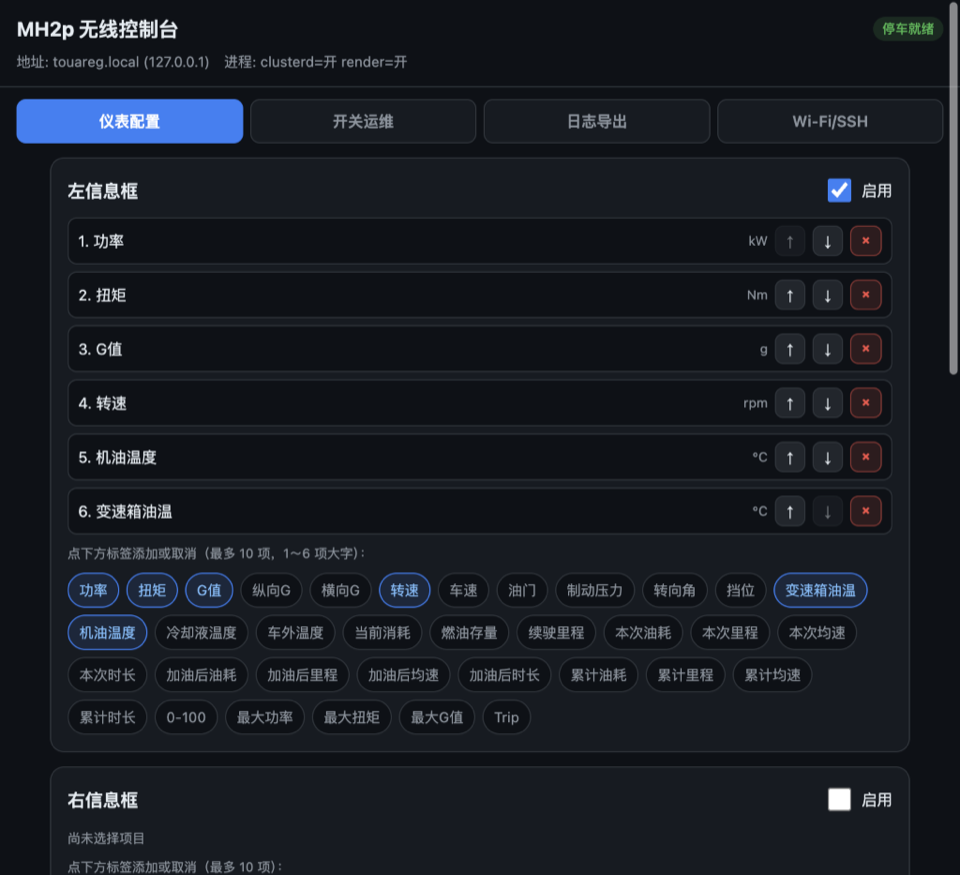

<div align="center">


# 途锐 MH2p CarPlay 改装全家桶 & 无线开发底座

<p>
  <a href="https://github.com/a78c7/touareg-cn-carplay-mods/releases/latest"></a>
  <a href="docs/README.md"></a>
  <a href="#手机无线控制台与-ai-自由开发"></a>
  <a href="docs/07-无线控制台与SSH开发.md"></a>
  <a href="#许可证"></a>
</p>

**不拆一粒螺丝、无需专用网卡 —— 单 U 盘解锁途锐全屏 / 无线 / HUD / 仪表地图与大字运动信息框，支持手机 `8080` 离线无线升级（OTA）、一键脱敏诊断、3 次崩溃自动安全模式与 GLES2 60fps 独立仪表底座。**

当前主线 **v22.0**（最新版见 **[Releases](https://github.com/a78c7/touareg-cn-carplay-mods/releases/latest)** · 皮肤与配置交流见 **[Discussions](https://github.com/a78c7/touareg-cn-carplay-mods/discussions)**）

<p>
  <a href="https://github.com/a78c7/touareg-cn-carplay-mods/releases/latest"><b>📦 下载最新版 U 盘包 &amp; OTA</b></a> ·
  <a href="#4-步免拆刷入安装"><b>⚡ 4 步安装</b></a> ·
  <a href="#11-大可选功能全景"><b>🧩 功能清单</b></a> ·
  <a href="#手机无线控制台与-ai-自由开发"><b>📱 无线 OTA &amp; AI 开发</b></a> ·
  <a href="docs/README.md"><b>📚 MH2p 开发手册</b></a> ·
  <a href="#免责声明"><b>⚠️ 免责声明</b></a> ·
  <a href="#vw-touareg-cn--mh2p-open-cockpit"><b>🇺🇸 EN</b></a> ·
  <a href="#vw-touareg--mh2p-open-cockpit-deutsch"><b>🇩🇪 DE</b></a>
</p>

</div>

---

## 演示与仪表视觉效果

https://github.com/user-attachments/assets/618e8fe2-e579-4aed-b9de-ab50b8576374

<div align="center">
  <sub><i>上方视频可点击有声播放（中英双语字幕） · 收藏最高画质可下载 <a href="https://github.com/a78c7/touareg-cn-carplay-mods/releases/download/v22.0/touareg-cockpit-demo-1080p60.mp4"><b>🎞️ 1080p 60fps 演示母带 (67 MB)</b></a></i></sub>
  <br>
  <sub><i>注：视频前段多套定制仪表为基于本仓库 <code>1920×639</code> 独立图层与 10Hz 实时通道的扩展演示；当前 U 盘包内置「全屏 CarPlay 地图 + 295px 对称大字运动信息框（10Hz + <code>smooth=1</code> 阻尼平滑）与导航卡」及独立 GLES2 60fps 动画通道（<code>gles60.c</code>），并开放电脑端离线预览器 <code>tools/preview/index.html</code> 与无线控制台/SSH 自由定制。</i></sub>
</div>

<br>

<div align="center">
  
  <br>
  <sub><i><b>仪表视觉示意图</b>：中央为手机 CarPlay 实时导航地图（车标自动居中），左右为严格等宽对称（<code>295×344px</code>）的大字运动信息框与大字导航信息卡，严丝合缝对齐左下挡位与右下车速斜边。</i></sub>
</div>

---

> [!IMPORTANT]
> **适用车型、防倒卖与安全边界（必读）**
> - **国行途锐 P 版全系自动通刷（`MH2p_CN_VWG36_P*`）**：全屏 CarPlay、导航上 HUD、仪表地图与信息框、OK 切地图、语音键短按唤 Siri、5GHz 修复均已放开至国行途锐全部 `P` 版固件（如 `P2878`、`P2876`、`P2838`、`P9832` 等），非国行途锐 P 版自动跳过不改任何文件。内置 **3 次崩溃零损耗安全模式自动熔断**（覆盖 J9 HMI、`cl_probe.so`、`clusterd`/`cl_render`、`io-pkt`，正常开机零 eMMC 写入）。
> - **大众 MH2p 通用弹窗屏蔽**：`VW_NoBtAuthPopup` / `VW_NoSimPopup` 校验大众品牌（`VW`），通过共享 Bundle `98` 精准过滤弹窗，与 HUD 插件互不冲突。
> - **跨品牌同平台通用底座**：`VW_WiFi_Dev`（手机 `8080` 无线控制台 / 离线 OTA / 一键脱敏诊断 / 无线 SSH）与 **[`docs/` 平台技术手册](docs/README.md)** 适用于大众集团同平台 **MH2p（MIB2+ High）**——涵盖 **大众途锐、奥迪（A6/A7/A8/Q3/Q7/Q8/e-tron）、保时捷（PCM 5）、宾利、兰博基尼（Urus LIS III）**。
> - **免费开源，严禁任何形式的转售或高价代刷**：本项目遵循 **PolyForm Noncommercial 1.0.0 + [附加条款](LICENSE.ADDITIONAL-TERMS.md)**，严禁售卖程序与安装包，非官方协助安装仅可收取合理劳务费（上限 ¥100）。如果您是花钱买到压缩包的，请立即退款！

---

## 11 大可选功能全景

> 所有模块默认保存在 `USB/未选模块/`（**默认全部未开启**），均通过电脑端「改装设置」按需勾选**安装 / 卸载 / 不处理**，依赖关系自动弹窗联动。

| 分类 | 模块名称 | 核心效果 | 适用范围 |
| :--- | :--- | :--- | :---: |
| **中控与投屏** | **🖥️ 全屏 CarPlay** | 车机端就地修补 38 字节去掉黑边，铺满整块中控屏（自动校验皮肤 CRC32，不符安全跳过） | 国行途锐 P 版 |
| | **📡 无线 CarPlay** | 开启原厂未激活的无线 CarPlay（集成 LawPaul 模块） | MH2p 通用 |
| | **🤖 Android Auto** | 开启原厂未激活的安卓投屏（集成 LawPaul 模块） | MH2p 通用 |
| **HUD 与仪表** | **🧭 导航上 HUD** | 苹果/高德/百度转向箭头、距离、路名、车道直投 HUD（全新洁净室自研有线 iAP2 + 无线双栈） | 国行途锐 P 版 |
| | **🗺️ 仪表地图 + 大字运动信息框** | CarPlay 地图投射 `1920×639` 全液晶仪表（高德自动居中、方向盘缩放）；左右 `295px` 对称 **46px 粗体 + 10Hz 阻尼平滑运动刻度条**（43 项实车物理数据）、**大字导航卡**与独立 **GLES2 60fps 动画引擎**（试验） | 国行途锐 P 版 |
| | **🔄 方向盘 OK 双击切原车地图** | 方向盘右侧 `OK` 键 2 秒内连按 2 下，在 CarPlay 地图与原车地图间无缝秒切（`VW_HUD_4_OkMapSwitch`） | 国行途锐 P 版 |
| | **🎙️ 方向盘语音键短按唤 Siri** | 连接 CarPlay 时短按方向盘语音键直接唤出 Siri，不用再长按 2 秒（原厂长按不受影响；`VW_HUD_5_SiriShortPress`） | 国行途锐 P 版 |
| **无线与运维** | **📱 手机无线控制台（OTA + 诊断 + 可选 SSH）** | 手机热点打开 `http://touareg.local:8080` 秒改信息框、调车标、**离线 `.tar` 无线升级与一键回滚**、**一键下载脱敏诊断包**、查看/清除安全模式；可选开 `2012` 无线 SSH 供 AI 自由开发 | MH2p 通用 |
| **修复与降噪** | **📶 升 P2878 无线 5GHz 修复** | 仅旧固件（如 P9832）升级 P2878 后有线正常但无线连不上时勾选（解除 `enable5GHzCountryAdaption` 拦截） | 国行途锐 P 版 |
| | **🔕 去除蓝牙「输入用户名」弹窗** | 共享 Bundle `98` 仅拦截蓝牙 OBEX 认证弹窗（`Busrlo`），不影响通话、音乐与 CarPlay | 大众 MH2p |
| | **🔕 屏蔽「SIM 仅用于数据」弹窗** | 共享 Bundle `98` 仅拦截连接投屏时的 `PHONE_SIM_DATAONLY` 提示，不影响联网与 SOS | 大众 MH2p |

<details>
<summary><b>💡 新手 2 秒抄作业：不知道怎么选？点这里看推荐组合</b></summary>

| 车主类型 | 推荐勾选模块 | 说明 |
| :--- | :--- | :--- |
| **大多数途锐车主（闭眼入）** | 在配置器点一键 **「驾驶推荐全套」**（全屏 + 无线 CarPlay + HUD + 仪表地图 + OK 双击切地图），习惯用 Siri 再补勾 **「语音键短按唤 Siri」** | 兼顾日常导航体验与原车地图随时切回 |
| **想手机调仪表 + 以后无线升级免拔盘** | 在上面基础上再勾选 **「手机无线控制台」**（普通车主不用勾 SSH） | 以后调信息框、升级新版（OTA）、导诊断包全在手机浏览器搞定 |
| **被烦人弹窗困扰** | 按实际弹窗按需补勾 **「去除输入用户名弹窗」** 或 **「屏蔽 SIM 提示」** | 两项独立生效，互不冲突 |
| **从 P9832 等老固件升上来连不上无线** | 补勾 **「老固件升 P2878 无线 CarPlay 5GHz 区域修复」** | 原厂 P2878 无线正常无需勾选 |

</details>

---

## 4 步免拆刷入安装

1. **准备 U 盘**：容量 **32GB 以内**，格式化为 **FAT32**（Windows：右键格式化；Mac：磁盘工具 → 抹掉 → `MS-DOS (FAT)`）。
2. **解压到 U 盘根目录**：从 **[Releases](https://github.com/a78c7/touareg-cn-carplay-mods/releases/latest)** 下载最新 `zip`，把压缩包里的**全部内容直接放进 U 盘第一层**（切勿多套一层外层文件夹）：
   ```text
   U盘根目录/
   ├── Data/                          ← 必须直接位于 U 盘第一层
   ├── Meta/                          ← 必须直接位于 U 盘第一层
   ├── Mods/                          ← 默认为空，由配置器自动移入已选模块
   ├── 未选模块/                       ← 存放全部 12 个待选模块目录
   └── 改装设置（Windows）.exe / （Mac）.command
   ```
3. **【必做】运行「改装设置」勾选并保存**：双击 U 盘根目录的 **`改装设置（Windows）.exe`** 或 **`改装设置（Mac）.command`**（**不运行直接插车会空刷、不会安装任何模块**）：
   - 在本地离线网页里直接点快捷预设或逐项选 **「安装 / 卸载 / 不处理」**，点选拖拽左右信息框与大字导航卡；
   - 若开启「手机无线控制台」，填好手机热点和 4～8 位管理口令 → 点击 **「保存到 U 盘」**（Mac 版自动清掉 `._*` 隐藏文件）。
4. **上车自动刷入**：安全弹出 U 盘 → **发动车辆** → 插入扶手箱 USB 口。约 10 秒后车机自动重启刷机（全程数分钟、会自动重启几次，**期间请勿操作车机**）→ 屏幕提示移除介质后拔出即生效。

> [!TIP]
> - **未签名提示**：桌面配置器未购商业签名，Windows 点「更多信息 → 仍要运行」；Mac 在「系统设置 → 隐私与安全性」点「仍要打开」。程序仅监听本机 `127.0.0.1` 修改当前 U 盘，**绝不联网**，源码见 [`tools/configurator`](tools/configurator)。
> - **旧版升级与黑边**：已刷过旧版直接覆盖刷入即可，原有的车标校准 `cl.conf` 自动保留；首次刷完若 CarPlay 仍有黑边，在 iPhone 蓝牙/CarPlay 设置里「忘记此车辆」重连一次即可。

<details>
<summary><b>🖥️ 点击展开查看：电脑端「途锐改装设置 v22」离线可视化界面</b></summary>
<br>
<div align="center">
  
</div>
</details>

---

## 手机无线控制台与 AI 自由开发

`VW_WiFi_Dev` 利用车机闲置的 `bcm2` 客户端接口静默连入手机热点（RSDB 并发不占无线 CarPlay、不改原车 `ecm0` 4G 车联网），彻底告别有线网卡和反复拔插 U 盘：

<div align="center">
  
  <br>
  <sub><i>手机连热点打开 <code>http://touareg.local:8080</code>：停车安全锁保护、43 项分类选配与大字预设、运动条/导航卡/车标调节、行车记录 CSV 无线下载。</i></sub>
</div>

### 1. 普通车主：零命令行，手机浏览器秒改配置、离线无线升级与一键脱敏诊断
- 在「改装设置」里把 **「手机无线控制台」** 选为安装（无需勾选 SSH），填入 1～3 个常用手机热点（自动处理中文名十六进制编码与 iPhone 弯撇号 `’`）及 4～8 位管理口令。
- 上车打开手机个人热点（**iPhone 首次请开启「最大兼容性」并在「设置 → 个人热点」页亮屏等 3～5 秒**；安卓选 WPA2），车机开机约 1 分钟后自动连入。
- 手机浏览器访问 **`http://touareg.local:8080`**（首次输一次口令自动记住），停车时（车速 ≤ 3 km/h）直接改信息框、开关平滑动画/Siri 短按/独立 60fps 模式，支持：
  - **离线无线升级（OTA）与一键回滚**：下载官方 Release 的 `touareg-ota-*.tar` 在网页一键上传，自动 SHA-256 校验、白名单落盘并备份旧版，以后升级核心程序免插拔 U 盘；
  - **一键脱敏诊断包**：在「日志导出」页一键下载 `touareg_diag_sanitized.txt`（自动抹去 Wi-Fi 密码、口令、SSH 密钥、手机号与 VIN），发群/提 Issue 一步到位；
  - **3 次崩溃安全模式可视管理**：异常触发熔断时顶部自动高亮提示，排除问题后可一键清除锁并刷新基线。

### 2. 傻瓜式无线 SSH + AI 自由开发（含车机硬件与渲染护栏）

想用电脑上的 **[DeepSeek Harness](https://github.com/deepseek-ai/deepseek-harness)**（或 Claude Code / Cursor），或者只带一部安卓手机用 **[DSH Go](https://github.com/ccch1mneyyy/dsh-go)**（DeepSeek Harness 安卓端，iPhone 暂无公开包）无线直连车机自定义仪表，只需 **3 步**：

1. **拿本车专属私钥**：在「改装设置」里安装无线控制台时勾上 **「同时开启 SSH 无线开发终端（端口 2012）」** 并保存，桌面自动生成 `途锐无线SSH密钥/touareg_ed25519`（私钥不留在 U 盘里）。
2. **开热点连车机**：发动车辆并打开手机个人热点等待约 1 分钟（若手机开了全局 VPN/代理，请先关闭或绕过局域网）。
3. **把私钥和下面整段提示词直接发给 AI**（已内置车机资源与渲染硬护栏，防止 AI 写卡画面或写伤闪存）：

<details>
<summary><b>🤖 点击展开并一键复制：发给 AI 助手的无线连车安全指令（v22.0 含硬件与渲染护栏）</b></summary>

```text
这是我车机的 SSH 私钥文件 `touareg_ed25519`（电脑默认在桌面 `途锐无线SSH密钥/` 文件夹，安卓手机端请直接读取我上传或放在 Download 目录下的 `touareg_ed25519`）。
请你自己读取这把私钥并配置保存好车机 SSH 连接（端口 `2012`，用户名 `root`）：
- 先尝试连接 `touareg.local:2012`；如果当前系统（如安卓端）不解析 `.local`，请你自动读取本机热点路由/ARP 邻居表或扫描当前热点子网开放 `2012` 端口的设备找到车机 IP 并连上，无需让我手动查 IP 或填配置。

车机环境、硬件资源与渲染安全护栏（请严格遵守，不可违背）：
1. 系统是 QNX 6.6.0 (ARMv7 Tegra K1，总内存约 2 GB)，shell 是 ksh（无 bash / sed -i / wc）。
2. 严禁改动原厂只读分区（/ifs、/mnt/system），不要频繁重载 pfctl 避免冲击 io-pkt；锁车后整机随 CAN 休眠断电，禁止干扰车机电源管理。
3. 内存与 eMMC 寿命红线：`/tmp` 是内存盘，严禁往 `/tmp` 塞大文件、视频或无限增长日志；严禁高频周期性写 `/mnt/app` 或 `/mnt/ota` 闪存（实时遥测全部在 `/tmp/dash.state` 与 `/tmp/cluster_cp.state`）。
4. `/mnt/app` 默认只读：改文件前先 `mount -uw /mnt/app` 并备份原文件，用 `.new` 写完原子 `mv` 替换后立刻 `sync && mount -ur /mnt/app` 恢复只读；改完仪表配置执行 `slay -f cl_render` 秒级刷新（无需重启车机）。
5. 渲染架构与帧率护栏（极重要）：
   - `cl_render` 的 `capture=h264` 地图模式走 NVDEC 硬解 + `screen_blit`，`dash.c` 是 CPU 软渲两侧 295×344 小框（开启 `smooth=1` 即可流畅显示数字与运动条）；**严禁在 `dash.c` 里用 CPU 循环做 1920×639 全屏复杂动画**，必然掉帧发卡！
   - 若要开发全屏 60fps 动效仪表、指针或粒子主题，必须走 `src/cl_render/gles60.c` 的 OpenGL ES 2.0 硬件加速通道（`capture=gles60`，窗口 `58`，`eglSwapInterval(dpy, 1)`，通过 `eglGetProcAddress` 动态解析 `gl*` 函数，绝不直接链接 `-lGLESv2`）。
   - 车机已启用 3 次崩溃安全模式熔断（`/mnt/app/eso/bin/apps/cluster/safe_mode` 或 `/tmp/vw_*_safe_mode`），改动前请先用电脑端 `tools/preview/index.html` 本地验证。
6. 完整接口表与开发界限见公开仓库：https://github.com/a78c7/touareg-cn-carplay-mods/tree/main/docs

现在请自动连上车机，只读查看一下当前车速/油温、安全模式状态和已安装的模块，向我汇报连接成功，然后听我用大白话吩咐修改。
```

</details>

---

## 日常使用、离线预览、高德说明与排障

- **仪表与 HUD**：仪表按方向盘 `VIEW` 键切到导航页，连上 CarPlay 后自动投屏（两侧原厂圆表盘可在车机设置里隐藏），夜间模式同步变深色；开 ACC 时地图自动上移避让辅助驾驶图标。
- **方向盘快捷操作**：选装 `VW_HUD_4_OkMapSwitch` 后，地图页且 CarPlay 在线时 **2 秒内连按 2 下右侧 `OK` 键**秒切原车/CarPlay 地图；选装 `VW_HUD_5_SiriShortPress` 后，CarPlay 在线时**短按方向盘语音键**直接唤出 Siri（无需长按 2 秒）。
- **电脑端离线预览与车友配置分享（`tools/preview/index.html` + GitHub Discussions）**：直接双击打开仓库里的 [`tools/preview/index.html`](tools/preview/index.html)，无需上车即可在浏览器按 `1920×639` 精确预览 `dash.conf` 布局、对比 `smooth=1` 阻尼动画与 5Hz 跳格、或拖入真实行车 CSV 回放并一键截屏。欢迎将你调好的 `dash.conf` 与效果图发布到 **[GitHub Discussions](https://github.com/a78c7/touareg-cn-carplay-mods/discussions)** 共享给其他车友！

<details>
<summary><b>📼 进阶（可选）：10Hz 行车记录 U 盘（绝大多数车主无需此功能）</b></summary>

- 普通车主刷完改装包直接拔走 U 盘即可，不需要开启行车记录。
- 仅当你希望记录 34 项真实物理传感器 CSV 供 AI 复盘或拖入 `tools/preview/index.html` 回放时，在「改装设置」展开底部的 **「进阶工具：U 盘用途切换」** 点 **「改成行车记录 U 盘」** 后常插扶手箱（已装「导航上 HUD」时自动后台写入 `drive_logs/`，每小时约 5 MB，不再触发刷机）。
- **介质提醒**：长期插车写入请务必使用**品牌正品 U 盘**（如闪迪 / 三星 / 铠侠），避免车辆突然断电导致杂牌 U 盘 FAT32 分区损坏。

</details>

<details>
<summary><b>📍 高德地图在 CarPlay 仪表上的已知特性与适配说明</b></summary>

- **车标左右偏（已默认开启画面自动居中）**：高德导航会把车标往目的地侧偏移约 3 cm；改装默认每秒识别画面车标，偏约 3 秒自动挪回时钟正下方（仅对高德生效，苹果/百度不受影响）。
- **比例尺自动缩放**：导航中高德会随车速与路口自动改回比例尺，方向盘上下键缩放为临时生效。
- **车道指引**：高德不通过 CarPlay 下发车道数据，需要 HUD / 导航卡车道指引可使用百度地图。
- **偶发开机停在原车地图**：iPhone 未响应第二屏请求，断开 CarPlay 重连一次即可恢复。

</details>

<details>
<summary><b>🔧 卸载还原、5GHz 无线修复与提 Issue 附日志</b></summary>

- **一键卸载还原**：运行「改装设置」把要移除的模块选为 **「卸载」** 保存后插车刷一次即精准还原（手动卸载需先将对应目录从 `未选模块/` 移回 `Mods/` 再放空文件 `uninstall.txt`；卸载 HUD 时需连同仪表地图、OK 切地图与语音键短按 Siri 一并卸载）。
- **插 U 盘没反应 / 刷完没变化**：确认 U 盘为 **≤ 32GB FAT32**、`Data`/`Meta` 直接在根目录，且**已运行「改装设置」将所选模块移入 `Mods/`**；排查日志看 U 盘 `Logs/` 对应 `.log`（`_ModKit_Update.log` 中的 `Filename too long` 可忽略）。
- **老固件升 P2878 后无线 CarPlay 连不上**：在「改装设置」勾选 **「老固件升 P2878 无线 CarPlay 5GHz 区域修复」** 刷入，再于车机和 iPhone 双端忘记设备重新配对（详见 [#7](https://github.com/a78c7/touareg-cn-carplay-mods/issues/7)）。
- **提 Issue 附日志**：已装无线控制台的车主直接在 `http://touareg.local:8080` → **日志导出**点 **「下载脱敏诊断包」**（自动抹除密码/口令/VIN/手机号）；无无线模块时在 U 盘根目录建 `cluster_logs` 文件夹插车 2 分钟提取。切勿公开与本车绑定的 `backup` 目录。

</details>

---

## MH2p 跨品牌开发文档与源码架构

原开发笔记仓库 `vw-mh2p-dev-notes` 已完整并入 **[`docs/`](docs/README.md)**，每条结论均标注 **【途锐特有】** 或 **【MH2p 通用】**，供大众、奥迪、保时捷、宾利、兰博基尼同平台开发者查阅：

| 开发实战记录（[`docs/01~07`](docs/README.md)） | MH2p 平台参考手册（[`docs/reference/`](docs/reference/README.md)） | 核心源码目录（[`src/` & `tools/`](src)） |
| :--- | :--- | :--- |
| • [01 调试环境与工具](docs/01-调试环境与工具.md)<br>• [02 CarPlay 导航上 HUD](docs/02-CarPlay导航上HUD.md)<br>• [03 CarPlay 地图上仪表](docs/03-CarPlay地图上仪表.md)<br>• [04 仪表信息框与行车记录](docs/04-仪表信息框.md)<br>• [05 全屏补丁与 U 盘包](docs/05-全屏CarPlay与U盘包.md)<br>• [06 给其他车型的建议](docs/06-给其他车型的建议.md)<br>• [07 无线控制台与 SSH 开发](docs/07-无线控制台与SSH开发.md) | • [R1 QNX 分区、进程、ModKit 与防火墙](docs/reference/R1-系统结构与文件位置.md)<br>• [R2 HMI（J9 Java 插件与 BAP）](docs/reference/R2-HMI-J9-Java.md)<br>• [R3 DSI 车辆数据属性实测表](docs/reference/R3-车辆数据接口.md)<br>• [R4 显示屏编号、图层与 dmdt](docs/reference/R4-显示系统.md)<br>• [R5 CarPlay / iAP2 双栈协议](docs/reference/R5-CarPlay与iAP2.md) | • [`src/hud-java`](src/hud-java)：HMI OSGi 插件与 43 项遥测采集<br>• [`src/popup-filter-java`](src/popup-filter-java)：共享 Bundle 98 弹窗过滤器<br>• [`src/cluster-probe`](src/cluster-probe)：双屏解密与有线 Cinemo 钩子<br>• [`src/clusterd`](src/clusterd)：仪表切屏与安全区守护<br>• [`src/cl_render`](src/cl_render)：H.264 硬解、运动信息框与导航卡<br>• [`src/vhpatch`](src/vhpatch)：全屏 CarPlay 就地补丁器<br>• [`src/touareg_netd`](src/touareg_netd)：mDNS 与 `8080` 无线控制台<br>• [`tools/configurator`](tools/configurator)：跨平台本地「改装设置」 |

---

## 社区引用与致谢

- **[luanqibazao0123-bot](https://github.com/luanqibazao0123-bot)**（[#7](https://github.com/a78c7/touareg-cn-carplay-mods/issues/7)）：启发了 `v21` 大字运动刻度信息框视觉重构，并提供了老固件升 `P2878` 实测线索。
- **海外社区引用**：已被德国途锐论坛 **Touareg-Freunde** 的 [欧版 MH2p P2869 仪表投屏项目帖](https://www.touareg-freunde.de/forum/thread/30309-geschafft-apple-carplay-im-digitalen-kombiinstrument-des-touareg-cr-mh2p-p2869/)引用参考。
- **[LawPaul / MH2p SD ModKit](https://github.com/LawPaul/MH2p_SD_ModKit)**（[官网](https://lawpaul.github.io/MH2p_SD_ModKit_Site/)）：免拆 U 盘刷机框架及可选 `AppleCarPlay` / `AndroidAuto` 模块（[CC BY-NC-SA 4.0](LICENSES/MH2p_SD_ModKit_LICENSE.md)，其中安卓修复引用了 [fifthBro/pcm5-androidauto-connect-fix](https://github.com/fifthBro/pcm5-androidauto-connect-fix)）。
- **[fifthBro / mh2p-cluster](https://github.com/fifthBro/mh2p-cluster)** & **[mh2p-ssh-access](https://github.com/fifthBro/mh2p-ssh-access)**：`dio_cluster.so`（v0034）与 `cl_render` 上游基础（[CC BY-NC-SA 4.0](LICENSES/fifthBro_mh2p-cluster_LICENSE.md)）。
- **[davecozens / touareg-carplay](https://github.com/davecozens/touareg-carplay)**：全屏几何数值参考；**[luka-dev](https://github.com/luka-dev)**：`mib2q-carplay-rgi`（GPL-3.0）、`jxe2jar`、`qnx65-armv7-toolchain`。

## 许可证

- **本仓库原创代码**（`src/hud-java`、`src/popup-filter-java`、`src/cluster-probe/` 含自研有线 iAP2 解析器 `cl_wired_rg.c`、`src/clusterd`、`src/touareg_netd`、`src/vhpatch`、`src/common`、`tools/`、模块脚本）：采用 **[PolyForm Noncommercial 1.0.0](LICENSE) + [非商业附加条款](LICENSE.ADDITIONAL-TERMS.md)**。`docs/` 文档文字允许按 **CC BY-SA 4.0** 署名共享。
- **第三方开源组件**：`src/cl_render`、`dio_cluster.so`、ModKit 及 LawPaul 模块遵循 **CC BY-NC-SA 4.0**（详见 [THIRD_PARTY_NOTICES.md](LICENSES/THIRD_PARTY_NOTICES.md)）；`dash_font.h` 预渲染字形基于 Noto Sans CJK SC（[SIL OFL 1.1](LICENSES/NotoSansCJK_OFL.md)）；`stb_truetype.h` 为公有领域（[Public Domain](LICENSES/stb_PUBLIC_DOMAIN.md)）；`vhpatch` 静态链接 `zlib 1.3.1`（[zlib License](LICENSES/zlib_LICENSE.md)）。
- **非商业与反倒卖边界声明**：**整个 U 盘发布包与无线 OTA 包仅供个人非商业学习与使用，严禁商用、售卖安装包或捆绑收费**；非官方协助车主安装仅可收取合理劳务费（上限 ¥100）并须告知开源免费来源，且本程序在桌面配置器、车机 `8080` 控制台与刷机脚本中均内嵌免费开源声明。本仓库全部原创代码与自研 `VW_*` 模块不含任何大众或苹果受版权保护的原厂文件；可选的第三方 `AppleCarPlay` / `AndroidAuto` 模块原样引用自上游 LawPaul `MH2p_SD_ModKit`（默认未开启，按需选装）。

## 免责声明

1. **非官方**：个人业余研究项目，与大众、奥迪、保时捷、宾利、兰博基尼、苹果、谷歌、高德等公司无任何关联或授权关系。
2. **按现状公开**：代码、U 盘包和文档按“现状”提供，不作任何明示或暗示保证。
3. **风险自负**：刷机改装可能导致车机/仪表异常、丧失原厂保修或不符合当地法规，**一切直接或间接后果均由使用者自行承担**。
4. **行车安全**：严禁驾驶时操作手机控制台或车机设置；信息框数据仅供参考，车速与告警灯一律以原车仪表为准。
5. **严禁商用与高价倒卖**：作者不提供付费刷机或远程协助；任何转售、打包收费行为均违反 [PolyForm Noncommercial 1.0.0](LICENSE) 与[附加条款](LICENSE.ADDITIONAL-TERMS.md)并与作者无关。
6. **权利人联系**：如相关权利人认为内容涉及合法权益，请通过 [Issue](https://github.com/a78c7/touareg-cn-carplay-mods/issues) 联系，核实后及时处理。

---

## VW Touareg (CN) & MH2p Open Cockpit

One zero-disassembly USB flash for China-market VW Touareg P-series units (`MH2p_CN_VWG36_P*` — full end-to-end verified on `P2878`, auto-probing & safe-skipping incompatible sub-patches on other CN `P*` builds, and skipping non-CN/other vehicles), plus an open wireless web console, offline OTA updater, and SSH development base for **MH2p (MIB2+ High)** units across **VW, Audi, Porsche PCM 5, Bentley, and Lamborghini**:

- **11 Opt-in Modules (all disabled by default under `USB/未选模块/`, independently installable & uninstallable)**: Full-screen CarPlay (38-byte in-place patch), wireless CarPlay & Android Auto (upstream LawPaul modules), HUD turn-by-turn (wireless `libesoiap2` & clean-room wired Cinemo iAP2), `1920×639` cluster map with vision-based AMap centering, `OK` double-tap stock-map toggle (`VW_HUD_4_OkMapSwitch`), steering-wheel voice short-press Siri (`VW_HUD_5_SiriShortPress`), symmetrical `295px` **46px bold telemetry boxes with 10 Hz damped sport gauge bars (`smooth=1`, 43 real DSI channels)**, **large-font navigation card** (`nav_box=1/2`), standalone **60 fps GLES2 animation engine** (`gles60.c`), `VW_Wireless5GHzFix`, and shared Bundle 98 popup filters (`VW_NoBtAuthPopup` / `VW_NoSimPopup`).
- **Wireless Console, Offline OTA & Zero-Wear Safe Mode (`VW_WiFi_Dev`)**: Connects via idle `bcm2` STA (`dhcp.client -n -R`, preserving 5 GHz RSDB wireless CarPlay and `ecm0` telematics). Open `http://touareg.local:8080` (PIN-protected, parked-only lock) for live config, SHA-256 verified allowlisted `.tar` offline OTA & one-click rollback, one-click sanitized diagnostic bundle download, 3-crash zero-wear safe-mode management, or optional key-only **Wireless SSH (`:2012`)**. Preview layouts locally via [`tools/preview/index.html`](tools/preview/index.html).
- **Install**: Format a ≤ 32 GB **FAT32** USB drive → extract the [latest release zip](https://github.com/a78c7/touareg-cn-carplay-mods/releases/latest) to the USB root → **run `改装设置（Windows）.exe` or `改装设置（Mac）.command` to select modules & save (required, as all modules default to off)** → start engine, insert USB, wait for reboots, remove when prompted.
- **Docs & License**: Full Chinese engineering docs (`01–07`) & platform reference (`R1–R5`) in [`docs/README.md`](docs/README.md). Original code licensed under **PolyForm Noncommercial 1.0.0** + [Additional Terms](LICENSE.ADDITIONAL-TERMS.md); third-party components per `LICENSES/`. **Personal, non-commercial use only; strict anti-resale; use entirely at your own risk.**

---

## VW Touareg & MH2p Open Cockpit (Deutsch)

Ein-USB-Stick-Modifikationspaket ohne Ausbau für den **VW Touareg III (CR)** mit **MH2p-Steuergerät (MIB2+ High)** sowie offene drahtlose Web-Konsole, Offline-OTA & SSH-Entwicklungsbasis für **VW, Audi, Porsche (PCM 5), Bentley und Lamborghini (LIS III)**:

- **11 optionale Module (standardmäßig alle deaktiviert unter `USB/未选模块/`, einzeln installier- und deinstallierbar)**: Vollbild-CarPlay (38-Byte-In-Place-Patch), Wireless CarPlay & Android Auto (LawPaul), HUD-Abbiegehinweise (Wireless & Clean-Room Wired Cinemo), `1920×639` Kombiinstrument-Karte inkl. **OK-Doppelklick-Umschaltung (`VW_HUD_4_OkMapSwitch`)** & **Sprachtaste-Kurzdruck-Siri (`VW_HUD_5_SiriShortPress`)**, symmetrische `295px` **Großschrift-Sport-Infoboxen mit 10-Hz-gedämpften Balken (`smooth=1`, 43 echte DSI-Kanäle)**, **Großschrift-Navigationskarte** (`nav_box=1/2`), eigenständige **60-fps-GLES2-Engine (`gles60.c`)**, `VW_Wireless5GHzFix` sowie gemeinsame Bundle-98-Popup-Filter (`VW_NoBtAuthPopup` / `VW_NoSimPopup`).
- **Drahtlose Web-Konsole, Offline-OTA & 3-Crash-Safe-Mode (`VW_WiFi_Dev`)**: Hintergrundverbindung über `bcm2` (`http://touareg.local:8080`, PIN-geschützt, Park-Sperre > 3 km/h) mit SHA-256-geprüftem Offline-OTA + Rollback, anonymisiertem Diagnosepaket, 3-Absturz-Schutzschaltung (ohne eMMC-Verschleiß) und optionalem Key-only **WLAN-SSH (`:2012`)**.
- **Hinweis für EU-Fahrzeuge (z. B. `P2869`)**: Touareg-UI-Skripte prüfen auf chinesische P-Stände (`MH2p_CN_VWG36_P*`) und brechen auf EU-/anderen Ständen sicher ohne Änderungen ab; Architektur, `docs/` (`01–07`, `R1–R5`), Quellcode (`src/`), `tools/preview/index.html` und `VW_WiFi_Dev` dienen direkt als Basis (siehe auch [Touareg-Freunde-Thread](https://www.touareg-freunde.de/forum/thread/30309-geschafft-apple-carplay-im-digitalen-kombiinstrument-des-touareg-cr-mh2p-p2869/)).
- **Lizenz & Haftungsausschluss**: Eigener Code unter **PolyForm Noncommercial 1.0.0** + [Zusatzbedingungen](LICENSE.ADDITIONAL-TERMS.md); Drittkomponenten gemäß `LICENSES/`. **Ausschließlich für den privaten, nicht-kommerziellen Gebrauch; Weiterverkauf streng untersagt; Nutzung auf eigene Gefahr.**
