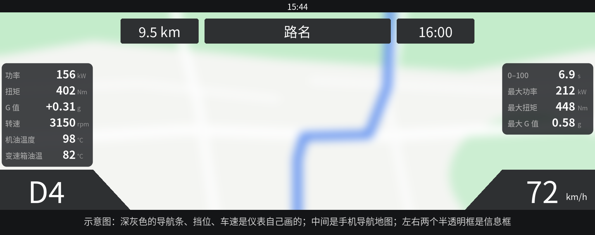
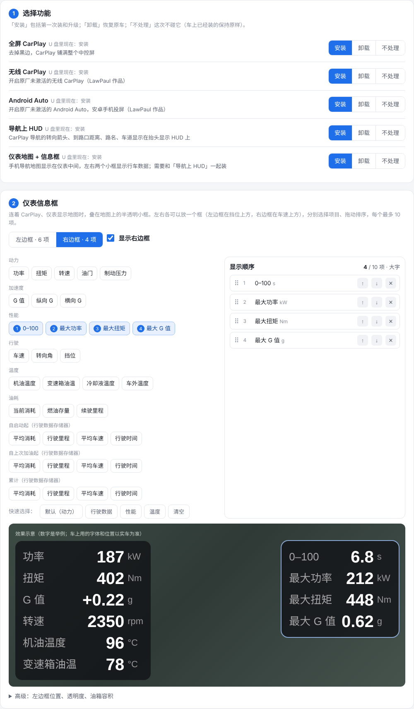
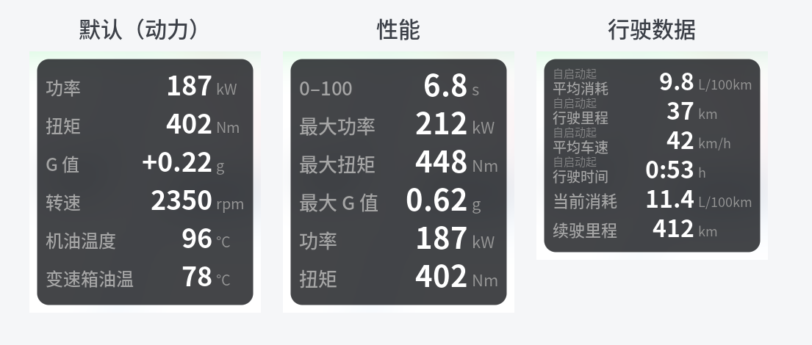

# 途锐中国版 CarPlay 改装合集：全屏 + 无线 + Android Auto + 导航上 HUD + CarPlay 地图上仪表 + 自定义仪表信息框

让中国版大众途锐（MH2p 车机）用一个 U 盘一次刷入五项改装。**当前版本 v19.3**（main 上的 v19.4：修复仪表地图偶尔不显示，高德转向补偿默认关；未发布）（ACC 时车标上移、显示原车界面时 CarPlay 不再断开，尚未上车实测）。

> **v19.1**：修复 U 盘安装脚本里的一道安全检查（车机没有 `wc` 命令，导致检查被跳过），功能和 v19 相同，刷过 v19 且正常的车不用重刷。

> **v19 新增**
> - **右边也能放信息框**：仪表右下角车速框上方可以再放一个框，和左边一样从 30 多项里任选、拖动排序，左右各自独立（例如左边放实时功率/扭矩/G 值，右边放 0–100 和最大值）。两个框字号相同、高度相同（项目少的框下面留空），左右对称。「改装设置」里点「左边框 / 右边框」切换编辑。
>
> **v18 新增**
> - **0–100 计时和本次最大值**：信息框可选「0–100」（起步后显示计时，过 100 km/h 显示成绩）、「最大功率」「最大扭矩」「最大 G 值」（车机开机以来）。
> - **行车记录**：「改装设置」里一键把 U 盘改成「行车记录 U 盘」一直插在车上，每次开车把功率、扭矩、转速、车速、油门、刹车、方向盘、加速度、挡位、油温、油耗等约 10 次/秒记到 U 盘（CSV，每小时约 5 MB），不连 OBD。
>
> **v17 新增**
> - **仪表信息框可自定义**：30 项行车数据任选，最多 10 项，**自己定显示顺序**；名称和大众行车电脑一致（当前消耗、续驶里程、自启动起 / 自上次加油起 / 累计的平均消耗、行驶里程、平均车速、行驶时间等），选得越多字号自动越小，不会挡住仪表上的挡位。
> - **「改装设置」程序**：U 盘里双击就能打开（Windows / Mac 都有），在网页里勾选每个功能"安装 / 卸载 / 不处理"、点选信息框项目并**拖动排序**，带效果预览，点保存即可，不用改文件、不用敲命令。
> - **全屏 CarPlay 改为在车上就地修改**：包里不再带任何大众文件，卸载也不依赖当初那个 U 盘。
> - v17 尚未上车实测，遇到问题可以用「改装设置」把对应功能选为卸载再刷一次，并提 Issue。

- **全屏 CarPlay**：去掉黑边，铺满整个中控屏（`Mods/VW_FullScreenCarPlay`）
- **无线 CarPlay**：开启原厂未激活的无线 CarPlay（`Mods/AppleCarPlay`，LawPaul 作品）
- **Android Auto**：开启原厂未激活的 Android Auto，安卓手机可投屏（`Mods/AndroidAuto`，LawPaul 作品）
- **CarPlay 导航上 HUD**：苹果地图 / 高德等 CarPlay 导航的转向箭头、到路口距离（带进度条）、路名、车道指引显示在抬头显示 HUD 上（`Mods/VW_HUD_1_RouteGuidance` + `Mods/VW_HUD_2_ClusterNav`）
- **CarPlay 地图上仪表**：手机导航 App 的地图画面显示在仪表中间（原车导航地图的位置），车标对准仪表时钟正下方、靠近底部（高德、苹果地图、百度地图分别校准，自动切换）；仪表上方显示剩余距离和到达时间（原车样式）；断开 CarPlay 自动回到原车地图（`Mods/VW_HUD_3_CarPlayCluster`，需要和 HUD 两个文件夹一起装）
- **仪表信息框**：叠在仪表 CarPlay 地图上的半透明小框（左边一个，v19 起右边也可以放一个），实时显示行车数据，每秒刷新 5 次。**显示哪几项、什么顺序自己选**（「改装设置」程序里点选、拖动排序），默认功率、扭矩、G 值、转速、机油温度、变速箱油温；共 30 项可选，最多 10 项，详见下面"仪表信息框说明"

> ⚠️ **非官方改装，风险自负。** 本项目只公开个人研究的方法和代码，不提供任何保证，作者不对使用后果承担责任。使用前请先读[免责声明](#免责声明)。

下载即用，已包含刷机所需的 [MH2p SD ModKit](https://lawpaul.github.io/MH2p_SD_ModKit_Site/)，不用另外准备。

*仪表上的效果示意（v19，示意图不是实拍）：中间是手机导航地图，左边框显示实时功率、扭矩等，右边框显示 0–100 和最大值；深灰色的导航条、挡位、车速是仪表原车显示。*

**只适用于车机版本 `MH2p_CN_VWG36_P2878`**，其它版本脚本会自动退出，不改动任何东西。

✅ 已在 2023 款途锐（P2878）上验证：全屏、无线、HUD（箭头、距离、路名）、仪表 CarPlay 地图（无线/有线 CarPlay，高德、苹果地图、百度地图：出图、按 VIEW 切换、断开自动恢复、车机设置切夜间后仪表同步变深色）、仪表信息框（v16）。
⚠️ 已有车主在未改装的车上用 U 盘完整刷入 v19：全屏、无线 CarPlay、HUD 正常；他反馈的仪表车标被 ACC（自适应巡航）标志挡住，v19.2 已改为开 ACC 时自动上移（尚待实车验证）。另外只在 iOS 27 上测试过。遇到问题请按下面"排查日志"收集日志并提 Issue。

**装过旧版本（touareg-cn-carplay-fullscreen，已下线）的车**：可以直接用本仓库的新 U 盘覆盖刷入，脚本会识别已装状态。卸载也可以用新 U 盘（见下面"全屏 CarPlay 是怎么改的"）。

## 安装（5 步）

1. **准备 U 盘**：找一个 32GB 以内的 U 盘，格式化为 **FAT32**（Windows：右键 U 盘 → 格式化；Mac：磁盘工具 → 抹掉 → MS-DOS (FAT)）。
2. **复制文件**：到 [**Releases**](https://github.com/a78c7/touareg-cn-carplay-mods/releases/latest) 下载 `touareg-cn-carplay-mods-版本号.zip`，解压，把**里面的全部内容**（`Data`、`Meta`、`Logs`、`Mods` 和两个「改装设置」程序）复制到 U 盘根目录。
3. **选择功能**：双击 U 盘里的 **「改装设置（Windows）.exe」** 或 **「改装设置（Mac）.command」**，浏览器里会打开设置页面：每个功能选「安装 / 卸载 / 不处理」，仪表信息框勾选要显示的项目、拖动排序，点 **「保存到 U 盘」**。程序会自动处理依赖关系、检查 U 盘格式，并清掉 Mac 复制时产生的隐藏文件（不联网，只改这个 U 盘里的文件）。全部默认安装的话这一步可以跳过（Mac 用户仍建议运行一次，用来清理隐藏文件）。

   

   - Windows 如果提示"Windows 已保护你的电脑"：点"更多信息" → "仍要运行"。
   - Mac 第一次打开会提示"无法验证开发者"：打开 系统设置 → 隐私与安全性，在下面点"仍要打开"，再双击一次（macOS 14 及以前也可以右键 → 打开）。
   - 出现这两个提示只是因为程序没有购买开发者签名。程序**不联网**，只在本机打开设置页面、只改这个 U 盘里的文件，源码在 `tools/configurator`，可放心运行。
4. **车上刷入**：先在电脑上弹出 U 盘，**发动车辆**，插入 U 盘。约 10 秒后车机自动重启并开始安装，过程几分钟，会重启几次、可能出现红色工程界面，**期间不要操作车机**。
5. **拔掉 U 盘**：屏幕提示移除介质时拔出 U 盘，车机重启后连接 CarPlay 即可。无线连接：iPhone 设置 → 通用 → CarPlay → 选择车辆，或在车机里添加手机。如果仍有黑边，在 iPhone 上"忘记此车辆"后重新连接。

不想用程序也可以手动：把不要的模块文件夹从 U 盘 `Mods` 里删掉（或移到别处）再刷；依赖关系：`VW_HUD_1` + `VW_HUD_2` 要一起；`VW_HUD_3`（仪表地图）需要 HUD_1、HUD_2 也在。

### CarPlay 导航上 HUD 说明

- 装好后连 CarPlay，在苹果地图或高德里开始导航，**等约 1 分钟**（车机开机后组件要等界面完全启动），HUD 出现箭头、距离和路名。
- 路名会自动去掉"进入"等前缀；没有名字的路显示"无名道路"（HUD 和仪表顶部同一行）。
- 车道指引只在地图有车道数据的路口出现（大路口、高架、高速出入口）。
- 只装 HUD 不装仪表地图时，仪表中间会显示"导航已在移动设备上激活"，这是原车行为；装了仪表地图后这条提示会被去掉。
- 临时关闭：U 盘根目录放一个名为 `vwcn_off` 的空文件插在车上即可，拔掉恢复。

### CarPlay 地图上仪表说明

- 仪表切到**导航地图页**（方向盘 VIEW 键切换），连上 CarPlay 后约 1～3 秒，仪表中间显示手机 App 的地图（开机后 CarPlay 一连上就会出图）。
- 断开 CarPlay 后约 3 秒，仪表自动回到原车地图，HUD 和仪表上的导航信息同时清除。
- 仪表两侧的表盘可以在仪表设置里隐藏，地图会铺满整个仪表。
- 导航时仪表上方显示**剩余距离**和**到达时间**（仪表原车样式，数据来自手机导航）。
- **车标位置**：默认对准仪表时钟正下方、靠近底部。三个 App 摆车标的规则不同，已分别校准并按 App 名自动切换：苹果地图按设定居中；百度导航时车标比设定点偏右约 165 像素，已补偿；高德导航时车标固定在画面约 85% 高度，并会往**下一个路口的转弯方向**挪约 210 像素，已按下一个转向自动补偿。百度不导航时车标位置固定、不受控制。车机重启后高德要重新开始一次导航才会被识别（它只在开始导航时发 App 名字）。
- 位置可自己改：车机上 `/mnt/app/eso/bin/apps/cluster/cl.conf`（说明写在文件里；SSH 调试时可用同目录的 `cl.sh` 实时切换，如 `cl.sh va 3`）。不同车（仪表尺寸、时钟位置）需要重新校准。
- 仪表地图的样式、缩放、全览由手机 App 决定，车机控制不了。高德的"全览"按钮会把中控和仪表的全览状态对调（高德自身的问题）。
- 夜间：在车机设置里切到夜间，仪表地图同步变深色。
- 只关闭仪表地图（保留 HUD）：最简单是用"卸载"方法只卸载 `VW_HUD_3_CarPlayCluster`。

### 仪表信息框说明（v16，v17 起可自定义，v18 加性能项，v19 加右边框）

*三种常用组合（「改装设置」里的快速选择），30 多项可以任意组合、排序；左右两个框各选各的。*

- 仪表显示 CarPlay 地图时，地图左下（挡位框上方）有一个半透明小框，每行一个数，每秒刷新 5 次。只在连着 CarPlay、仪表显示地图时出现。
- **右边框（v19）**：右下角车速框上方可以再放一个框，默认不显示。在「改装设置」里点「右边框」，勾上"显示右边框"，再点选项目、排序（或手改 `dash.conf` 的 `r_items=`、`r_show=1`）。两个框字号相同（按项目多的那个框选）、高度相同（项目少的框下面留空），左右对称；右边框的位置在 `dash.conf` 的 `r_x`、`r_y`、`r_right`。
- **自己选显示什么**：刷机前运行 U 盘里的「改装设置」程序，在"仪表信息框"里点选项目、拖动排序，页面上有效果示意；改完要重新刷一次 U 盘。（也可以手改 `Mods/VW_HUD_3_CarPlayCluster/Update/dash.conf` 的 `items=` 行，文件里有说明。）
  可选的 30 项，名称和大众行车电脑一致：功率、扭矩、G 值、纵向 G、横向 G、转速、车速、油门、制动压力、转向角、挡位、变速箱油温、机油温度、冷却液温度、车外温度、当前消耗、燃油存量（升）、续驶里程，以及"行驶数据"三个存储器**自启动起、自上次加油起、累计**各自的平均消耗、行驶里程、平均车速、行驶时间（框里分两行显示，上面小字是存储器名）。
  - **最多 10 项**，第 11 项起不显示。字号按项数自动选：1～6 项大字，7～8 项中字，9～10 项小字（都不会挡到仪表左下角的挡位框；小字在仪表上偏小，建议不超过 8 项）。
  - 不想要信息框、位置、背景透明度、油箱容积（默认 90 升）也在程序里设置。
  - `dash.conf` 每次刷 U 盘都会覆盖车上的同名文件（`cl.conf` 不会被覆盖，那是车标位置的校准）。
- **0–100 和最大值（v18）**：「0–100」从静止起步才计时，起步后实时显示已用时间，过 100 km/h 显示成绩并保留到下一次；中途松油门/刹车（车速比最高点低 3 km/h）或超过 30 秒就作废。起步和到 100 的时刻在两次数据之间插值，不受数据间隔（约 0.1 秒）限制；用车上的真实车速（不是表显车速，表显一般偏高几个百分点）。「最大功率 / 最大扭矩 / 最大 G 值」从车机开机起算，熄火后车机关机就重新开始。
- **G 值**：加速度合成值（纵向 + 横向），加速时带 `+`、刹车时带 `-`，只转弯或匀速时不带符号；轻度平滑，比实际慢约 0.2～0.3 秒。要分开看可选"纵向G""横向G"。
- 单位按公制（km/h、°C、L/100km）显示；当前消耗停车时自动变成 L/h。
- 数据由 Java 插件（`VW_HUD_2_ClusterNav`）读车机自己的车辆状态和行车电脑接口，不连 OBD、不改仪表编码。功率/扭矩/加速度/转速/油温已在 2023 款途锐上实测；车速、油门、刹车、方向盘、外温、续航和行车电脑数据走同一接口，**v17 尚未上车验证**。

### 行车记录（v18）

- 刷完 v18 后，运行 U 盘里的「改装设置」，在「U 盘用途」点 **改成行车记录 U 盘**（会把 `Data`、`Meta` 改名为 `_Data`、`_Meta`，并新建 `drive_logs` 文件夹），之后这个 U 盘可以一直插在车上，不会刷机。要再刷机时点 **改回刷机 U 盘**。也可以用任何一个空 U 盘，只要根目录有 `drive_logs` 文件夹（不能有 `Data`、`Meta`）。
- 每次车机启动生成一个 `drive_logs/drive_<日期-时间>.csv`，约 10 行/秒，每小时约 5 MB。列：时间（毫秒）、车速、真实车速、转速、功率、扭矩、油门、制动压力、转向角、横摆角速度、纵向加速度（m/s²）、横向加速度（g）、挡位、变速箱油温、机油温度、冷却液温度、当前消耗、油量、车外温度、续驶里程、四轮轮速。没有的值留空。用 Excel 或 Numbers 能直接打开。
- 车机每 10 秒存一次，熄火时最后不到 10 秒的数据可能没存上。拔 U 盘前最好等车机熄屏。
- 车机每次开机时钟从 1970 年开始、过一会儿才校准，所以文件名多是 `drive_19700101-…`；重名时自动加 `_2`、`_3`，不会覆盖。
- 没有 ECU 内部数据（增压、点火角、爆震、空燃比、进气温度），这些要用诊断工具读。
- 只需要「导航上 HUD」（`VW_HUD_2_ClusterNav`）是 v18，不需要连 CarPlay。

### 排查日志

U 盘根目录新建 `cluster_logs` 文件夹，插在车上开导航 2 分钟以上，日志会自动拷进去（`vwcn.log`、`dio_cluster.log`、`cl_probe.log`、`clusterd.log`）。提 Issue 时附上。注意：日志里可能有手机名称、导航路名等信息，公开前先看一遍，不想公开的删掉。

安装时原版文件会备份到 U 盘（各模块文件夹的 `Update/backup/` 或 `Update/Backup/`），建议保留这个 U 盘。平时不要把它插在车上，否则每次插入都会进入刷机（改成「行车记录 U 盘」后可以一直插着）。

### 全屏 CarPlay 是怎么改的

包里不带大众的文件。刷机时，U 盘里的小程序 `vhpatch` 打开车机自己的界面文件 `skin3/viewhandler.zip`，先逐项核对是不是这个车机版本的原样（不是就什么都不改），再按补丁表 `fullscreen.patch` 改其中两个文件的 38 个字节；`info.txt` 里的 CarPlay 画面尺寸由 1152×592 改为 1673×748。改之前原文件会复制到 U 盘（`Mods/VW_FullScreenCarPlay/Update/backup/`）。卸载时优先用这个备份，没有就按同一张补丁表在车上改回去，所以**换了 U 盘、U 盘格式化过也能卸载**。其它被改的文件（CarPlay 进程配置、HMI 插件列表、功能授权）卸载时也是在车机上原地还原。

## 卸载（恢复原车）

运行「改装设置」，把要卸载的功能选为「卸载」，保存后按上面第 4、5 步再刷一次，原版恢复（任何一份完整的新版改装包都可以）。手动方法：在要卸载的模块文件夹里新建一个空文件 `uninstall.txt`。卸载 HUD 时 `VW_HUD_1`、`VW_HUD_2`、`VW_HUD_3` 三个一起卸（程序会自动处理）。

说明：卸载会还原所有被改的原厂文件、删除新增的程序。ModKit 自身的开机钩子（让 U 盘模块能开机运行的那部分）会留在车机里，没有模块时它什么也不做；如需彻底移除请参考 [ModKit 官网](https://lawpaul.github.io/MH2p_SD_ModKit_Site/)。

## 出问题怎么办

- 插 U 盘没反应或提示"不支持更新"：U 盘不是 FAT32，或 `Data`、`Meta` 不在 U 盘根目录。
- 刷完没变化：用电脑打开 U 盘 `Logs/` 里对应模块的 `.log` 查看原因（例如版本不匹配会写 `abort`）。
- `Logs/_ModKit_Update.log` 里的 `cp: Can't get file status (.../Post/...): Filename too long` 是 ModKit 自带复制命令的提示，LawPaul 的模块也会出现，可以忽略：看 `_ModKit_Post.log` 和各模块的 `-Post.log`、`-Persist.log`，有内容就说明重启后的脚本都已正常运行。
- 无线 CarPlay 连不上：需要车上导航数据正常、有 5GHz WiFi 天线（ModKit 官网说明）。
- Android Auto 连不上：换一根支持数据传输的手机线。
- 仪表一直显示原车地图：确认仪表在地图页、手机 App 已开始导航；开机后等 1 分钟；按上面方法收集日志。
- CarPlay 异常：按上面方法卸载（先卸 `VW_HUD_3`，再卸 HUD_1/2）。

⚠️ 改装风险自负，可能影响保修（见[免责声明](#免责声明)）。仪表地图只占用原车导航地图的位置，车速、警告灯等由仪表自己显示，不经过本改装。

## 开发过程与源码

- **按主题整理的开发笔记**：[a78c7/vw-mh2p-dev-notes](https://github.com/a78c7/vw-mh2p-dev-notes)（调试环境、导航上 HUD、地图上仪表、信息框、全屏、给其他车型的建议）
- **[docs/开发过程.md](docs/开发过程.md)**：从零做出"导航上 HUD"和"地图上仪表"的完整过程、踩过的坑、给其他 MH2p 车型（大众/奥迪/保时捷）的参考。
- `src/hud-java`：车机 Java 插件 VWClusterNav（HUD 数据、剩余距离/到达时间、去掉提示、仪表显示切换）
- `src/cluster-probe`：`cl_probe.so`，注入 CarPlay 进程，向 iPhone 声明仪表屏、接收并解密第二路视频
- `src/clusterd`：仪表守护进程，有画面时启动显示、断开时恢复原车
- `src/cl_render`：H.264 解码显示（基于 fifthBro 的 `cluster.c` 修改，CC BY-NC-SA 4.0）；`dash.c` 仪表信息框
- `src/vhpatch`：车上给 viewhandler.zip 打补丁 / 还原的小程序（`mkpatch.py` 用你自己的原厂和改装文件生成补丁表）；`src/build.sh`：交叉编译脚本；`tools/configurator`：U 盘里的「改装设置」程序（Go，`sh build.sh 版本号` 生成 Windows/Mac 版）；`tools/`：调试工具（macOS 网卡驱动 axbridge、截屏等）

## 致谢

- **[LawPaul / MH2p SD ModKit](https://github.com/LawPaul/MH2p_SD_ModKit)**（[网站](https://lawpaul.github.io/MH2p_SD_ModKit_Site/)）：让 MH2p 能用 U 盘改装的基础工具。本仓库 `USB/Data`、`USB/Meta`、`USB/Logs`、`USB/Mods/README.md` 原样来自该项目，遵循 **CC BY-NC-SA 4.0**（禁止商用），许可证见 [LICENSES/MH2p_SD_ModKit_LICENSE.md](LICENSES/MH2p_SD_ModKit_LICENSE.md)。
- **LawPaul / MH2p CarPlay**：`USB/Mods/AppleCarPlay` 原样来自 ModKit 官网提供的模块包（CC BY-NC-SA 4.0），作用是写入 CarPlay 功能授权并开启无线。
- **LawPaul / MH2p Android Auto**：`USB/Mods/AndroidAuto` 原样来自 ModKit 模块包（CC BY-NC-SA 4.0）；其中仅对保时捷生效的多设备修复引用了 [fifthBro/pcm5-androidauto-connect-fix](https://github.com/fifthBro/pcm5-androidauto-connect-fix)，途锐不会执行。
- **[davecozens / touareg-carplay](https://github.com/davecozens/touareg-carplay)**：英国右舵途锐全屏方案，本补丁的几何数值参考于此。
- **[fifthBro / mh2p-cluster](https://github.com/fifthBro/mh2p-cluster)**（[网站](https://fifthbro.github.io)）：`dio_cluster.so` 原样来自其 v0034 版本（让 iPhone 发出路线指引数据）；仪表显示程序 `cl_render` 基于其公开的 `cluster.c` 修改。均遵循 **CC BY-NC-SA 4.0**（见 [LICENSES/fifthBro_mh2p-cluster_LICENSE.md](LICENSES/fifthBro_mh2p-cluster_LICENSE.md)）。他是 MH2p 仪表投屏的开拓者，本项目的"断开后恢复原车地图"等问题都参考了他代码里的注释。
- **[fifthBro / mh2p-ssh-access](https://github.com/fifthBro/mh2p-ssh-access)**：开发调试用的 SSH 模块（未包含在 U 盘包里）。
- **[luka-dev / mib2q-carplay-rgi](https://github.com/luka-dev/mib2q-carplay-rgi)**：CarPlay 路线指引和第二屏（altScreen）协议研究；**[luka-dev / jxe2jar](https://github.com/luka-dev/jxe2jar)**：车机 Java 程序转换/反编译；**[luka-dev / qnx65-armv7-toolchain](https://github.com/luka-dev/qnx65-armv7-toolchain)**：QNX 交叉编译环境。

## 免责声明

1. **非官方**：本项目是个人业余研究，与大众汽车（Volkswagen）、上汽大众 / 一汽-大众、苹果（Apple）、谷歌（Google）、高德等公司没有任何关系，也未获得其授权或认可。文中提到的品牌和商标归各自所有者，只用来说明适用车型和功能。
2. **只公开方法，不提供保证**：仓库里的代码、U 盘包和文档按"现状"公开，供学习、研究和个人使用。作者不保证它们能用、适合你的车、没有错误，也不保证以后会维护或更新。
3. **风险自负**：刷机和改装可能导致车机或仪表功能异常、无法启动、需要到 4S 店恢复，可能失去原厂保修，也可能不符合你所在地的法规或车辆检验要求。是否使用由你自己判断，**由此造成的车辆损坏、数据丢失、维修费用、保修或法律纠纷等任何直接或间接后果，由使用者自行承担，作者不承担责任**。
4. **行车安全**：不要在驾驶时操作手机或车机设置。HUD、仪表地图和信息框里的数据只供参考，车速、警告灯等一律以原车仪表为准；数据显示有误或延迟时不要据此驾驶。
5. **不提供服务、禁止商用**：作者不提供付费刷机或远程协助。任何人修改、打包、转售或代刷本项目的，与作者无关，也违反下面的非商业许可。
6. **权利联系**：如果你是相关权利人，认为本仓库的内容侵犯了你的权利，请通过 [Issue](https://github.com/a78c7/touareg-cn-carplay-mods/issues) 联系，核实后会及时修改或删除。

下载、复制或使用本项目，即表示你已阅读并同意以上内容。

## 许可证

- 本仓库新写的部分（全屏补丁脚本、`src/hud-java`、`src/cluster-probe`、`src/clusterd`、`tools/`、各模块安装脚本、文档）：**GPL-3.0**（见 [LICENSE](LICENSE)）。
- `src/cl_render` 和 `dio_cluster.so`：fifthBro 作品及其修改版，**CC BY-NC-SA 4.0**。信息框字形 `src/cl_render/dash_font.h` 由 Noto Sans CJK SC 预渲染，**SIL OFL 1.1**（见 [LICENSES/NotoSansCJK_OFL.md](LICENSES/NotoSansCJK_OFL.md)）。
- ModKit 及 LawPaul 的模块：**CC BY-NC-SA 4.0**。
- 因包含禁止商用的部分，**整个 U 盘包仅供个人非商业使用**。
- 仓库和 U 盘包里不含大众或苹果的文件：全屏 CarPlay 只带补丁表（改哪几个字节），在车上就地修改本车已有的文件。

---

# VW Touareg (China) CarPlay mods: full-screen + wireless + Android Auto + navigation on the HUD + CarPlay map on the instrument cluster

Five mods in one flash for the China-market VW Touareg (MH2p, head unit `MH2p_CN_VWG36_P2878` only — other versions exit without changes):

- **Full-screen CarPlay** (`Mods/VW_FullScreenCarPlay`)
- **Wireless CarPlay** (`Mods/AppleCarPlay`, by LawPaul)
- **Android Auto** (`Mods/AndroidAuto`, by LawPaul)
- **CarPlay turn-by-turn on the HUD**: arrow, distance, street name, lanes (`Mods/VW_HUD_1_RouteGuidance` + `Mods/VW_HUD_2_ClusterNav`)
- **CarPlay map on the instrument cluster**: the phone's cluster map (iPhone second video stream, "altScreen") replaces the stock navigation map in the middle of the cluster; it switches back to the stock map automatically when CarPlay disconnects; a translucent box on the left shows live **power, torque, G, rpm, engine oil and gearbox oil temperature** (`Mods/VW_HUD_3_CarPlayCluster`, needs both HUD folders)

✅ Verified on a 2023 Touareg (wireless and wired CarPlay; AMap, Apple Maps and Baidu on the cluster; night mode follows the head-unit setting). ⚠️ One owner has flashed v19 from USB on an unmodified car and every install step logged OK; how the cluster map behaves on that car is still to be reported (the author's test car had the same binaries installed by hand); only tested on iOS 27. Upgrading from the earlier touareg-cn-carplay-fullscreen package: flash this drive over it; this package can also uninstall it. Logs may contain your phone name and street names — review before posting.

**Install**: FAT32 drive ≤ 32 GB → download the zip from [Releases](https://github.com/a78c7/touareg-cn-carplay-mods/releases/latest) and copy everything in it to the root → double-click `改装设置（Windows）.exe` / `改装设置（Mac）.command` on the drive to choose install / uninstall / skip per mod and the info-box rows in a local web page (it also removes macOS `._*` files; it works offline, serves the page on 127.0.0.1 only and changes only files on the drive — the Windows/macOS warnings appear only because it is not code-signed) → start the engine, insert the drive, wait (several reboots) → remove the drive when prompted. Full-screen CarPlay ships no VW file: `vhpatch` checks the car's own `skin3/viewhandler.zip` and changes 38 bytes listed in `fullscreen.patch` (reverted the same way on uninstall).

**Cluster map**: put the cluster on its navigation map page (VIEW button); the phone's map appears 1–3 s after CarPlay connects, also right after boot. Remaining distance and arrival time are shown by the cluster itself (stock style). The car icon is placed under the cluster clock near the bottom: the phone is told the cluster is 1920x960 and only rows 230–869 are shown; per-app safe areas (AMap / Apple Maps / Baidu behave differently, AMap also shifts the car ~210 px toward the next turn, which is compensated from the route-guidance maneuver type) are switched automatically by app name. Settings: `/mnt/app/eso/bin/apps/cluster/cl.conf`. Side gauges can be hidden in the cluster settings.

**v19.1**: the install/uninstall scripts no longer use `wc`, which the ModKit USB environment lacks (a line-count safety check was silently skipped; the edits themselves were correct); `cp: ... Filename too long` in `_ModKit_Update.log` comes from ModKit's own copy and is harmless. Same features as v19.

**v19**: a second info box on the right (above the speed panel), with its own rows and order: `r_items=`, `r_show=1`, `r_x`, `r_y`, `r_right` in `dash.conf` or the 左边框/右边框 switch in 改装设置; both boxes use the same font size. Not yet verified on the car.

**v18**: info-box rows `t100` (0–100 km/h: elapsed while running, then the result; start and finish interpolated between samples, real vehicle speed), `pmax`, `tqmax`, `gmax` (maxima since the head unit started); **drive log**: a USB drive with a `drive_logs` folder (and no `Data`/`Meta`, the 改装设置 program can switch a drive between flash and log mode) gets one CSV per head-unit start, ~10 rows/s of speed, rpm, power, torque, pedal, brake, steering, yaw, accelerations, gear, temperatures, consumption, tank, range and wheel speeds. Not yet verified on the car.

**Info box (v16, configurable since v17)**: while the CarPlay map is on the cluster, a translucent box left of the map shows live values, 5 updates/s. Choose the rows and their order in `Mods/VW_HUD_3_CarPlayCluster/Update/dash.conf` before flashing (`items=power,torque,g,rpm,oil,gearbox` is the default; 30 items: power, torque, g, glong, glat, rpm, speed, pedal, brake, steer, gear, gearbox, oil, coolant, outside, cons, fuel, range, plus average consumption / distance / average speed / driving time for each of the three VW board-computer memories — since start `trip…`, since refuelling `refuel…`, long term `total…` — Chinese names work too; up to 10 rows; the font shrinks for 7–8 and 9–10 rows so the box never covers the gear indicator). v17 is not yet verified on the car. `show=0` hides it; `x`, `y`, `alpha`, `tank_l` in the same file. G = total of longitudinal + lateral, `+` accelerating, `-` braking. Metric units assumed. Data comes from the head unit's own vehicle-state / board-computer DSI services (Java bundle `vwcn.Dash`), no OBD or cluster coding.

**Uninstall**: empty `uninstall.txt` in each mod folder to remove, flash again. Remove the three HUD folders together.

**Logs**: create `cluster_logs` on a drive, leave it plugged in while navigating for 2+ minutes.

**How it was built**: see [docs/开发过程.md](docs/开发过程.md) (Chinese) — LD_PRELOAD hook into `dio_manager` advertising a second display to the iPhone, ChaCha20-Poly1305 stream decryption (libairplay 320.17.1), NvMedia H.264 decode, displaymanager layering `[58, 33]` so the stock map stays bound underneath, and the VW HMI (J9 Java) plug-in. Sources in `src/`, build script `src/build.sh`. Topic-organized notes: [a78c7/vw-mh2p-dev-notes](https://github.com/a78c7/vw-mh2p-dev-notes).

## Credits

- **[LawPaul / MH2p SD ModKit](https://github.com/LawPaul/MH2p_SD_ModKit)**: `USB/Data`, `USB/Meta`, `USB/Logs`, `USB/Mods/README.md`, `USB/Mods/AppleCarPlay`, `USB/Mods/AndroidAuto` included unmodified, CC BY-NC-SA 4.0.
- **[davecozens / touareg-carplay](https://github.com/davecozens/touareg-carplay)**: full-screen geometry values.
- **[fifthBro / mh2p-cluster](https://github.com/fifthBro/mh2p-cluster)**: `dio_cluster.so` (v0034, unmodified) and `cluster.c` (modified, `src/cl_render`), CC BY-NC-SA 4.0. Pioneer of MH2p cluster projection.
- **[luka-dev](https://github.com/luka-dev)**: mib2q-carplay-rgi (CarPlay route guidance and altScreen research), jxe2jar, qnx65-armv7-toolchain.

**License**: new code GPL-3.0 ([LICENSE](LICENSE)); `src/cl_render`, `dio_cluster.so`, ModKit and LawPaul mods CC BY-NC-SA 4.0; info-box glyphs (`src/cl_render/dash_font.h`, pre-rendered from Noto Sans CJK SC) SIL OFL 1.1 ([LICENSES/NotoSansCJK_OFL.md](LICENSES/NotoSansCJK_OFL.md)). The USB bundle as a whole is for **personal, non-commercial use only**. No VW or Apple program code is included.

**Disclaimer**: unofficial personal research, not affiliated with or endorsed by Volkswagen, Apple, Google or any other company; trademarks belong to their owners. Published "as is", without any warranty. Flashing and modifying the head unit may cause malfunctions, require a dealer restore, void the warranty or conflict with local rules — you use it entirely at your own risk, and the author is not liable for any direct or indirect damage or loss. Do not operate the phone or head unit while driving; the original cluster is always authoritative. No paid flashing or support is offered; anyone reselling or flashing this for money has nothing to do with the author. Rights holders: please open an Issue and the content will be reviewed and changed or removed.
