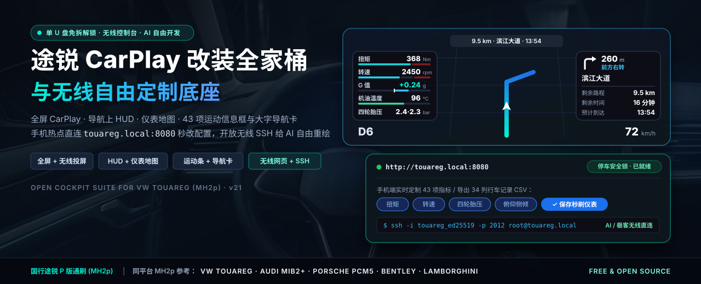
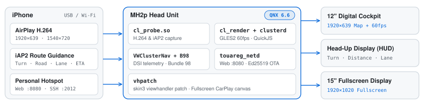

<div align="center">

<picture>
  <source media="(prefers-color-scheme: dark)" srcset="docs/img/hero_banner_dark.svg">
  <source media="(prefers-color-scheme: light)" srcset="docs/img/hero_banner_light.svg">
  
</picture>

# 途锐 CarPlay 仪表改装包

单 U 盘免拆免升系统，解锁途锐无线 / 全屏 CarPlay、抬头显示导航、液晶仪表大地图与行车数据，并支持手机无线设置和升级。

<p>
  <a href="https://github.com/a78c7/touareg-cn-carplay-mods/releases/latest"><b>下载 v23.6</b></a> ·
  <a href="#能实现哪些功能">功能清单</a> ·
  <a href="#4-步免拆安装">4 步安装</a> ·
  <a href="#适用车型与安装前须知">能不能装</a> ·
  <a href="https://github.com/a78c7/touareg-cn-carplay-mods/discussions">讨论与自制包分享</a> ·
  <a href="RELEASE_NOTES.md">更新日志</a> ·
  <a href="README.en.md">English</a> ·
  <a href="README.de.md">Deutsch</a>
</p>

<p><a href="https://github.com/a78c7/touareg-cn-carplay-mods/releases"></a>&nbsp;&nbsp;<a href="https://github.com/a78c7/touareg-cn-carplay-mods/stargazers"></a>&nbsp;&nbsp;<a href="https://touareg-likes.pages.dev/like"></a></p>

</div>

---

<div align="center">
  
  <br>
  <sub><i>仪表实车布局：CarPlay 地图自动居中，左右对称显示大字行车数据与路口导航卡。</i></sub>
</div>

<br>

https://github.com/user-attachments/assets/618e8fe2-e579-4aed-b9de-ab50b8576374

<div align="center">
  <sub><i>实车演示视频（点击有声播放，中英双语字幕；前段展示 60fps 自定义仪表皮肤效果）。</i></sub>
</div>

---

## 能实现哪些功能

全程不用敲命令，双击 U 盘里的「改装设置」，点点鼠标勾选需要的功能、拖一拖仪表数据框位置就能保存刷车（所有功能默认关闭，按需选装，可随时一键卸载还原）：

<div align="center">
  
  <br>
  <sub><i>电脑端「改装设置」：离线勾选模块、实时拖拽左右数据框与导航卡，一键保存到 U 盘。</i></sub>
</div>

<br>

| 分类 | 功能名称 | 装完有什么变化 | 适用范围 |
| :--- | :--- | :--- | :---: |
| **中控与投屏** | **全屏 CarPlay** | 去掉原车中控屏两侧黑边，画面铺满 15 寸大屏（`P2878` 精确表已实测，`P2838`/`P2853`/`P9832` 等其余国行 15 寸 `P` 版自动指纹适配，不匹配时安全跳过） | 国行途锐 P 版 |
| | **无线 CarPlay** | 解锁原车隐藏的无线 CarPlay，上车免插线自动连 | MH2p 通用 |
| | **Android Auto** | 解锁原车隐藏的安卓投屏（中规改款前原厂未开放，按需勾选） | MH2p 通用 |
| **抬头与仪表** | **导航上 HUD** | 苹果 / 高德 / 百度地图的转向箭头、距离、路名和车道直投前风挡抬头显示（需原车带 HUD，有线/无线都支持） | 国行途锐 P 版 |
| | **仪表大地图 + 行车数据框** | CarPlay 地图直接显示在 12 寸液晶仪表中间（高德自动居中、方向盘可缩放）；左右对称大字显示 51 项真实车况（含氛围灯主题色、无功率/扭矩自动替补防死 0）与路口导航卡，并支持 60fps 自定义仪表皮肤 | 国行途锐 P 版 |
| | **方向盘 `OK` 键切原车地图** | 地图页双击右侧 `OK` 键秒切 CarPlay 与原车地图；同时启用自定义皮肤时三连击 `OK` 切皮肤（不装本项则默认双击 `OK` 零延迟切皮肤） | 国行途锐 P 版 |
| | **语音键短按唤 Siri（试验）** | 连着 CarPlay 时短按方向盘语音键直接叫 Siri，不用长按（原厂长按不变；部分固件可能同时触发原车语音或偶发音量调节锁在语音通道，遇此情况单独卸载即可） | 国行途锐 P 版 |
| **无线与管理** | **手机无线控制台** | 车机连手机热点后，手机浏览器打开 `http://touareg.local:8080` 就能调仪表数据、切皮肤、无线升级与导出排障包（进阶可顺手开无线 SSH） | MH2p 通用 |
| **修复与降噪** | **升 P2878 无线 5GHz 修复** | 仅老固件（如 `P9832`）升级 `P2878` 后出现“有线正常、无线连不上”时勾选 | 国行途锐 P 版 |
| | **去除蓝牙「输入用户名」弹窗** | 屏蔽反复弹出的蓝牙登录输入框，不影响通话、听歌与 CarPlay | 大众 MH2p |
| | **屏蔽「SIM 仅用于数据」弹窗** | 屏蔽投屏时反复弹出的 SIM 卡提示，不影响车机联网与 SOS | 大众 MH2p |

<details>
<summary><b>新手怎么选？推荐勾选组合</b></summary>

| 车主需求 | 推荐勾选 | 说明 |
| :--- | :--- | :--- |
| **大多数途锐车主** | 直接点一键预设 **「驾驶推荐全套」**（全屏 + 无线 CarPlay + HUD + 仪表地图 + OK 双击切地图）；习惯用 Siri 可补勾「语音键短按唤 Siri」 | 兼顾导航体验，随时切回原车地图 |
| **想手机调仪表、后续免拔盘升级** | 在上面基础上补勾 **「手机无线控制台」**（普通车主不用勾 SSH） | 后续改信息框、切皮肤、无线升级全在手机浏览器搞定 |
| **被烦人弹窗困扰** | 按车上实际出现的弹窗补勾「去除输入用户名弹窗」或「屏蔽 SIM 提示」 | 两项独立生效，互不冲突 |
| **老固件升 P2878 连不上无线** | 补勾「老固件升 P2878 无线 CarPlay 5GHz 区域修复」 | 出厂即为 `P2878` 且开启无线 CarPlay 后连接正常的车辆无需勾选 |

</details>

---

<a id="notice"></a>

## 适用车型与安装前须知

> [!IMPORTANT]
> **不用先升级车机系统，原车直接刷就行！** 2019–2023 款 15 寸大屏国行途锐原车 `P` 版系统免升级就能直刷全套功能（含去黑边全屏 CarPlay 跨版本自动适配；皮肤不匹配时仍自动安全跳过、不影响其他功能）。**千万别去网上或闲鱼乱找来路不明的 `2878` 系统包自己刷车机**——刷整机系统有黑砖风险，部分改过的野包还会留后台暗桩导致电瓶亏电（确需升系统只建议去 4S 店正规升级）。

| 项目 | 说明 |
| :--- | :--- |
| **支持车型** | **2019–2023 款中规改款前途锐**（配 **15 寸中控大屏 + 12 寸全液晶仪表**；原车 `P` 版系统免升级直刷，`P2878` / `P2869` / `P2838` 均已实车跑通，其余 `P` 版自动探测并支持跨版本全屏指纹适配，不匹配安全跳过；无线控制台与技术文档通用同平台车型）。 |
| **不支持车型** | **2019 / 2021–2022 领航（特别）版**（9.2 寸小屏 + 机械指针表盘、无抬头显示，插上也会自动安全退出）；**2025–2026 中规改款新途锐**与 **欧版 2024+ 中期改款**；**老款二代途锐（7P）**。 |
| **欧版 / 同平台车** | 欧版途锐（如 `P2869`）及其他 MH2p 车型运行途锐界面补丁会自动安全跳过、不改文件；无线控制台、源码与文档可直接作开发底座（参考德国 [Touareg-Freunde 讨论帖](https://www.touareg-freunde.de/forum/thread/30309-geschafft-apple-carplay-im-digitalen-kombiinstrument-des-touareg-cr-mh2p-p2869/)）。 |
| **手机与仪表投屏** | **高德上仪表（第二屏）**：高德官方要求 **iPhone 12 及以上机型 + iOS 17.4 及以上系统**（并更新高德 App），旧机型或低版本 iOS 只有中控第一屏有画面、仪表第二屏不出图（苹果自带地图 `iOS 15.4+` 即可上仪表）。<br>**无线投屏方式**：请直接勾选本包 **「无线 CarPlay」** 走车机原生无线（或插数据线）；市面上绝大多数**外插无线 CarPlay 转换盒不支持转发第二屏**，插盒子只能投中控第一屏、投不到仪表第二屏。 |

- **配置差异提醒**：HUD 导航需原车带抬头显示；俯仰/侧倾角需配备空气悬架（中规 2021–2022 插混 eHybrid 无空悬不显示）；油箱容积默认按中规燃油 `90 L`（插混改为 `76 L`、欧规标配改为 `75 L`）；挡位齿比与进度条满量程按 3.0T 标定。
- **安全保护与免费声明**：内置 3 次崩溃自动退回原车的安全保护（正常开机零闪存写入）；行车中严禁操作车机或控制台，车速与告警灯始终以原车仪表为准。本项目完全免费开源、**严禁倒卖或付费代刷**，花钱买到请立即退款。
- **以前花钱找改装店刷过车 / 二手车注意**：部分商业改装包为防同行扒包，会在车机里留一个“开机自动还原”的后台暗桩，不仅会挡住本开源包开机启动（刷完没报错但仪表不出图），还有车友实测因此导致**停地库电瓶反复亏电**。刷完查看 U 盘 `Logs/` 日志即可自动排查（详见 [#10](https://github.com/a78c7/touareg-cn-carplay-mods/issues/10) 与 [`docs/07` 排查指南](docs/07-无线控制台与SSH开发.md#12-已改装车与二手车冲突排查改装店锁死入口与残留公钥)）。
- **车友自制皮肤与模块包分享**：自己调好的仪表皮肤、信息框配置或同平台适配包，欢迎压成 `.zip` 发到 **[讨论区「自制包与皮肤分享」](https://github.com/a78c7/touareg-cn-carplay-mods/discussions/categories/%E8%87%AA%E5%88%B6%E5%8C%85%E4%B8%8E%E7%9A%AE%E8%82%A4%E5%88%86%E4%BA%AB)** 分享交流（第三方包未经作者逐一实车测试，刷入请核对版本、风险自负）。

---

## 4 步免拆安装

1. **准备 U 盘**：准备一个 **32GB 以内、FAT32 格式** 的 U 盘（新盘通常出厂默认就是 FAT32，打开「改装设置」顶部会自动帮你检查；**如果不是 FAT32，格式化成 FAT32 即可**，不用每次重格）。
2. **解压到 U 盘根目录**：到 **[Releases](https://github.com/a78c7/touareg-cn-carplay-mods/releases/latest)** 下载最新 `zip`，把里面的**全部文件和文件夹直接放进 U 盘第一层**（别多套一层文件夹）：
   ```text
   U盘根目录/
   ├── Data/                          ← 必须直接放在 U 盘第一层
   ├── Meta/                          ← 必须直接放在 U 盘第一层
   ├── Mods/                          ← 默认为空，由「改装设置」自动移入已选模块
   ├── 未选模块/                       ← 存放全部 12 个模块目录（11 项功能中 HUD 拆为 2 步）
   └── 改装设置（Windows）.exe / （Mac）.command
   ```
3. **运行「改装设置」勾选并保存（必做）**：双击 U 盘里的 **`改装设置（Windows）.exe`** 或 **`改装设置（Mac）.command`**（不运行直接插车不会安装任何功能）：
   - 点一键预设或逐项选择 **安装 / 卸载 / 不处理**，按喜好拖拽左右行车数据框或导入自定义皮肤；
   - 若勾选「手机无线控制台」，填入 1～5 个手机热点和 6～16 位管理口令 → 点 **「保存到 U 盘」**（Mac 版会自动清理隐藏文件）。
4. **上车自动刷入**：电脑上安全弹出 U 盘 → **发动车辆** → 插进**前排数据 USB 口**（中央扶手箱内或中控台下方储物格 2 个口均可；后排 2 个口仅充电不能刷机，也不要用 USB 集线器或延长线）。等约 10 秒车机自动重启刷机（全程数分钟、自动重启几次，期间勿操作）→ 看到提示后拔出 U 盘即生效。

> [!NOTE]
> - **首次打开提示未签名**：桌面配置器未购商业签名，Windows 点「更多信息 → 仍要运行」，Mac 在「系统设置 → 隐私与安全性」点「仍要打开」；程序由 GitHub Actions 从 [`tools/configurator`](tools/configurator) 源码自动构建并附 `SHA256SUMS.txt`，仅本机 `127.0.0.1` 运行、绝不联网。
> - **装完看不到左右信息框或被圆盘盖住**：按方向盘右侧左右翻页键切到仪表「导航」页，再按一下 **`VIEW` 键**收起两侧原厂圆表盘即可完整显示（若习惯保留双圆表盘，可在车机仪表组合设置里将两侧圆盘内显选为空白避免遮挡）。
> - **老版本升级提醒**：`v22.01` 及更早版本升级到 `v22.1` / `v23.6` 需先用 U 盘覆盖刷入一次（自动保留原有配置与管理口令；早期未设口令的首次开机将在仪表屏自动显示 6 位随机口令，手机登录后永久隐藏），之后即可继续手机无线升级。
> - **首次刷完仍有黑边**：在 iPhone 蓝牙/CarPlay 设置中「忘记此车辆」重连一次即可。

---

<details>
<summary><b>日常使用、高德特性、常见问题与一键卸载还原</b></summary>

### 日常操作
- **仪表与抬头显示**：按方向盘右侧**左右翻页键**切到仪表「导航」页，短按 **`VIEW` 键**（或在车机「车辆设置 → 数字驾驶舱」中）可收起两侧原厂圆表盘；连上 CarPlay 自动投屏，自动同步昼夜模式，开 ACC 时地图自动上移避让图标。
- **方向盘快捷手势**：启用 `v23` 自定义皮肤且未装切原车地图模块时，**双击右侧 `OK` 键**零延迟切皮肤；若同时安装了「OK 键切原车地图」（`VW_HUD_4_OkMapSwitch`），在地图页且 CarPlay 在线时 **480 ms 内双击 `OK` 键**秒切原车/CarPlay 地图、**三连击 `OK` 键**切下一套皮肤；安装语音键短按模块后，CarPlay 在线时**短按语音键**唤 Siri（2019–2020 款实体按键与 2021–2023 款电容触控方向盘功能一致）。
- **电脑端 1:1 浏览器试驾模拟器**：双击打开 [`tools/preview/index.html`](tools/preview/index.html) 即可按 `1920×639` 预览信息框、试驾调试 `v23` 皮肤或回放行车 CSV，欢迎把配置和效果发到 **[GitHub Discussions](https://github.com/a78c7/touareg-cn-carplay-mods/discussions)**。
- **进阶可选：10Hz 行车记录 U 盘**：普通车主刷完拔走 U 盘即可；如需录制 34 列真实传感器 CSV，可在「改装设置」底部点 **「改成行车记录 U 盘」** 后常插前排数据 USB 口（已装 HUD 时后台写入 `drive_logs/`，每小时约 5 MB，不再触发刷机；长期写入请用闪迪/三星/铠侠等品牌正品 U 盘）。

### 高德地图在仪表上的已知特性
- **车标左右偏（默认自动居中）**：高德导航会把车标往目的地方向偏约 3 cm，本改装每秒识别画面车标，偏约 3 秒自动挪回时钟正下方（苹果/百度不受影响）。
- **比例尺自动回弹**：导航中高德会随车速和路口自动重置比例尺，方向盘上下键缩放为临时生效。
- **车道指引**：高德不通过 CarPlay 下发车道数据，需要 HUD/导航卡车道指引可用百度地图。
- **偶发开机停在原车地图**：iPhone 未响应第二屏请求，断开 CarPlay 重连一次即可恢复。

### 排障与一键卸载还原
- **一键卸载还原**：打开「改装设置」把要移除的模块选为 **「卸载」**，保存后插车刷一次即可（手动卸载需先移回 `Mods/` 并放入空文件 `uninstall.txt`；卸载 HUD 须同时卸载仪表地图、OK 切地图与短按 Siri）。
- **插 U 盘没反应 / 刷完无变化**：核对 U 盘为 **≤ 32GB FAT32**、`Data`/`Meta` 直接在根目录，且已运行「改装设置」将已选模块移入 `Mods/`；查看 U 盘 `Logs/`（`_ModKit_Update.log` 中的 `Filename too long` 可忽略）。
- **中控第一屏有导航，但仪表第二屏不出图**：① 切苹果地图能上仪表、只有高德不出图 → 手机未达高德官方要求（需 **iPhone 12+ 且 ≥ iOS 17.4**）；② 苹果/高德都上不去且插了第三方无线 CarPlay 盒子 → 普通转换盒不支持转发第二屏，拔掉盒子改用原车无线或插数据线即可。
- **以前找改装店刷过车，刷完没报错但仪表不出图（或电瓶常亏电）**：多半是老商业改装包留下的后台还原程序把自启入口锁回去了。打开刷机后的 U 盘 `Logs/` 日志看到 `WARN: suspected shop` 即可确认；最稳妥是去 4S 店正规重刷原厂系统清空暗桩，切勿网购来路不明的野包（技术细节与定点清理见 [`docs/07` 第 12 节](docs/07-无线控制台与SSH开发.md#12-已改装车与二手车冲突排查改装店锁死入口与残留公钥)）。
- **老固件升 P2878 无线连不上**：勾选 5GHz 区域修复刷入，并在车机与 iPhone 双端忘记设备重连（见 [#7](https://github.com/a78c7/touareg-cn-carplay-mods/issues/7)）。
- **提 Issue 附日志**：已装无线控制台可在 `http://touareg.local:8080` → **日志导出** 点「下载脱敏诊断包」（自动脱敏密码/口令/VIN/手机号）；未装无线模块可在 U 盘根目录建 `cluster_logs` 文件夹插车 2 分钟提取，**切勿公开本车 `backup` 目录**。

</details>

<details>
<summary><b>手机无线控制台、系统原理图、无线 SSH 与开发者文档</b></summary>

<br>

### 手机无线控制台（`http://touareg.local:8080`）

`VW_WiFi_Dev` 利用车机闲置的 `bcm2` 客户端接口在后台静默连入手机热点（RSDB 并发不占无线 CarPlay，不改原车 `ecm0` 4G 车联网），详见 **[`docs/07-无线控制台与SSH开发.md`](docs/07-无线控制台与SSH开发.md)**。

<div align="center">
  
  <br>
  <sub><i>手机无线控制台：停车锁保护（≤ 3 km/h）、51 项指标与氛围灯主色、实时大屏副屏模式、多皮肤热切、Ed25519 签名离线 OTA 与一键脱敏诊断。</i></sub>
</div>

1. 在「改装设置」安装 **「手机无线控制台」**（普通车主无需勾选 SSH），填入 1～5 个热点与 6～16 位口令；上车开热点（iPhone 首次开「最大兼容性」并在热点页亮屏 3～5 秒，注意同一部 iPhone 开热点调 8080/SSH 时无法同时连无线 CarPlay，日常关掉热点即恢复，或插线用有线 CarPlay + 热点；安卓选 WPA2），约 1 分钟自动连入。
2. 手机浏览器访问 **`http://touareg.local:8080`**（`X-Pin` 鉴权 + 停车锁保护）：可实时调信息框/切 `v23` 皮肤、上传 **Ed25519 签名校验** 的 `touareg-ota-*.tar` 离线升级与一键回滚、导出脱敏诊断包 `touareg_diag_sanitized.txt`、管理 3 次崩溃安全模式。

### 系统原理图（MH2p 车机数据与渲染链路）

<div align="center">
<picture>
  <source media="(prefers-color-scheme: dark)" srcset="docs/img/arch_dark.svg">
  <source media="(prefers-color-scheme: light)" srcset="docs/img/arch_light.svg">
  
</picture>
</div>

### 无线 SSH（`:2012`）+ AI 自由开发

使用电脑端 **[DeepSeek Harness](https://github.com/deepseek-ai/deepseek-harness)** / Claude Code / Cursor，或安卓端 **[DSH Go](https://github.com/ccch1mneyyy/dsh-go)**（iPhone 暂无公开包）无线连车自定义仪表只需 3 步：
1. 安装无线控制台时勾上 **「同时开启 SSH 无线开发终端（端口 2012）」**，本车专属私钥自动保存到桌面 `途锐无线SSH密钥/touareg_ed25519`（不留在 U 盘）。
2. 发动车辆并开热点等待约 1 分钟（若开了全局 VPN/代理请关闭或绕过局域网）。
3. 把私钥与下面指令直接发给 AI（完整硬件与渲染界限见 [`docs/07` 第 11 节](docs/07-无线控制台与SSH开发.md#11-ai-无线开发边界与车机硬件护栏开发者与-ai-必读)）：

```text
这是我车机的 SSH 私钥文件 `touareg_ed25519`（电脑默认在桌面 `途锐无线SSH密钥/` 文件夹，安卓手机端请直接读取我上传或放在 Download 目录下的 `touareg_ed25519`）。
请你自己读取这把私钥并配置保存好车机 SSH 连接（端口 `2012`，用户名 `root`）：
- 先尝试连接 `touareg.local:2012`；如果当前系统（如安卓端）不解析 `.local`，请你自动读取本机热点路由/ARP 邻居表或扫描当前热点子网开放 `2012` 端口的设备找到车机 IP 并连上，无需让我手动查 IP 或填配置。

车机环境、硬件资源与渲染安全护栏（请严格遵守，不可违背）：
1. 系统是 QNX 6.6.0 (ARMv7 Tegra K1，总内存约 2 GB)，shell 是 ksh（无 bash / sed -i / wc）。
2. 严禁改动原厂只读分区（/ifs、/mnt/system），不要频繁重载 pfctl 避免冲击 io-pkt；锁车后整机随 CAN 休眠断电，禁止干扰车机电源管理。
3. 内存与 eMMC 寿命红线：`/tmp` 是内存盘，严禁往 `/tmp` 塞大文件、视频或无限增长日志；严禁高频周期性写 `/mnt/app` 或 `/mnt/ota` 闪存（实时遥测全部在 `/tmp/dash.state` 与 `/tmp/cluster_cp.state`）。
4. `/mnt/app` 默认只读：改文件前先 `mount -uw /mnt/app` 并备份原文件，用 `.new` 写完原子 `mv` 替换后立刻 `sync && mount -ur /mnt/app` 恢复只读；改完仪表配置执行 `slay -f cl_render` 秒级刷新（无需重启车机）。
5. 渲染架构与帧率护栏（极重要）：
   - `cl_render` 的 `capture=h264` 地图模式走 NVDEC 硬解 + `screen_blit`，`dash.c` 是 CPU 软渲两侧 295×308 小框（开启 `smooth=1` 即可流畅显示数字与运动条）；严禁在 `dash.c` 里用 CPU 循环做 1920×639 全屏复杂动画，必然掉帧发卡！
   - 若要开发全屏 60fps 动效仪表、指针、粒子或同屏 CarPlay 地图自定义主题，优先使用 `v23.0` / `v23.6` 正式的 `src/cl_render/v23_gles.c`（`v23_mode`，QuickJS + OpenGL ES 2.0 + 独立 `own_ctx` + 4 槽离屏桥物理隔离 60 fps 单画布引擎）；纯独立 C 试验通道为 `src/cl_render/gles60.c`（`capture=gles60`，窗口 `58`，`eglSwapInterval(dpy, 1)`，通过 `eglGetProcAddress` 动态解析 `gl*` 函数，绝不直接链接 `-lGLESv2`）。
   - 车机已启用 3 次崩溃安全模式熔断（`/mnt/app/eso/bin/apps/cluster/safe_mode` 或 `/tmp/vw_*_safe_mode`），改动前请先用电脑端 `tools/preview/index.html` 本地验证。
6. 完整接口表与开发界限见公开仓库：https://github.com/a78c7/touareg-cn-carplay-mods/tree/main/docs

现在请自动连上车机，只读查看一下当前车速/油温、安全模式状态和已安装的模块，向我汇报连接成功，然后听我用大白话吩咐修改。
```

### MH2p 跨品牌开发文档与源码索引

完整笔记见 **[`docs/`](docs/README.md)**（每条结论均标注 **【途锐特有】** 或 **【MH2p 通用】**，适用于同平台大众途锐、奥迪、保时捷 PCM 5、宾利、兰博基尼 LIS III）：

| 开发实战记录（[`docs/01~07`](docs/README.md)） | MH2p 平台参考（[`docs/reference/`](docs/reference/README.md)） | 核心源码目录（[`src/` & `tools/`](src)） |
| :--- | :--- | :--- |
| • [01 调试环境与工具](docs/01-调试环境与工具.md)<br>• [02 CarPlay 导航上 HUD](docs/02-CarPlay导航上HUD.md)<br>• [03 CarPlay 地图上仪表](docs/03-CarPlay地图上仪表.md)<br>• [04 仪表信息框与行车记录](docs/04-仪表信息框.md)<br>• [05 全屏补丁与 U 盘包](docs/05-全屏CarPlay与U盘包.md)<br>• [06 给其他车型的建议](docs/06-给其他车型的建议.md)<br>• [07 无线控制台与 SSH 开发](docs/07-无线控制台与SSH开发.md) | • [R1 系统结构与防火墙](docs/reference/R1-系统结构与文件位置.md)<br>• [R2 HMI（J9 Java 与 BAP）](docs/reference/R2-HMI-J9-Java.md)<br>• [R3 DSI 车辆数据实测表](docs/reference/R3-车辆数据接口.md)<br>• [R4 显示屏编号与 dmdt](docs/reference/R4-显示系统.md)<br>• [R5 CarPlay / iAP2 双栈](docs/reference/R5-CarPlay与iAP2.md)<br>• [仪表 1920×639 几何规范](docs/reference/CLUSTER_LAYOUT_SPEC.md) | • [`src/hud-java`](src/hud-java)：HMI 插件与 51 项遥测<br>• [`src/popup-filter-java`](src/popup-filter-java)：共享 Bundle 98 弹窗过滤<br>• [`src/cluster-probe`](src/cluster-probe)：双屏解密与有线 Cinemo 钩子<br>• [`src/clusterd`](src/clusterd)：仪表切屏与安全区守护<br>• [`src/cl_render`](src/cl_render)：H.264 硬解、信息框与 GLES2/QuickJS<br>• [`src/vhpatch`](src/vhpatch)：全屏 CarPlay 就地补丁器<br>• [`src/touareg_netd`](src/touareg_netd)：mDNS、8080 控制台与签名 OTA<br>• [`tools/configurator`](tools/configurator)：跨平台本地「改装设置」 |

</details>

<details>
<summary><b>安全声明、开源协议详情与社区致谢</b></summary>

### 安全熔断、非官方免责与商标归属
- **零损耗安全熔断**：覆盖 J9 HMI、`cl_probe.so`、`clusterd`/`cl_render`、`io-pkt` 全链路（3 次崩溃自动退回原车，正常开机零 eMMC 写入）。行车期间严禁操作车机设置或手机控制台，车速与告警信息以原车仪表为准。
- **非官方与风险自负**：本项目为个人业余研究项目，与大众汽车（Volkswagen）、奥迪、保时捷、宾利、兰博基尼、苹果（Apple）、谷歌（Google）、高德（AMap）、百度（Baidu）等公司无任何官方关联或授权关系。代码与安装包按“现状”提供，刷机风险与质保影响由使用者自负；权利人如有异议请通过 [Issue](https://github.com/a78c7/touareg-cn-carplay-mods/issues) 联系。
- **商标声明**：`Volkswagen` 与 `Touareg` 为 Volkswagen AG 注册商标；`CarPlay is a trademark of Apple Inc., registered in the U.S. and other countries and regions.`

### 开源协议边界（零冲突统一口径）
- **独立原创组件**：`src/hud-java`、`src/popup-filter-java`、`src/cluster-probe`（含独立重写的 `wired/cl_wired*.c`）、`src/clusterd`、`src/touareg_netd`、`src/vhpatch`、`src/common`、`tools/` 及全部 `VW_*` 脚本遵循 **[PolyForm Noncommercial 1.0.0](LICENSE) + [非商业附加条款](LICENSE.ADDITIONAL-TERMS.md)**（不含大众/苹果原厂文件；严禁商用、转售、付费代刷或商业捆绑）；`docs/` 文档文字采用 **CC BY-SA 4.0**。
- **改编与第三方组件**：基于 `fifthBro/mh2p-cluster` 改编的 `src/cl_render/` 整体代码及其编译产物 `cl_render`（**不叠加附加条款**；其内嵌 `quickjs/` 遵循 MIT、`dash_font.h` 遵循 SIL OFL 1.1、`stb_truetype.h` 遵循 Public Domain / MIT）、以及 `dio_cluster.so`、ModKit 及可选 LawPaul 模块遵循 **[CC BY-NC-SA 4.0](LICENSES/CC-BY-NC-SA-4.0.md)**（同样严禁商用）。完整署名与全部第三方许可见 **[THIRD_PARTY_NOTICES.md](LICENSES/THIRD_PARTY_NOTICES.md)**。

### 社区引用与致谢
- **[luanqibazao0123-bot](https://github.com/luanqibazao0123-bot)**（[#7](https://github.com/a78c7/touareg-cn-carplay-mods/issues/7)）：启发了 `v21` 大字运动刻度信息框视觉重构与 `60fps` 仪表引擎，并提供老固件升 `P2878` 实测线索。
- **[massif-01](https://github.com/massif-01)**（[#10](https://github.com/a78c7/touareg-cn-carplay-mods/issues/10)）、**[sy6904](https://github.com/sy6904)**（[#14](https://github.com/a78c7/touareg-cn-carplay-mods/issues/14)）、**[Lovingwatchcat](https://github.com/Lovingwatchcat)**（[#16](https://github.com/a78c7/touareg-cn-carplay-mods/issues/16)）：分别协助完成 `P2853` 商业包暗桩取证、`P2869` 连续多版 `v23.6` 闪屏/冷启动排障验证，以及 `P2838` 商业双件套（`dio_manager.org` + `.j`）零损定点接管实测。
- **海外社区引用**：已被德国途锐论坛 **Touareg-Freunde** 的 [欧版 MH2p P2869 仪表投屏项目帖](https://www.touareg-freunde.de/forum/thread/30309-geschafft-apple-carplay-im-digitalen-kombiinstrument-des-touareg-cr-mh2p-p2869/)引用参考。
- **[LawPaul / MH2p SD ModKit](https://github.com/LawPaul/MH2p_SD_ModKit)**（[官网](https://lawpaul.github.io/MH2p_SD_ModKit_Site/)）：免拆 U 盘刷机框架及可选 `AppleCarPlay` / `AndroidAuto` 模块（[CC BY-NC-SA 4.0](LICENSES/CC-BY-NC-SA-4.0.md)，其中安卓修复引用了 [fifthBro/pcm5-androidauto-connect-fix](https://github.com/fifthBro/pcm5-androidauto-connect-fix)）。
- **[fifthBro / mh2p-cluster](https://github.com/fifthBro/mh2p-cluster)** & **[mh2p-ssh-access](https://github.com/fifthBro/mh2p-ssh-access)**：`dio_cluster.so`（v0034）与 `cl_render` 上游基础（[CC BY-NC-SA 4.0](LICENSES/CC-BY-NC-SA-4.0.md)）。
- **[davecozens / touareg-carplay](https://github.com/davecozens/touareg-carplay)**：全屏几何数值参考；**[luka-dev](https://github.com/luka-dev)**：`jxe2jar`、`qnx65-armv7-toolchain` 编译与逆向工具链。

</details>

---

## 许可证

独立原创组件遵循 **[PolyForm Noncommercial 1.0.0](LICENSE) + [非商业附加条款](LICENSE.ADDITIONAL-TERMS.md)**（免费开源，严禁商用倒卖）；`src/cl_render/` 及其编译产物 `cl_render` 与上游模块遵循 **[CC BY-NC-SA 4.0](LICENSES/CC-BY-NC-SA-4.0.md)**（不叠加附加条款）；`docs/` 文档文字遵循 **CC BY-SA 4.0**；完整第三方声明见 **[THIRD_PARTY_NOTICES.md](LICENSES/THIRD_PARTY_NOTICES.md)**。
